<h1 align="center">Mallet UI</h1>

<p align="center">
  A tactile design system and interaction toolkit for Android Views.
</p>

<p align="center">
  
  
  
  
</p>

<p align="center">
  <b>English</b> · <a href="README.zh-CN.md">简体中文</a>
</p>

<p align="center">
  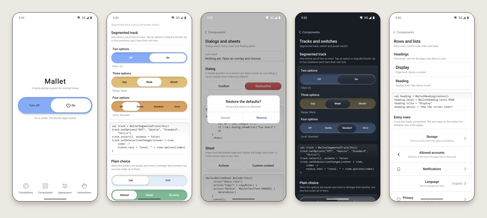
</p>

**Mallet** is the craftsman's hammer, and a salute to Smartisan (锤子科技, “Hammer Technology”),
the phone maker that treated every interface detail as a piece of craft; the project is not
affiliated with Smartisan or its owners. A mallet shapes a sheet in two ways only: it raises
some parts and sinks others. That is all a Mallet interface is made of: raised surfaces,
recessed tracks, and a press that sinks.

Pages, cards and text stay neutral. **Colour means state**, and it lies in the recessed bed
of a control, under a neutral thumb that follows your finger.

Mallet is a complete library for the classic Android View system: layouts in XML, or views
built in Kotlin or Java. It needs no Compose, no AppCompat and no Material Components, and
ships as one AAR without a single image or font file.

|  |  |
|---|---|
| **55 components** | tracks, switches, steppers, sliders, buttons, chips, fields, rows, bars, tabs, dialogs, sheets, menus, toasts, loading, empty and error states |
| **An interaction system** | press that sinks, thumbs and pages that follow the finger, pages laid out as places, rows that slide aside, sections that open, one curve for everything that glides |
| **A design system** | colour roles, five hues, an eleven-step type scale, spacing, shape, four materials, motion tokens, 50 icons drawn in code; light, dark and high contrast |
| **Proof** | 1,080 tests on the JVM, 38 tests with real touches on an Android 16 emulator and 37 on Android 6.0, a demo app built on the library alone, without another UI kit |

## See it move

Recorded from the showcase app on an Android 16 emulator, at normal speed. Every clip is
driven by real touch events; the dot that marks the finger is drawn by the recording tool.

| Pages are places | Colour is state | It follows the finger |
|:---:|:---:|:---:|
| 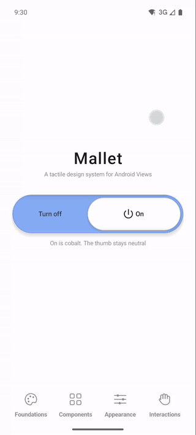 | 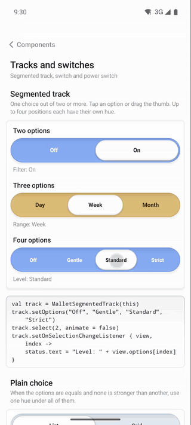 | 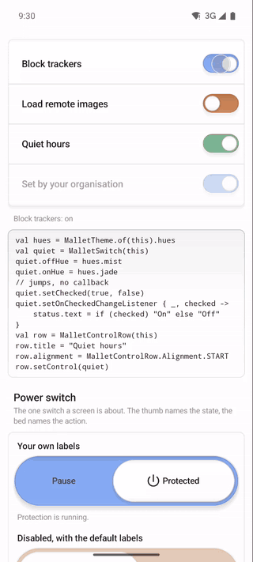 |
| A page lies beside, above or below another one. Drag the page towards where the next one lies; Back follows the map. | Off is bronze, on is cobalt, four levels run bronze, ochre, cobalt, jade. The thumb stays neutral. | Thumbs move at finger speed and glide the rest of the way on one curve. Nothing bounces. |

| Slide aside, open in place | Dialogs, sheets, menus, toasts | A theme that changes in place |
|:---:|:---:|:---:|
| 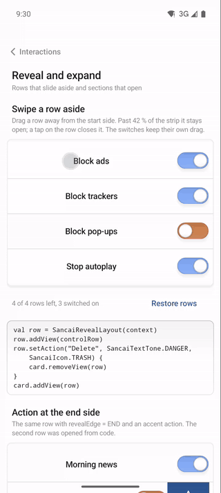 | 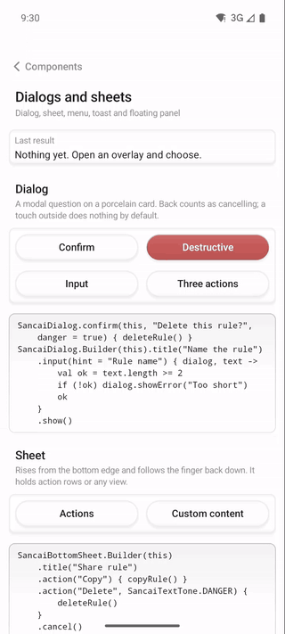 | 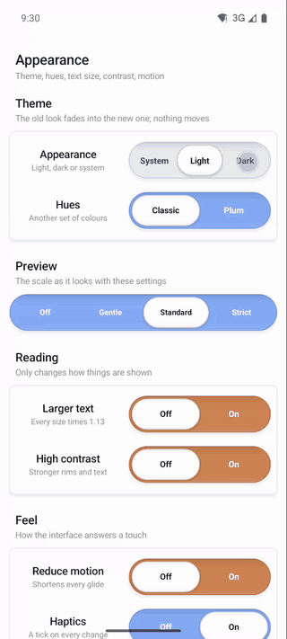 |
| `MalletRevealLayout`, `MalletExpandableLayout` | `MalletDialog`, `MalletBottomSheet`, `MalletMenu`, `MalletToast` | `MalletTheme`, `MalletThemeTransition` |

## The language in eight rules

1. **Colour is state, and it lives in the bed.** The part you touch is always the same neutral bead.
2. **Four materials, nothing else.** Surface (raised), track (recessed, carries the hue), thumb (raised, inside a track) and the recessed well for text and pictures. No tinted buttons, no ripples, no elevation overlays.
3. **Text is centred; arrows are not part of the text.** A chevron stands on its own at the edge and points to where the next page lies.
4. **Dividers run from rim to rim.** Rows read as sections of one body, not as boxes in a box.
5. **Pressing sinks; it does not tint.** 1.5 dp down, straight back.
6. **Everything follows the finger, or glides.** One easing curve; nothing bounces, nothing fades in.
7. **Pages are places.** Navigation is movement through a map, not a stack of cards, and a place carries no signpost.
8. **Depth is painted, short and downward.** One hairline rim, one short soft shadow below.

The full specification, with every token and its value, is the
[Design system](docs/DESIGN_SYSTEM.md).

## What is inside

| Family | Components |
|---|---|
| Surfaces and text | `MalletSurface` · `MalletDivider` · `MalletText` · `MalletIconView` (50 icons) |
| Actions | `MalletButton` · `MalletChip` · `MalletChipGroup` · `MalletTag` · `MalletBadge` |
| Choice | `MalletSegmentedTrack` · `MalletSwitch` · `MalletPowerSwitch` · `MalletCheckbox` · `MalletRadioButton` · `MalletRadioGroup` |
| Numbers and progress | `MalletStepper` · `MalletSlider` · `MalletProgressBar` · `MalletSpinner` |
| Text input | `MalletTextField` |
| Rows and pages | `MalletPage` · `MalletHeading` · `MalletEntryRow` · `MalletControlRow` · `MalletLinkRow` · `MalletKeyValueList` |
| Reading | `MalletParagraph` · `MalletCallout` · `MalletFlowRow` · `MalletMediaFrame` |
| Navigation | `MalletNavBar` · `MalletTopBar` · `MalletTabs` · `MalletPager` · `MalletPageIndicator` · `MalletSpatialHost` · `MalletSpatialGraph` · `MalletBack` · `MalletSpatialTransition` |
| Overlays | `MalletDialog` · `MalletBottomSheet` · `MalletMenu` · `MalletToast` · `MalletFloatingPanel` |
| States | `MalletStateView` · `MalletStateLayout` · `MalletSkeleton` · `MalletBanner` |
| Interaction | `MalletPress` · `MalletHaptics` · `MalletRevealLayout` · `MalletExpandableLayout` · `MalletThemeTransition` |
| Foundation | `MalletTheme` · `MalletColors` · `MalletHues` · `MalletTextRole` · `MalletSpacing` · `MalletMotion` · `MalletMaterial` · `MalletWindow` |

Every component is described in the [Component catalog](docs/COMPONENT_CATALOG.md), with a
picture in both themes, its XML attributes and its code API.

<p align="center">
  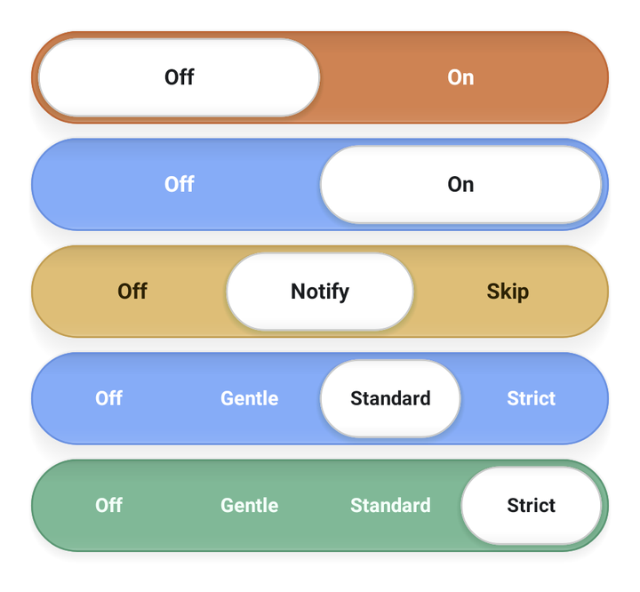
  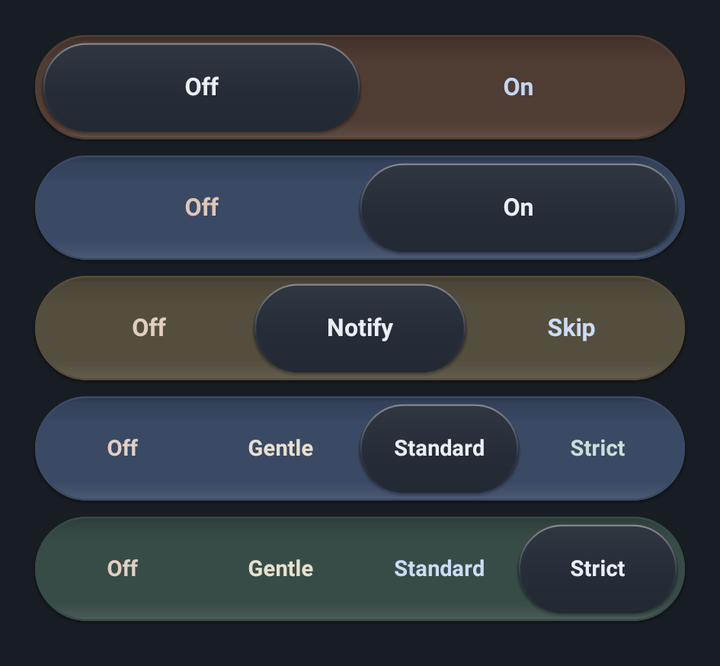
</p>

The components

- work from **XML and from code**, in Kotlin and in Java;
- have **disabled, focused and pressed** states where they can be operated, answer the keyboard and D-pad, and describe themselves to screen readers;
- follow **right-to-left** layouts and keep their state across rotation;
- follow the theme: **light, dark, high contrast**, a text scale, reduced motion, your own colours and hues.

## Quick start

Mallet UI is not on Maven Central yet. A release carries a ready-made Maven repository:
unzip `mallet-0.1.0-maven-repo.zip` into your project, for example into `libs/mallet-repo/`.

```kotlin
// settings.gradle.kts
dependencyResolutionManagement {
    repositories {
        google()
        mavenCentral()
        maven { url = uri("libs/mallet-repo") }
    }
}

// app/build.gradle.kts
dependencies {
    implementation("io.github.avalonskyafar:mallet:0.1.0")
}
```

Then put Mallet views into any layout of any activity. No theme, base class or setup call is
required.

```xml
<io.github.avalonskyafar.mallet.widget.MalletPage
    xmlns:android="http://schemas.android.com/apk/res/android"
    xmlns:app="http://schemas.android.com/apk/res-auto"
    android:layout_width="match_parent"
    android:layout_height="match_parent">

    <io.github.avalonskyafar.mallet.widget.MalletHeading
        android:layout_width="match_parent"
        android:layout_height="wrap_content"
        app:malletTitle="Protection"
        app:malletDetail="How strictly content is filtered" />

    <io.github.avalonskyafar.mallet.widget.MalletSurface
        android:layout_width="match_parent"
        android:layout_height="wrap_content"
        android:layout_marginTop="10dp">

        <io.github.avalonskyafar.mallet.widget.MalletControlRow
            android:id="@+id/strength"
            android:layout_width="match_parent"
            android:layout_height="wrap_content"
            app:malletTitle="Strength"
            app:malletOptions="@array/strength_levels"
            app:malletSelectedIndex="2" />

        <io.github.avalonskyafar.mallet.widget.MalletControlRow
            android:layout_width="match_parent"
            android:layout_height="wrap_content"
            app:malletTitle="Only on Wi-Fi">

            <io.github.avalonskyafar.mallet.widget.MalletSwitch
                android:id="@+id/wifi"
                android:layout_width="wrap_content"
                android:layout_height="wrap_content"
                app:malletChecked="true" />
        </io.github.avalonskyafar.mallet.widget.MalletControlRow>
    </io.github.avalonskyafar.mallet.widget.MalletSurface>
</io.github.avalonskyafar.mallet.widget.MalletPage>
```

A card is a group: this one holds two rows that belong together. A lone control never gets a
card of its own: it joins the card of its relatives, or stands on the canvas under its heading
(see the [Design system](docs/DESIGN_SYSTEM.md)). The first row makes its segmented track from
`malletOptions`; code reaches it through `track`:

```kotlin
val strength = findViewById<MalletControlRow>(R.id.strength)
strength.track?.setOnSelectionChangeListener { _, index -> prefs.strength = index }

MalletDialog.confirm(this, "Restore all defaults?", "Every setting returns to its original value.",
    positiveLabel = "Restore", danger = true) { prefs.reset() }
```

A view can also be built in code, from Kotlin or, as here, from Java:

```java
MalletSegmentedTrack track = new MalletSegmentedTrack(context);
track.setOptions("Off", "On");
track.select(1, false);
track.setOnSelectionChangeListener((view, index) -> prefs.setEnabled(index == 1));
```

Other ways to add the library (the AAR file alone, a source module, JitPack), theming, windows
and system bars, living next to AppCompat or Material, testing and shrinking are covered in the
[Integration guide](docs/INTEGRATION_GUIDE.md). `samples/minimal/` is a one-screen app written
in Java and XML only, built against the released binary.

### Pages as places

```kotlin
val graph = MalletSpatialGraph.Builder("home")
    .connect("home", Side.END, "settings")       // drag towards the end side to get there
    .connect("home", Side.BELOW, "history")
    .child("settings", Side.END, "accounts")     // opened from a row, dragged back
    .build()

val host = MalletSpatialHost(this)
host.setGraph(graph) { key -> createPage(key) }
setContentView(host)
host.show("home")
MalletBack.attach(this, host)                    // system Back follows the map
```

### Make it yours

```xml
<style name="Theme.MyApp" parent="Theme.Mallet">
    <item name="malletColorAccent">#7A4B8F</item>
    <item name="malletHueCobalt">#A997E6</item>
    <item name="malletHueCobaltEdge">#8874D0</item>
</style>
```

<p align="center">
  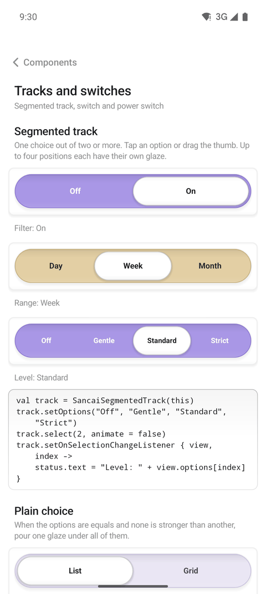
  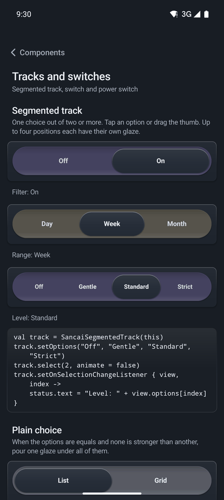
  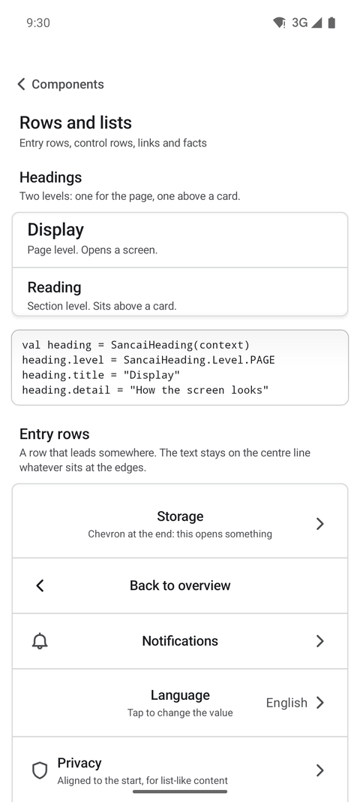
  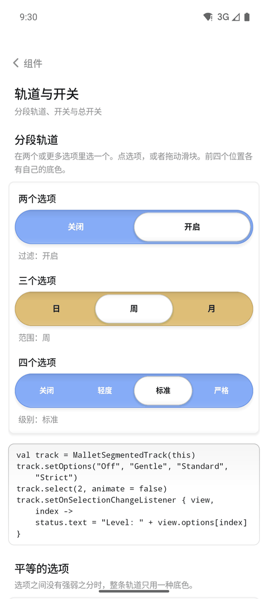
</p>

## The showcase app

`showcase/` is a demo app built on the library alone, without another UI kit: 27 pages,
every component live, each with the code that makes it. Its own navigation is the spatial
host: Foundations, Components, Interactions and Appearance, the four first-level pages, lie
around Home.

```
                    Appearance
                        |
  Foundations  ——  Home  ——  Interactions
                        |
                   Components
```

Home shows nothing that points at its neighbours: no arrows, no page names at the edges. It
names the pages around it once, in a row of four entries at its bottom: an outline icon above
a short label, one entry for each first-level page. The page at the start side comes first and
the page at the end side last, with the pages below and above between them: Foundations,
Components, Appearance, Interactions. An entry can be tapped; the page it names is also reached
by dragging Home towards the side where it lies. The row is the library's navigation row,
`MalletNavBar`, in launcher mode.

A first-level page shows no way back: no back row, no arrow, no bar. It is left the way it was
reached, by dragging back towards Home, or with the system's Back. A page without a button to
tap is how the drag becomes a habit. This is the original app's own design, and it is
deliberate (**Extracted**; four entries instead of the original's three, and a page above Home,
are **Extended**). Deeper pages, opened from a row, keep a quiet way-back row that names their
parent. The original has no back control at any depth, so that row is **New**, and it exists
only in the showcase.

Install the APK of a release, or build it:

```bash
./gradlew :showcase:installDebug
```

The app is in English and Simplified Chinese, and its Appearance page switches theme, hue
set, text size, contrast, motion and haptics while it runs.

## Documentation

| | |
|---|---|
| [Design system](docs/DESIGN_SYSTEM.md) | Principles, colour, hues, type, space, shape, materials, states, motion, icons, theming, accessibility |
| [Component catalog](docs/COMPONENT_CATALOG.md) | Every component: purpose, picture, XML attributes, code API, provenance |
| [Gallery](docs/GALLERY.md) | The showcase on a device: every page in both themes, overlays, gestures half-way, other hues, high contrast, large text, Chinese, right to left, and eight clips |
| [Interaction guide](docs/INTERACTION_GUIDE.md) | Press, haptics, tracks, pages as places, system back, activities as neighbours, theme change, reveal, expand, who owns a gesture, motion tokens |
| [Integration guide](docs/INTEGRATION_GUIDE.md) | Adding the library, first screen, XML, Kotlin, Java, theming, windows, other UI kits, custom views, testing, shrinking |
| [Design decisions and provenance](docs/DESIGN_DECISIONS.md) | What was extracted from the original app, what was extended, what is new, and why |
| [Verification](docs/VERIFICATION.md) | What was built, run and measured for this release, and what was not |
| [Licence audit](docs/LICENSE_AUDIT.md) · [Third-party notices](THIRD_PARTY_NOTICES.md) | Licences of the origin and of every dependency |
| [Changelog](CHANGELOG.md) · [Contributing](CONTRIBUTING.md) | |

## Where it comes from

Mallet UI is extracted from the interface of **Gravekeeper (守目人)**, an Android app by the same
author whose screens are built entirely in Java, without a single layout file, by one class
tied to that app. The design idea and the interaction model were complete there, but they
could not be reused, and much of a general toolkit was missing.

Mallet keeps the idea, states it as tokens and rules, rewrites the parts as independent
components, and fills the gaps in the same language. Every part is marked:

| Mark | Meaning | Examples |
|---|---|---|
| **Extracted** | design and numbers taken from the original | segmented track, switches, card, rows, dialog, spatial navigation, press |
| **Extended** | an original idea generalised or completed | button variants, stepper, text field, navigation row, icons, theme |
| **New** | designed for Mallet from its materials and rules | checkbox, radio, slider, progress, chips, tabs, top bar, menu, bottom sheet, states, skeleton, banner |

The evidence, with file and line of the original for every extracted part, and the reasons
for every deliberate difference, is in [Design decisions](docs/DESIGN_DECISIONS.md). The
library contains none of the original app's business logic, models or artwork.

## Verified

| | |
|---|---|
| Unit tests | 1,045 for the library and 35 for the showcase, on the JVM with Robolectric and Android's native graphics, none failing (8 more are film tests, run when asked for); every view is also run through a whole life on API 23, 28 and 32 |
| Device tests | 38 tests drive the installed showcase with real touch events on an Android 16 emulator, and 37 of them on Android 6.0, the oldest version supported; all pass |
| Static checks | Android Lint with warnings as errors, both modules; a source-rule test that forbids ripples, elevation and text sizes outside the scale |
| Shrinking | the release demo APK is built with R8 and resource shrinking; the library needs no keep rules |
| Integration | `samples/minimal`, a separate Java project, resolves the library from the release's Maven repository, builds shrunk and runs; the source archive, unpacked elsewhere, builds and passes its tests |

Details, commands and limits are in [Verification](docs/VERIFICATION.md).

## Build

Requirements: JDK 17 or newer, Android SDK Platform 36.

```bash
./gradlew :mallet:testDebugUnitTest :showcase:testDebugUnitTest   # tests on the JVM, with pictures
./gradlew :mallet:lintDebug :showcase:lintDebug                   # static checks
./gradlew dist                                                    # AAR, Maven repo zip, demo APK, source zip
python tools/device.py all                                        # device tests, screenshots, clips (needs a device)
```

```
mallet/      the library            io.github.avalonskyafar:mallet
showcase/    the demo app           io.github.avalonskyafar.mallet.showcase
samples/     a minimal app in Java and XML that uses the released binary
docs/        design system, catalog, guides, pictures
tools/       catalog and picture generators, device runner
```

## Status

Version 0.1.0 is the first release. The API follows one set of conventions throughout and is
covered by tests, but it has not been through a deprecation cycle yet: until 1.0, a minor
version may change it.

## Licence

[MIT](LICENSE) © 2026 AvalonskyAfar. The library bundles no third-party code or assets; its
dependencies (AndroidX, Kotlin standard library) are Apache-2.0. See
[NOTICE](NOTICE.md) and [Third-party notices](THIRD_PARTY_NOTICES.md).
