<h1 align="center">Mallet UI · Mallet</h1>

<p align="center">
  一套“釉色陶瓷”风格的 Android View 设计系统与交互工具库。
</p>

<p align="center">
  
  
  
  
</p>

<p align="center">
  <a href="README.md">English</a> · <b>简体中文</b>
</p>

<p align="center">
  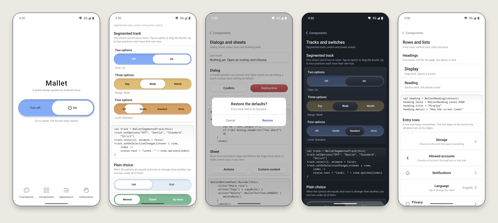
</p>

Mallet 得名于唐 Mallet：素净的胎体上，只有施釉之处才有颜色。这套工具库遵循同样的原则——
页面、卡片与文字保持中性；**颜色只表示状态**，并且落在控件凹陷的“釉床”里，上面是一枚
跟随手指移动的中性滑块。

它是一套面向经典 Android View 体系的完整组件库：既可以写在 XML 布局里，也可以用 Kotlin
或 Java 在代码中构建。不依赖 Compose、AppCompat 或 Material Components；产物是一个
AAR，不包含任何图片或字体文件。

|  |  |
|---|---|
| **55 个组件** | 轨道、开关、步进器、滑块、按钮、标签、输入框、行、导航栏、选项卡、对话框、底部面板、菜单、轻提示，以及加载、空、错误状态 |
| **一套交互系统** | 按下即“下沉”、滑块与页面跟随手指、页面即“地点”、行侧滑露出操作、区块原地展开，所有滑行共用一条缓动曲线 |
| **一套设计系统** | 颜色角色、五种釉色、十一级字号、间距、圆角、三种材质、动效令牌、50 个纯代码绘制的图标；浅色、深色与高对比度 |
| **可验证** | JVM 上 1,050 项测试；Android 16 模拟器上 36 项、Android 6.0 模拟器上 35 项真实触摸测试，以及一个只用本库、不借助其他 UI 库搭建的演示应用 |

## 动起来的样子

以下片段以正常速度录制自运行在 Android 16 模拟器上的演示应用，全部由真实触摸事件驱动；标记手指位置的圆点由录制工具绘制。

| 页面即地点 | 颜色即状态 | 跟随手指 |
|:---:|:---:|:---:|
| 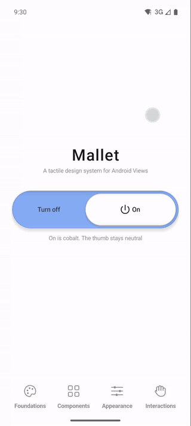 | 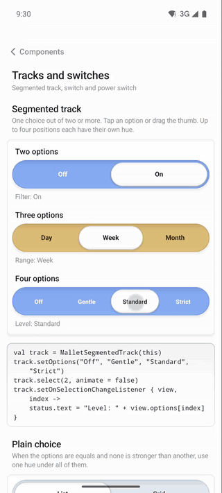 | 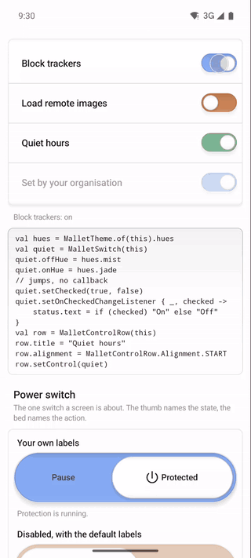 |
| 页面位于另一页面的旁边、上方或下方，朝它拖动即可到达；返回键沿地图原路返回。 | 关是陶红（bronze），开是钴蓝（cobalt）；四档依次为陶红、赭黄（ochre）、钴蓝、青瓷（jade）。滑块始终是中性的。 | 滑块以手指的速度移动，松手后沿同一条曲线滑到位，没有回弹。 |

| 侧滑与原地展开 | 对话框、底部面板、菜单、轻提示 | 主题原地切换 |
|:---:|:---:|:---:|
| 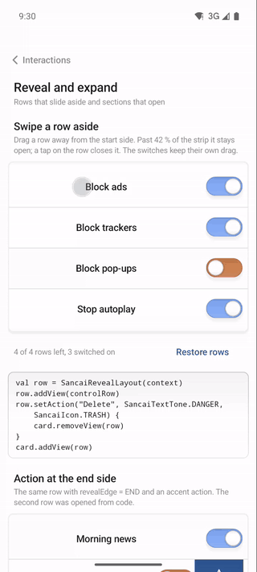 | 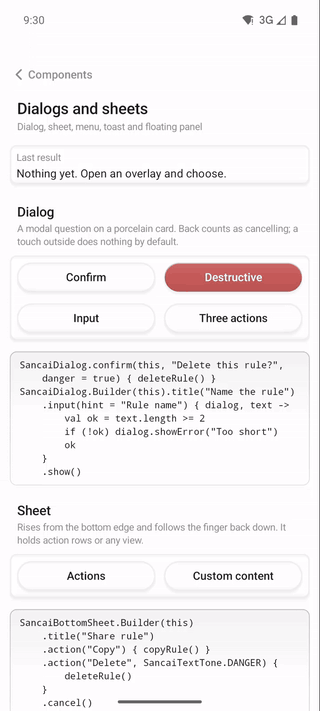 | 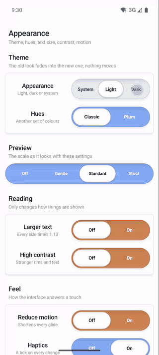 |
| `MalletRevealLayout`、`MalletExpandableLayout` | `MalletDialog`、`MalletBottomSheet`、`MalletMenu`、`MalletToast` | `MalletTheme`、`MalletThemeTransition` |

## 八条规则

1. **颜色即状态，且只在釉床里。** 手指触碰的部分永远是同一枚中性滑块。
2. **只有三种材质。** 瓷面（凸起）、釉轨（凹陷、有色）、滑块（凸起、位于轨道内），外加一个盛放文字与图片的“井”。没有染色按钮，没有水波纹，没有阴影叠层。
3. **文字居中，箭头独立。** 箭头单独放在边缘，指向下一页所在的方向，不挤占文字。
4. **分隔线贯通两缘。** 各行读起来是同一块瓷面上的分区，而不是盒子套盒子。
5. **按下是下沉，不是变色。** 下沉 1.5 dp，松手即回。
6. **要么跟手，要么滑行。** 只有一条缓动曲线；不回弹，不淡入。
7. **页面即地点。** 导航是在一张地图上移动，而不是一叠卡片。
8. **深度是画出来的，短而向下。** 一道细边，一抹向下的短阴影。

完整规范（每个令牌及其取值）见[设计系统](docs/DESIGN_SYSTEM.md)。

## 包含什么

| 类别 | 组件 |
|---|---|
| 表面与文字 | `MalletSurface` · `MalletDivider` · `MalletText` · `MalletIconView`（50 个图标） |
| 操作 | `MalletButton` · `MalletChip` · `MalletChipGroup` · `MalletTag` · `MalletBadge` |
| 选择 | `MalletSegmentedTrack` · `MalletSwitch` · `MalletPowerSwitch` · `MalletCheckbox` · `MalletRadioButton` · `MalletRadioGroup` |
| 数值与进度 | `MalletStepper` · `MalletSlider` · `MalletProgressBar` · `MalletSpinner` |
| 文本输入 | `MalletTextField` |
| 行与页面 | `MalletPage` · `MalletHeading` · `MalletEntryRow` · `MalletControlRow` · `MalletLinkRow` · `MalletKeyValueList` |
| 阅读 | `MalletParagraph` · `MalletCallout` · `MalletFlowRow` · `MalletMediaFrame` |
| 导航 | `MalletNavBar` · `MalletTopBar` · `MalletTabs` · `MalletPager` · `MalletPageIndicator` · `MalletSpatialHost` · `MalletSpatialGraph` · `MalletBack` · `MalletSpatialTransition` |
| 浮层 | `MalletDialog` · `MalletBottomSheet` · `MalletMenu` · `MalletToast` · `MalletFloatingPanel` |
| 状态 | `MalletStateView` · `MalletStateLayout` · `MalletSkeleton` · `MalletBanner` |
| 交互 | `MalletPress` · `MalletHaptics` · `MalletRevealLayout` · `MalletExpandableLayout` · `MalletThemeTransition` |
| 基础 | `MalletTheme` · `MalletColors` · `MalletHues` · `MalletTextRole` · `MalletSpacing` · `MalletMotion` · `MalletMaterial` · `MalletWindow` |

每个组件的用途、浅色与深色截图、XML 属性和代码 API 都收录在
[组件目录](docs/COMPONENT_CATALOG.md)（英文）中。

<p align="center">
  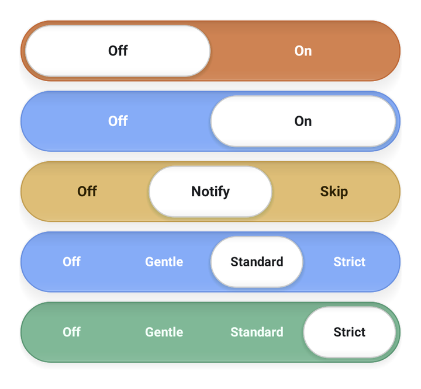
  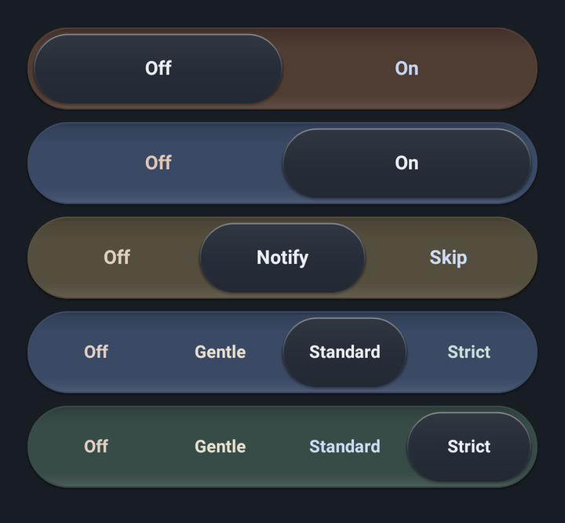
</p>

这些组件

- 同时支持 **XML 与代码**，Kotlin 与 Java 均可；
- 可操作的组件具备**禁用、焦点、按下**状态，支持键盘与方向键操作，并向读屏软件描述自己；
- 适配**从右到左**布局，旋转屏幕后保留状态；
- 跟随主题：**浅色、深色、高对比度**，文字缩放，减弱动效，以及你自己的颜色与釉色。

## 快速开始

Mallet UI 尚未发布到 Maven Central。每个发行版都附带一个现成的 Maven 仓库：把
`mallet-0.1.0-maven-repo.zip` 解压到你的工程里，例如 `libs/mallet-repo/`。

```kotlin
// settings.gradle.kts
dependencyResolutionManagement {
    repositories {
        google()
        mavenCentral()
        maven { url = uri("libs/mallet-repo") }
    }
}

// app/build.gradle.kts
dependencies {
    implementation("io.github.avalonskyafar:mallet:0.1.0")
}
```

然后把 Mallet 的 View 放进任意 Activity 的任意布局即可，不需要指定主题、继承基类或调用初始化方法。

```xml
<io.github.avalonskyafar.mallet.widget.MalletPage
    xmlns:android="http://schemas.android.com/apk/res/android"
    xmlns:app="http://schemas.android.com/apk/res-auto"
    android:layout_width="match_parent"
    android:layout_height="match_parent">

    <io.github.avalonskyafar.mallet.widget.MalletHeading
        android:layout_width="match_parent"
        android:layout_height="wrap_content"
        app:malletTitle="防护"
        app:malletDetail="内容过滤的严格程度" />

    <io.github.avalonskyafar.mallet.widget.MalletSurface
        android:layout_width="match_parent"
        android:layout_height="wrap_content"
        android:layout_marginTop="10dp">

        <io.github.avalonskyafar.mallet.widget.MalletSegmentedTrack
            android:id="@+id/strength"
            android:layout_width="match_parent"
            android:layout_height="wrap_content"
            app:malletOptions="@array/strength_levels"
            app:malletSelectedIndex="2" />
    </io.github.avalonskyafar.mallet.widget.MalletSurface>
</io.github.avalonskyafar.mallet.widget.MalletPage>
```

```kotlin
val strength = findViewById<MalletSegmentedTrack>(R.id.strength)
strength.setOnSelectionChangeListener { _, index -> prefs.strength = index }

MalletDialog.confirm(this, "恢复全部默认设置？", "所有设置都会回到初始值。",
    positiveLabel = "恢复", danger = true) { prefs.reset() }
```

```java
MalletSegmentedTrack track = new MalletSegmentedTrack(context);
track.setOptions("关", "开");
track.select(1, false);
track.setOnSelectionChangeListener((view, index) -> prefs.setEnabled(index == 1));
```

其他接入方式（单独的 AAR、源码模块、JitPack）、主题定制、窗口与系统栏、与 AppCompat 或
Material 共存、测试与代码压缩，见[接入指南](docs/INTEGRATION_GUIDE.md)。
`samples/minimal/` 是一个只用 Java 和 XML 写成的最小示例工程。

### 页面即地点

```kotlin
val graph = MalletSpatialGraph.Builder("home")
    .connect("home", Side.END, "settings")       // 朝末端方向拖动即可到达
    .connect("home", Side.BELOW, "history")
    .child("settings", Side.END, "accounts")     // 从行进入，拖动返回
    .build()

val host = MalletSpatialHost(this)
host.setGraph(graph) { key -> createPage(key) }
setContentView(host)
host.show("home")
MalletBack.attach(this, host)                    // 系统返回键沿地图返回
```

### 换成你自己的样子

```xml
<style name="Theme.MyApp" parent="Theme.Mallet">
    <item name="malletColorAccent">#7A4B8F</item>
    <item name="malletHueCobalt">#A997E6</item>
    <item name="malletHueCobaltEdge">#8874D0</item>
</style>
```

<p align="center">
  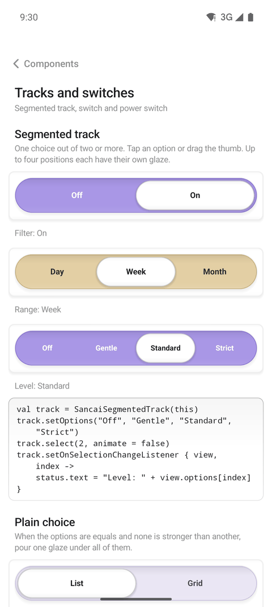
  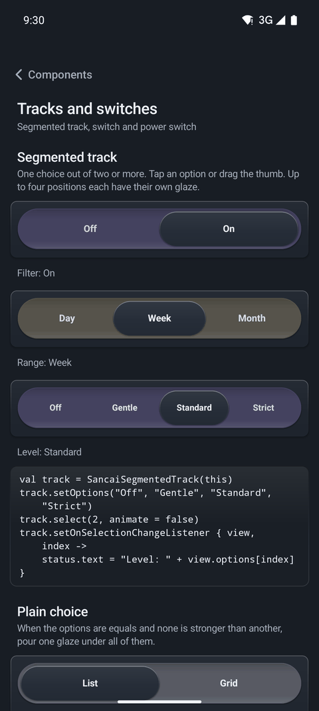
  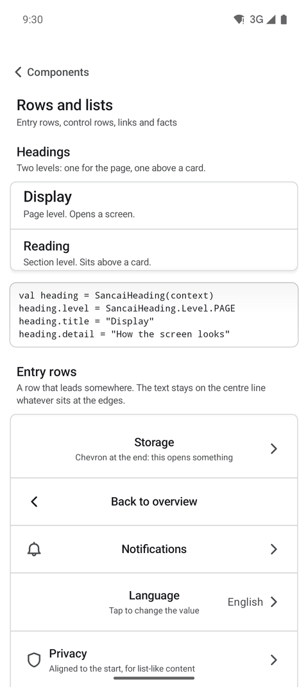
  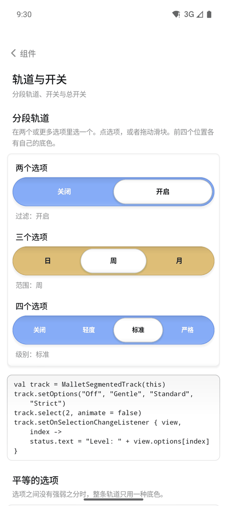
</p>

## 演示应用

`showcase/` 是一个只用本库、不借助其他 UI 库搭建的演示应用：共 27 个页面，每个组件都可以实际操作，
并附上生成它的代码。它自身的导航就是空间导航：基础、组件、交互、外观四个页面围绕着首页。

```
                      外观
                       |
        基础  ——  首页  ——  交互
                       |
                      组件
```

安装发行版中的 APK，或者自行构建：

```bash
./gradlew :showcase:installDebug
```

应用提供英文与简体中文界面；“外观”页面可以在运行时切换主题、釉色、字号、对比度、动效与触感。

## 文档

| | |
|---|---|
| [设计系统](docs/DESIGN_SYSTEM.md) | 原则、颜色、釉色、字体、间距、形状、材质、状态、动效、图标、主题、无障碍 |
| [组件目录](docs/COMPONENT_CATALOG.md) | 每个组件的用途、截图、XML 属性、代码 API 与来源标注 |
| [图集](docs/GALLERY.md) | 演示应用在设备上的样子：每个页面的浅色与深色截图、各种浮层、手势进行到一半的画面、另一套釉色、高对比度、大字号、中文、从右到左，以及八段录屏 |
| [交互指南](docs/INTERACTION_GUIDE.md) | 按压、触感、轨道、页面即地点、系统返回、把 Activity 当作相邻页面、主题切换、侧滑、展开、手势归属、动效令牌 |
| [接入指南](docs/INTEGRATION_GUIDE.md) | 添加依赖、第一个界面、XML、Kotlin、Java、主题、窗口、与其他 UI 库共存、自定义 View、测试、压缩 |
| [设计决策与来源](docs/DESIGN_DECISIONS.md) | 哪些提取自原应用、哪些是扩展、哪些是新设计，以及理由 |
| [验证记录](docs/VERIFICATION.md) | 本次发行实际构建、运行、测量了什么，以及没有做什么 |
| [许可证审计](docs/LICENSE_AUDIT.md) · [第三方声明](THIRD_PARTY_NOTICES.md) | 原项目与每个依赖的许可证 |
| [更新日志](CHANGELOG.md) · [参与贡献](CONTRIBUTING.md) | |

文档正文为英文。

## 它从哪里来

Mallet UI 提取自同一作者的 Android 应用**守目人（Gravekeeper）**的界面。该应用的全部界面
都由一个与应用自身紧密耦合的 Java 类在代码中搭建，没有任何布局文件。它的设计理念和交互模型
是完整的，但无法复用，而且缺少一套通用组件库所需的许多部分。

Mallet 保留了这套理念，把它整理成令牌与规则，把各部分重写为独立组件，并用同一种设计语言补齐
缺失的部分。每个部分都有来源标注：

| 标注 | 含义 | 例子 |
|---|---|---|
| **Extracted（提取）** | 设计与数值取自原应用 | 分段轨道、开关、卡片、行、对话框、空间导航、按压反馈 |
| **Extended（扩展）** | 对原有思路的推广或补全 | 按钮变体、步进器、输入框、导航栏、图标、主题 |
| **New（新增）** | 依照同样的材质与规则为 Mallet 新设计 | 复选框、单选、滑块、进度、标签、选项卡、顶栏、菜单、底部面板、状态视图、骨架屏、横幅 |

每个提取部分在原项目中的文件与行号，以及每一处有意差异的理由，都记录在
[设计决策](docs/DESIGN_DECISIONS.md)中。本库不包含原应用的任何业务逻辑、模型或美术素材。

## 验证

| | |
|---|---|
| 单元测试 | 组件库 1,030 项、演示应用 20 项，在 JVM 上以 Robolectric 和 Android 原生图形运行，全部通过；另在 API 23、28、32 上让每个 View 走完一遍完整的生命周期 |
| 设备测试（模拟器） | 36 项测试在 Android 16 模拟器上以真实触摸事件操作已安装的演示应用，其中 35 项也在本库支持的最低版本 Android 6.0 上运行；全部通过 |
| 静态检查 | 两个模块均开启 Android Lint 且警告视为错误；另有源码规则测试，禁止水波纹、elevation 以及字号表之外的字号 |
| 代码压缩 | 发行版演示 APK 经过 R8 与资源压缩；本库不需要任何 keep 规则 |
| 接入验证 | 独立的 Java 工程 `samples/minimal` 从发行版的 Maven 仓库解析本库，经压缩构建后可以运行；源码压缩包解压到别处后可以独立构建并通过测试 |

具体命令、细节与局限见[验证记录](docs/VERIFICATION.md)。

## 构建

环境要求：JDK 17 或更高版本，Android SDK Platform 36。

```bash
./gradlew :mallet:testDebugUnitTest :showcase:testDebugUnitTest   # JVM 测试，同时生成截图
./gradlew :mallet:lintDebug :showcase:lintDebug                   # 静态检查
./gradlew dist                                                    # AAR、Maven 仓库 zip、演示 APK、源码 zip
python tools/device.py all                                        # 真机测试、截图、录屏（需要连接设备）
```

```
mallet/      组件库                 io.github.avalonskyafar:mallet
showcase/    演示应用               io.github.avalonskyafar.mallet.showcase
samples/     最小接入示例（Java + XML）
docs/        设计系统、组件目录、指南、图片
tools/       目录与图片生成脚本、设备运行脚本
```

## 状态

0.1.0 是第一个版本。API 全库遵循同一套约定，并有测试覆盖，但尚未经历过弃用周期：在 1.0
之前，次版本号的升级可能会改动 API。

## 许可证

[MIT](LICENSE) © 2026 AvalonskyAfar。本库不捆绑任何第三方代码或素材；其依赖（AndroidX、
Kotlin 标准库）均为 Apache-2.0。详见 [NOTICE](NOTICE.md) 与
[第三方声明](THIRD_PARTY_NOTICES.md)。
