# Component catalog

Every component of Mallet UI: what it is for, how it behaves, how it is declared in XML and
in code, and which of its parts can be set. The design rules behind the components are in
[DESIGN_SYSTEM.md](DESIGN_SYSTEM.md), their movement in [INTERACTION_GUIDE.md](INTERACTION_GUIDE.md).

> This file is generated from the sources by `tools/catalog.py`. Texts are the KDoc of the
> classes, attribute tables are read from the resource files, and the pictures are drawn by
> the unit tests. Do not edit it by hand.

Each component carries a mark that says where it comes from; the evidence is in
[DESIGN_DECISIONS.md](DESIGN_DECISIONS.md).

| Mark | Meaning |
|---|---|
| **Extracted** | Taken from the original application: its geometry, colours and behaviour, rewritten as a reusable component |
| **Extended** | An original idea generalised or completed |
| **New** | Designed for Mallet in the same language |

## Contents

- **Surfaces and text**: [Surface](#malletsurface), [Divider](#malletdivider), [Text](#mallettext), [IconView](#malleticonview)
- **Actions**: [Button](#malletbutton), [Chip](#malletchip), [ChipGroup](#malletchipgroup), [Tag](#mallettag), [Badge](#malletbadge)
- **Choice**: [SegmentedTrack](#malletsegmentedtrack), [Switch](#malletswitch), [PowerSwitch](#malletpowerswitch), [Checkbox](#malletcheckbox), [RadioButton](#malletradiobutton), [RadioGroup](#malletradiogroup)
- **Numbers and progress**: [Stepper](#malletstepper), [Slider](#malletslider), [ProgressBar](#malletprogressbar), [Spinner](#malletspinner)
- **Text input**: [TextField](#mallettextfield)
- **Rows and pages**: [Page](#malletpage), [Heading](#malletheading), [EntryRow](#malletentryrow), [ControlRow](#malletcontrolrow), [LinkRow](#malletlinkrow), [KeyValueList](#malletkeyvaluelist)
- **Reading**: [Paragraph](#malletparagraph), [Callout](#malletcallout), [FlowRow](#malletflowrow), [MediaFrame](#malletmediaframe)
- **Navigation**: [NavBar](#malletnavbar), [TopBar](#mallettopbar), [Tabs](#mallettabs), [Pager](#malletpager), [PageIndicator](#malletpageindicator), [SpatialGraph](#malletspatialgraph), [SpatialHost](#malletspatialhost), [Back](#malletback), [SpatialTransition](#malletspatialtransition)
- **Overlays**: [Dialog](#malletdialog), [BottomSheet](#malletbottomsheet), [Menu](#malletmenu), [Toast](#mallettoast), [FloatingPanel](#malletfloatingpanel)
- **States**: [StateView](#malletstateview), [StateLayout](#malletstatelayout), [Skeleton](#malletskeleton), [Banner](#malletbanner)
- **Interaction**: [Press](#malletpress), [Haptics](#mallethaptics), [RevealLayout](#malletreveallayout), [ExpandableLayout](#malletexpandablelayout), [ThemeTransition](#malletthemetransition), [HorizontalDragOwner](#mallethorizontaldragowner), [Control](#malletcontrol)

---

## Surfaces and text

What everything else stands on: the card, the divider, text in the type scale and icons.

### MalletSurface

**Extracted** · `io.github.avalonskyafar.mallet.widget.MalletSurface` · Showcase: Foundations › Materials and depth

The Mallet card: a raised surface that groups rows and controls.

A card is a group: it holds at least two rows or blocks that belong together. A lone control
never gets a card of its own: it joins the card of its relatives, or it stands on the canvas
under its heading, without a card. One composite block, such as a list, a state view, a
paragraph or a picture, may have a card to itself.

It is a `LinearLayout` (vertical unless told otherwise) with the surface material as its
background. Four things differ from a plain layout:

- The view is slightly larger than the card the eye sees, because the shadow is drawn inside
  the view: 1.4 dp on each side, 1 dp above and 4.8 dp below. Content padding (9 dp by
  default) is measured from the view bounds.
- `MalletDivider` children marked full-bleed are stretched from rim to rim.
- A `MalletRevealLayout` child of a vertical surface is stretched over the cell of its row,
  from rim to rim and from divider to divider, so that the action it uncovers comes out from
  the edge of the card. The row inside it keeps its place.
- Children are not clipped to their bounds, so that the tracks and capsules inside a card
  can let their shadows fade out into the room around them. A child that scrolls (a
  `ScrollView`, a list, a `RecyclerView`, anything marked as a scroll container) is the
  exception: its content ends at its own edge.

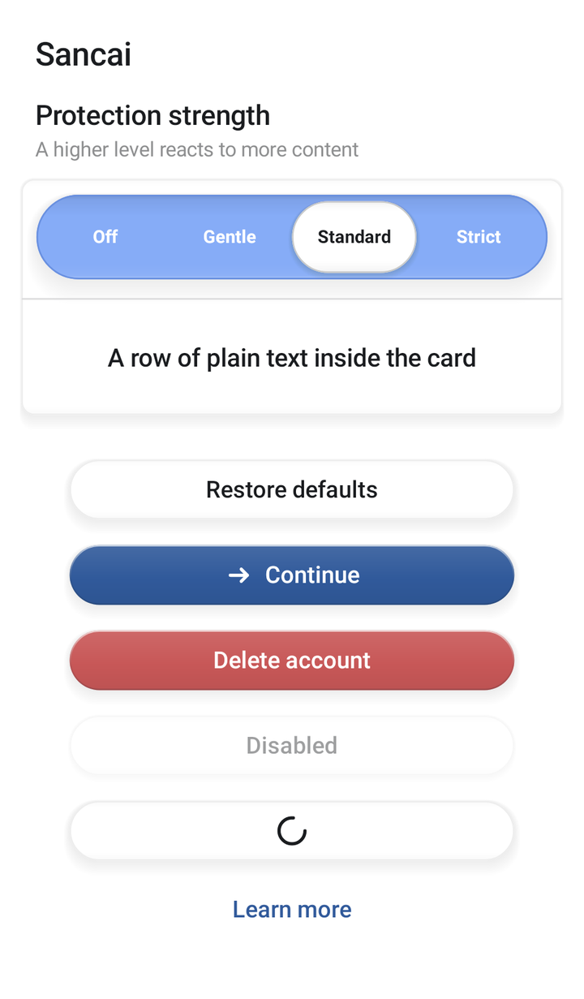 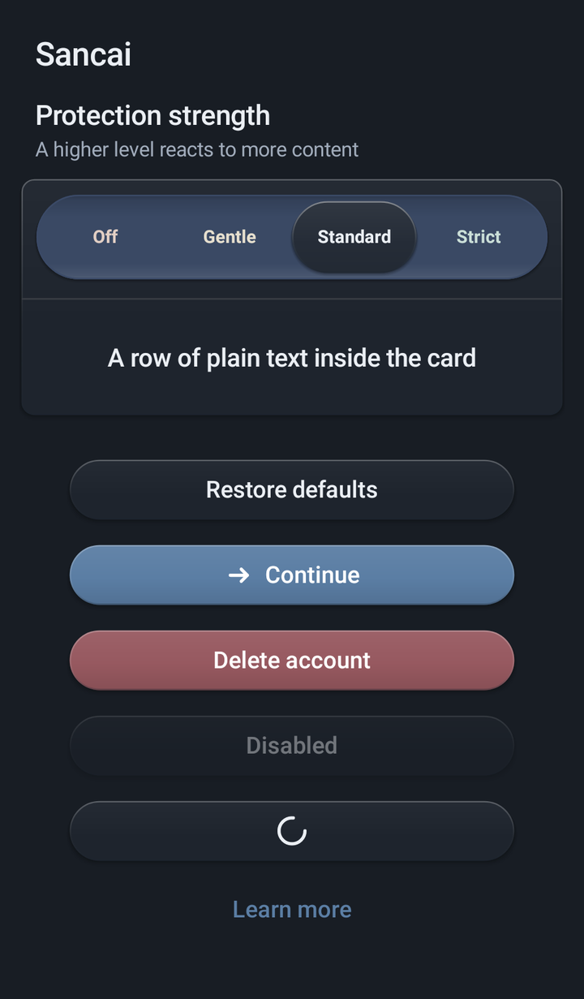

```xml
<io.github.avalonskyafar.mallet.widget.MalletSurface
    android:layout_width="match_parent"
    android:layout_height="wrap_content">
    <!-- rows, a MalletDivider, more rows -->
</io.github.avalonskyafar.mallet.widget.MalletSurface>
```

| XML attribute | Value | Meaning |
|---|---|---|
| `app:malletCornerRadius` | dimension | Corner radius of a body. |
| `app:malletElevated` | boolean | Whether a body is lifted (rim and shadow) or flat (rim only). |
| `app:malletSurfaceCorners` | `all` / `top` / `bottom` | Which corners are rounded; top and bottom are the two halves of a split card. |
| `app:malletContentPadding` | dimension | Padding between the view bounds and the content. Defaults to 9dp. |
| `android:orientation` | horizontal / vertical | The direction children are laid out in. |

| Member | What it does |
|---|---|
| `var cornerRadiusDp: Float` | Corner radius in dp. |
| `var elevated: Boolean` | Lifted (rim and shadow) or flat (rim only). |
| `var corners: MalletCorners` | Which corners are rounded. |
| `fun addDivider(verticalMarginDp: Float = 0f): MalletDivider` | Adds a full-bleed divider. |
| ↳ `const val CONTENT_PADDING_DP: Float` | Default padding between the view bounds and the content, in dp. |

### MalletDivider

**Extracted** · `io.github.avalonskyafar.mallet.widget.MalletDivider` · Showcase: Foundations › Materials and depth

A hairline divider: 14 % of the ink colour laid over the canvas, one dp thick.

Inside a `MalletSurface` a divider is full-bleed by default: the surface stretches it from
rim to rim regardless of the surface padding, so rows on either side read as sections of one
card rather than as boxes inside a box.

Pictures: see [MalletSurface](#malletsurface).

| XML attribute | Value | Meaning |
|---|---|---|
| `app:malletFullBleed` | boolean | Whether the divider runs from rim to rim of the MalletSurface it sits in, ignoring the padding of that surface. Defaults to true. |
| `android:orientation` | horizontal / vertical | The direction children are laid out in. |

| Member | What it does |
|---|---|
| `var fullBleed: Boolean` | Whether a parent `MalletSurface` stretches this divider to its rims. |
| `var orientation: Int` | `LinearLayout.HORIZONTAL` for a horizontal line (the default) or `LinearLayout.VERTICAL`. |

### MalletText

`io.github.avalonskyafar.mallet.widget.MalletText` · Showcase: Foundations › Typography

A text view that speaks the Mallet type scale: pick a `role` for size, weight and leading
and a `tone` for colour.

Font padding is switched off, so a line of text is exactly as tall as its glyphs and
vertical centring is optical rather than approximate.

Pictures: see [MalletSurface](#malletsurface).

```xml
<io.github.avalonskyafar.mallet.widget.MalletText
    android:layout_width="match_parent"
    android:layout_height="wrap_content"
    android:text="Protection strength"
    app:malletTextRole="heading" />
```

| XML attribute | Value | Meaning |
|---|---|---|
| `app:malletTextRole` | one of 11 names (see below) | Role in the type scale. |
| `app:malletTone` | `ink` / `muted` / `accent` / `danger` / `warning` / `success` | Colour role of text or of an icon. |

| Member | What it does |
|---|---|
| `var role: MalletTextRole` | Size, weight and leading. |
| `var tone: MalletTextTone` | Colour role. |
| ↳ `fun create(context: Context, text: CharSequence?, role: MalletTextRole, tone: MalletTextTone` | Creates a text view in code. |

### MalletIconView

`io.github.avalonskyafar.mallet.icon.MalletIconView` · Showcase: Foundations › Icons

Shows one `MalletIcon`.

The icon fills the smaller side of the content box; `wrap_content` measures 24 dp plus
padding. Directional icons mirror in right-to-left layouts. The view is decorative unless
you give it a content description.

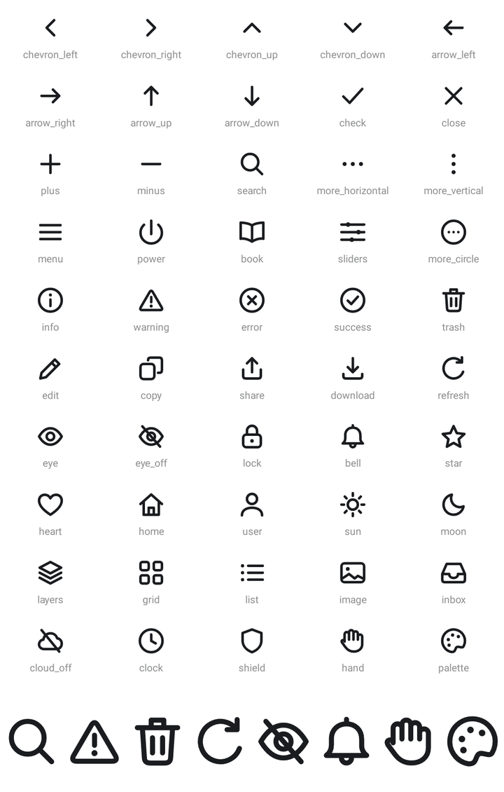 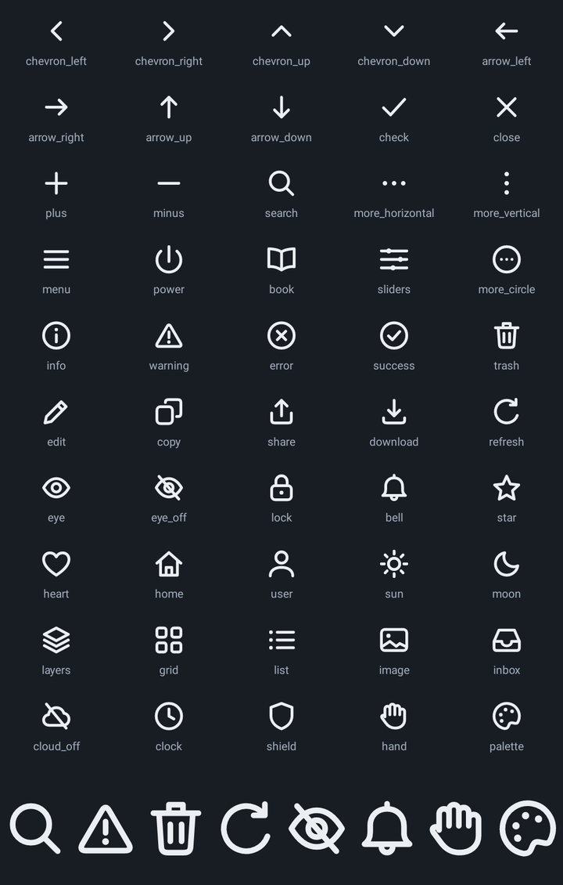

```xml
<io.github.avalonskyafar.mallet.icon.MalletIconView
    android:layout_width="wrap_content"
    android:layout_height="wrap_content"
    app:malletIcon="shield"
    app:malletTone="accent" />
```

| XML attribute | Value | Meaning |
|---|---|---|
| `app:malletIcon` | one of 50 names, or `none` (see below) | An icon of the built-in set. Values follow the order of the MalletIcon enum. |
| `app:malletTone` | `ink` / `muted` / `accent` / `danger` / `warning` / `success` | Colour role of text or of an icon. |
| `app:malletIconStroke` | dimension | Stroke width at the drawn size. Defaults to 2dp. |

| Member | What it does |
|---|---|
| `var icon: MalletIcon?` | The icon to draw, or `null` for nothing. |
| `var tone: MalletTextTone` | Colour role of the stroke, used when `color` is `null`. |
| `var color: Int?` | Explicit stroke colour; overrides `tone` when set. |
| `var strokeDp: Float` | Stroke width in dp at the drawn size. |
| ↳ `const val DEFAULT_SIZE_DP: Float` | Size, in dp, that `wrap_content` resolves to. |

---

## Actions

Things that are pressed. A page has at most one primary capsule; everything else is neutral.

### MalletButton

**Extended** · `io.github.avalonskyafar.mallet.widget.MalletButton` · Showcase: Components › Buttons and chips

The Mallet capsule button.

| Variant | Body | Use |
|---|---|---|
| `Variant.NEUTRAL` | neutral capsule | ordinary actions |
| `Variant.PRIMARY` | capsule in the accent colour | the one main action of a screen |
| `Variant.DANGER` | capsule in the danger colour | destructive actions |
| `Variant.TEXT` | none, coloured label only | dialog actions and inline links |

Pressing sinks the capsule by 1.5 dp and tightens its shadow; nothing changes colour.
Keyboard focus thickens the rim into ink. A disabled button pales. While `isLoading` the
label gives way to a spinner and clicks are ignored.

Pictures: see [MalletSurface](#malletsurface).

```xml
<io.github.avalonskyafar.mallet.widget.MalletButton
    android:layout_width="match_parent"
    android:layout_height="wrap_content"
    android:text="Restore defaults"
    app:malletButtonVariant="neutral" />
```

| XML attribute | Value | Meaning |
|---|---|---|
| `android:focusable` | boolean | Whether the button takes keyboard focus. True unless the layout says otherwise. |
| `android:clickable` | boolean | Whether the button answers taps and keys. True unless the layout says otherwise. |
| `app:malletButtonVariant` | `neutral` / `primary` / `danger` / `text` | The body of the button: a neutral capsule, a coloured capsule, or the label alone. |
| `app:malletTone` | `ink` / `muted` / `accent` / `danger` / `warning` / `success` | Text colour of the text variant. Defaults to accent. |
| `app:malletIcon` | one of 50 names, or `none` (see below) | Icon drawn before the label. |
| `app:malletLoading` | boolean | Replaces the label with a spinner and ignores clicks. |

| Member | What it does |
|---|---|
| `enum class Variant { NEUTRAL, PRIMARY, DANGER, TEXT }` |  |
| `var variant: Variant` | Visual variant. |
| `var tone: MalletTextTone` | Label colour of the `Variant.TEXT` variant. |
| `var icon: MalletIcon?` | Icon drawn before the label, or `null`. |
| `var isLoading: Boolean` | Shows a spinner instead of the label and ignores clicks. |

### MalletChip

**New** · `io.github.avalonskyafar.mallet.widget.MalletChip` · Showcase: Components › Buttons and chips

A small neutral capsule for filters, suggestions and short actions.

| Kind | Behaviour |
|---|---|
| `Kind.ACTION` | a small neutral button: a tap ticks and calls the click listener |
| `Kind.FILTER` | checkable: a tap flips `isChecked` and calls `setOnCheckedChangeListener` |

An unchecked chip is a raised white surface with an ink label. Checking a filter chip fills
it with its hue: the body becomes a recessed coloured capsule (`hue`, cobalt by default), a
small check mark is drawn before the label and the chip glides to its wider size. The colour
is the state; nothing else about the chip changes.

Pressing sinks the chip by 1.5 dp and tightens its shadow. Keyboard focus thickens the rim
into ink, Space and Enter act like a tap, and a disabled chip pales. The body is 32 dp high
inside a 44 dp touch target; the room around it holds the shadow.

`setOnCheckedChangeListener` is called for user input only (touch, keyboard, accessibility),
never for `setChecked`, and it is called before the haptic tick. Put several chips into a
`MalletChipGroup` to let them wrap and, optionally, to allow one choice only.

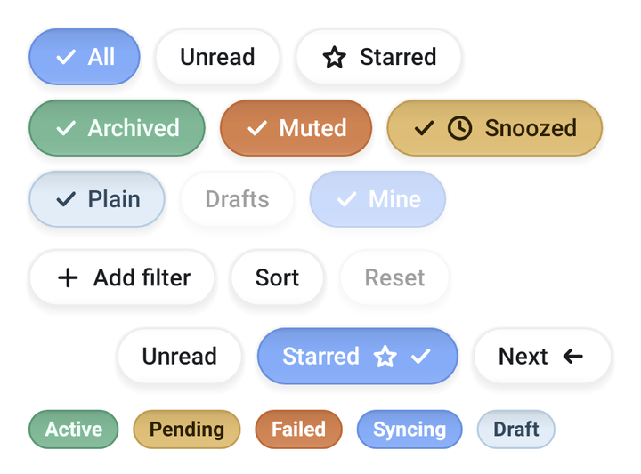 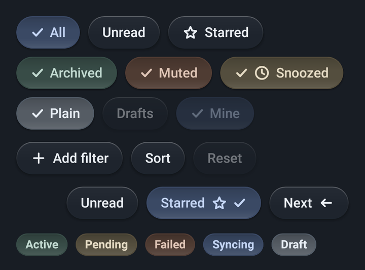

```xml
<io.github.avalonskyafar.mallet.widget.MalletChip
    android:layout_width="wrap_content"
    android:layout_height="wrap_content"
    android:text="Unread"
    app:malletChipKind="filter"
    app:malletChecked="true" />
```

| XML attribute | Value | Meaning |
|---|---|---|
| `android:text` | string | Label of the chip. |
| `android:enabled` | boolean | Whether the component can be operated. Disabled, it pales as a whole. |
| `app:malletChipKind` | `action` / `filter` | What the chip does: an action is pressed, a filter is checked and unchecked. |
| `app:malletChecked` | boolean | Whether a filter chip starts checked. |
| `app:malletHue` | `bronze` / `ochre` / `cobalt` / `jade` / `mist` | Hue of a checked filter chip. Cobalt by default. |
| `app:malletIcon` | one of 50 names, or `none` (see below) | Icon drawn before the label. |

| Member | What it does |
|---|---|
| `enum class Kind { ACTION, FILTER }` | What a chip does when it is tapped. |
| `fun interface OnCheckedChangeListener` | Called when the user checks or unchecks a filter chip. |
| ↳ `fun onCheckedChanged(chip: MalletChip, isChecked: Boolean)` |  |
| `fun setOnCheckedChangeListener(listener: OnCheckedChangeListener?)` | Listener for user-driven changes of `isChecked`. |
| `var text: CharSequence` | The label. |
| `var kind: Kind` | Whether the chip is pressed like a button or checked like a filter. |
| `var hue: MalletHue` | Hue that fills a checked filter chip. |
| `var icon: MalletIcon?` | Icon drawn before the label, or `null`. |
| `var isChecked: Boolean` | Whether a filter chip is checked. |
| `fun setChecked(checked: Boolean, animate: Boolean)` | Checks or unchecks a filter chip from code, gliding when `animate` is set. |
| `fun getBodyBounds(out: RectF)` | The visible capsule in view coordinates, written to `out`. |

### MalletChipGroup

**New** · `io.github.avalonskyafar.mallet.widget.MalletChipGroup` · Showcase: Components › Buttons and chips

A wrapping row of `MalletChip`s: chips flow from the start edge and continue on the next
line when the width runs out. Right-to-left layouts flow from the right.

Gaps are measured between the visible capsules, 8 dp by default in both directions. A chip
view is larger than its capsule (touch target and room for the shadow), so neighbouring chip
views sit closer than the gap and rows overlap slightly; the capsules never do. The first
capsule of a row is inset from the group's edge by the chip's 2 dp shadow gutter.

With `isSingleSelection` at most one filter chip is checked at a time: checking one unchecks
the others. `isSelectionRequired` also keeps the user from unchecking the last checked chip.
`setOnCheckedStateChangeListener` is called for user input only, never for `check`,
`clearCheck` or `MalletChip.setChecked`.

Pictures: see [MalletChip](#malletchip).

```xml
<io.github.avalonskyafar.mallet.widget.MalletChipGroup
    android:layout_width="match_parent"
    android:layout_height="wrap_content"
    app:malletChipGroupSingleSelection="true"
    app:malletChipGroupCheckedChip="@id/chip_all">

    <io.github.avalonskyafar.mallet.widget.MalletChip
        android:id="@+id/chip_all"
        android:layout_width="wrap_content"
        android:layout_height="wrap_content"
        android:text="All"
        app:malletChipKind="filter" />
</io.github.avalonskyafar.mallet.widget.MalletChipGroup>
```

| XML attribute | Value | Meaning |
|---|---|---|
| `app:malletChipGroupSingleSelection` | boolean | Whether at most one filter chip of the group can be checked at a time. |
| `app:malletChipGroupSelectionRequired` | boolean | Whether the user is kept from unchecking the last checked chip. |
| `app:malletChipGroupHorizontalGap` | dimension | Gap between the bodies of neighbouring chips in a row. 8dp by default. |
| `app:malletChipGroupVerticalGap` | dimension | Gap between the bodies of chips in neighbouring rows. 8dp by default. |
| `app:malletChipGroupCheckedChip` | reference | Id of the chip that is checked at start. |

| Member | What it does |
|---|---|
| `fun interface OnCheckedStateChangeListener` | Called when the user changes which chips of the group are checked. |
| ↳ `fun onCheckedStateChanged(group: MalletChipGroup, checkedIds: List<Int>)` |  |
| `fun setOnCheckedStateChangeListener(listener: OnCheckedStateChangeListener?)` | Listener for user-driven changes of the checked chips. |
| `var isSingleSelection: Boolean` | Whether at most one chip can be checked. |
| `var isSelectionRequired: Boolean` | Whether the user is kept from unchecking the last checked chip. |
| `var horizontalGap: Int` | Gap between the capsules of neighbouring chips in a row, in pixels. |
| `var verticalGap: Int` | Gap between the capsules of neighbouring rows, in pixels. |
| `val checkedChipIds: List<Int>` | Ids of the checked chips, in child order. |
| `val checkedChipId: Int get()` | Id of the first checked chip, or `View.NO_ID` while none is checked. |
| `fun check(id: Int, animate: Boolean = true)` | Checks the chip with `id` from code; listeners are not called. |
| `fun clearCheck(animate: Boolean = true)` | Leaves no chip checked. |

### MalletTag

**New** · `io.github.avalonskyafar.mallet.widget.MalletTag` · Showcase: Components › Buttons and chips

A status tag: a miniature recessed coloured capsule with a short bold label.

The tag says what state something is in ("Active", "Expired", "Draft") and nothing else. It
is 22 dp high, has no outer shadow, cannot be pressed and takes no focus. Its colour is the
state, and it lives in the bed: each `Tone` maps to one hue of the theme. Several tags
side by side belong in a `MalletChipGroup`, which wraps them onto further lines.

| Tone | Hue | Use |
|---|---|---|
| `Tone.POSITIVE` | jade | done, healthy, allowed |
| `Tone.CAUTION` | ochre | pending, needs attention |
| `Tone.NEGATIVE` | bronze | failed, blocked, off |
| `Tone.INFO` | cobalt | running, selected, new |
| `Tone.NEUTRAL` | mist | plain labels without a judgement |

Pictures: see [MalletChip](#malletchip).

```xml
<io.github.avalonskyafar.mallet.widget.MalletTag
    android:layout_width="wrap_content"
    android:layout_height="wrap_content"
    android:text="Active"
    app:malletTagTone="positive" />
```

| XML attribute | Value | Meaning |
|---|---|---|
| `android:text` | string | Label of the tag. |
| `app:malletTagTone` | `positive` / `caution` / `negative` / `info` / `neutral` | What the tag says about its subject; decides the hue of its bed. |

| Member | What it does |
|---|---|
| `enum class Tone { POSITIVE, CAUTION, NEGATIVE, INFO, NEUTRAL }` | What the tag says about its subject; each tone is one hue of the theme. |
| `var text: CharSequence` | The label. |
| `var tone: Tone` | What the tag says about its subject. |
| `val hue: MalletHue` | The hue `tone` maps to in the theme of this view. |

### MalletBadge

**New** · `io.github.avalonskyafar.mallet.widget.MalletBadge` · Showcase: Components › Buttons and chips

A count badge: a small capsule in the danger colour with a white number on it.

A `count` of zero hides the badge, unless `showDot` is set, in which case it shrinks to an
8 dp dot that says "something is new" without saying how much. Counts beyond `maxCount` are
written as "99+".

Use it as a plain view, or call `attach` to overlay one on the top end corner of any view
without touching the layout.

For screen readers the badge describes itself with its number and is hidden while it shows
no number. A content description or an `importantForAccessibility` other than `auto` that
you set yourself, in XML or from code, is kept: the badge then leaves that property alone.
Set the description back to `null`, or the importance back to `auto`, and the badge takes
it over again with its next change.

```xml
<io.github.avalonskyafar.mallet.widget.MalletBadge
    android:layout_width="wrap_content"
    android:layout_height="wrap_content" />
```

| Member | What it does |
|---|---|
| `var count: Int` | The number shown. |
| `var showDot: Boolean` | Whether a count of zero is drawn as a small dot instead of nothing. |
| `var maxCount: Int` | The largest number written out; anything above is shown as this number and a plus sign. |
| `val text: String` | What the badge currently says: the number, "99+" style overflow, or nothing. |
| `val isShowing: Boolean get()` | Whether anything is drawn at all: a count above zero, or the dot. |
| `fun detach()` | Removes a badge created with `attach` from its anchor. |
| ↳ `fun attach(anchor: View): MalletBadge` | Overlays a new badge on the top end corner of `anchor` and returns it. |

---

## Choice

Controls whose state is a colour in a recessed bed. The thumb or bead that moves over it stays neutral.

### MalletSegmentedTrack

**Extracted** · `io.github.avalonskyafar.mallet.widget.MalletSegmentedTrack` · Showcase: Components › Tracks and switches

The signature Mallet control: a recessed coloured track with two or more options and a neutral
thumb that follows the finger.

The colour of the bed is the state. As the thumb travels, the hue of the option it leaves
blends into the hue of the option it approaches, so the control answers "which option" by
position and "how strong" by colour at the same time.

By default the options are read as an ordinal scale and coloured bronze, ochre, cobalt and
jade in that order (see `io.github.avalonskyafar.mallet.theme.MalletHues.scale`). Use
`setHues` for a plain choice or a custom scale.

The view is 60 dp tall by default: a 52 dp track plus the gutter its shadow needs.

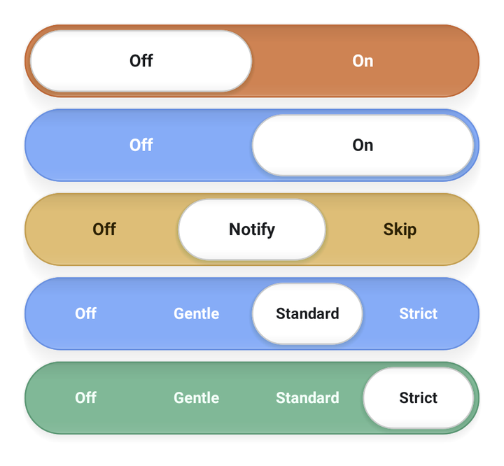 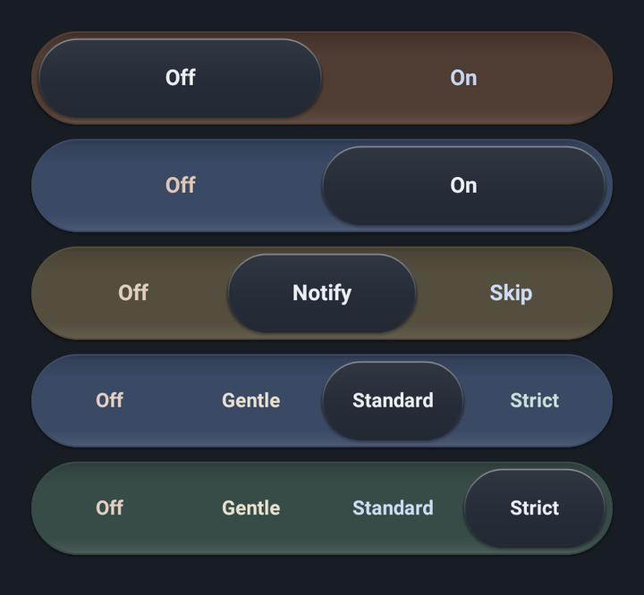

```xml
<io.github.avalonskyafar.mallet.widget.MalletSegmentedTrack
    android:layout_width="match_parent"
    android:layout_height="wrap_content"
    app:malletOptions="@array/strength_levels"
    app:malletSelectedIndex="2" />
```

| XML attribute | Value | Meaning |
|---|---|---|
| `app:malletOptions` | reference | Options of a multi-option control, as a string array. |
| `app:malletSelectedIndex` | integer | Index of the option selected at start. |
| `app:malletHueMode` | `scale` / `uniform` | How options are coloured. "scale" reads the options as an ordinal scale (off, gentle, standard, strict). "uniform" uses the single hue named by malletHue under every option, for plain choices. |
| `app:malletHue` | `bronze` / `ochre` / `cobalt` / `jade` / `mist` | One of the five hues of the theme. |
| `android:enabled` | boolean | Whether the component can be operated. Disabled, it pales as a whole. |

| Member | What it does |
|---|---|
| `fun interface OnSelectionChangeListener` | Called when the user moves the selection to another option. |
| ↳ `fun onSelectionChanged(track: MalletSegmentedTrack, index: Int)` |  |
| `fun setOnSelectionChangeListener(listener: OnSelectionChangeListener?)` | Listener for user-driven selection changes. |
| `var options: List<CharSequence>` | The option labels. |
| `val selectedIndex: Int get()` | Index of the selected option. |
| `fun setOptions(vararg labels: CharSequence)` | Replaces the option labels. |
| `fun setHues(hues: List<MalletHue>?)` | Sets the hue under each option, or `null` to return to the default ordinal scale. |
| `fun select(index: Int, animate: Boolean = true)` | Moves the selection to `index` from code. |
| ↳ `const val HEIGHT_DP: Float` | Default height of the view in dp: a 52 dp track plus its shadow gutter. |
| ↳ `const val GUTTER_SIDE_DP: Float` | Room at each side of the capsule, inside the view, in dp. |
| ↳ `const val GUTTER_TOP_DP: Float` | Room above the capsule, inside the view, in dp. |
| ↳ `const val GUTTER_BOTTOM_DP: Float` | Room below the capsule, inside the view, in dp. |

### MalletSwitch

**Extracted** · `io.github.avalonskyafar.mallet.widget.MalletSwitch` · Showcase: Components › Tracks and switches

The compact two-state switch: a small recessed coloured track with a neutral round thumb.

The colour of the bed is the state: bronze while off, cobalt while on, and a blend of
the two while the thumb travels. The thumb itself never changes colour. A tap toggles; a
horizontal drag makes the thumb follow the finger and commits to the nearer side on
release; a mostly vertical movement gives the gesture back to a scrolling parent and
leaves the state alone.

The view is 61 x 44 dp by default: the 61 x 34 dp track of the original (a 58 x 30 dp bed
plus the gutter its shadow needs), centred in a 44 dp touch target. A view forced to 34 dp
is all track. It carries no label of its own: give it a `contentDescription`.

The listener is called for user input only (touch, keyboard, accessibility action), never
for `setChecked` or `toggle`, so a change can be rolled back from inside the listener.

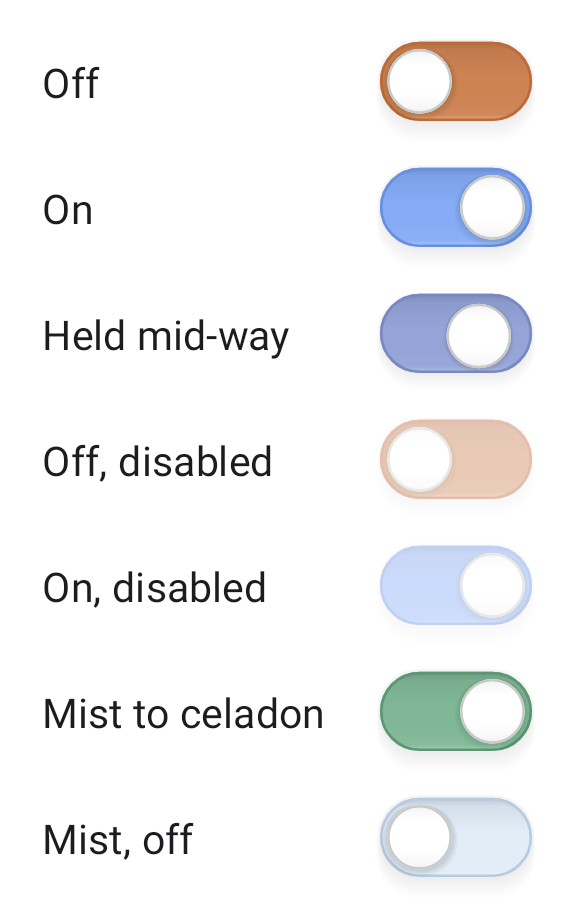 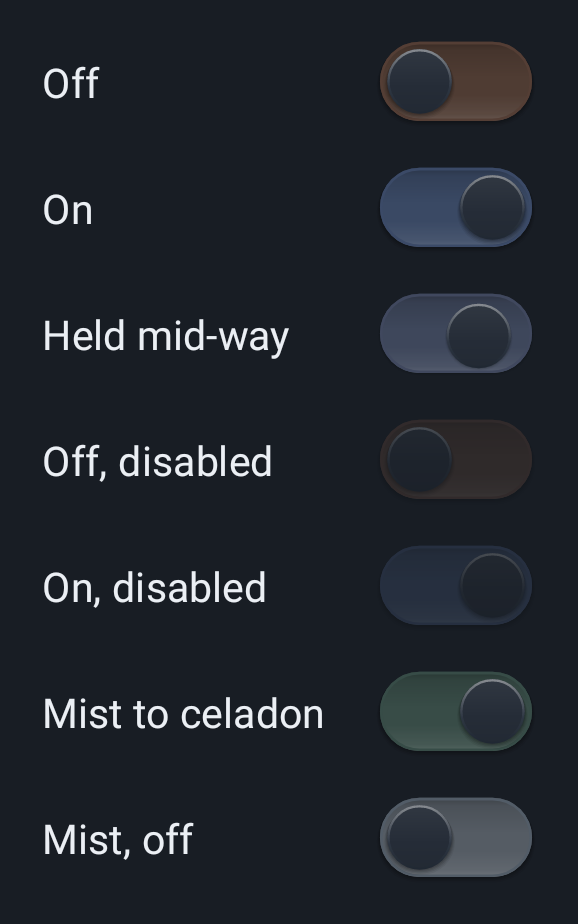

```xml
<io.github.avalonskyafar.mallet.widget.MalletSwitch
    android:layout_width="wrap_content"
    android:layout_height="wrap_content"
    app:malletChecked="true" />
```

| XML attribute | Value | Meaning |
|---|---|---|
| `app:malletChecked` | boolean | Whether a two-state control starts checked. |
| `app:malletSwitchOffHue` | `bronze` / `ochre` / `cobalt` / `jade` / `mist` | Hue of the bed while the switch is off. Default: bronze. |
| `app:malletSwitchOnHue` | `bronze` / `ochre` / `cobalt` / `jade` / `mist` | Hue of the bed while the switch is on. Default: cobalt. |
| `android:enabled` | boolean | Whether the component can be operated. Disabled, it pales as a whole. |

| Member | What it does |
|---|---|
| `fun interface OnCheckedChangeListener` | Called when the user turns the switch on or off. |
| ↳ `fun onCheckedChanged(switch: MalletSwitch, isChecked: Boolean)` | The user turned `switch` on or off; `isChecked` is its new state. |
| `fun setOnCheckedChangeListener(listener: OnCheckedChangeListener?)` | Listener for user-driven changes. |
| `var offHue: MalletHue` | Hue of the bed while the switch is off. |
| `var onHue: MalletHue` | Hue of the bed while the switch is on. |
| `var onStateDescription: CharSequence` | What accessibility services say for the on state. |
| `var offStateDescription: CharSequence` | What accessibility services say for the off state. |
| `fun setChecked(checked: Boolean, animate: Boolean)` | Sets the state from code. |
| ↳ `const val WIDTH_DP: Float` | Default width of the view in dp: a 58 dp track plus its side gutters. |
| ↳ `const val HEIGHT_DP: Float` | Height of the box the track is drawn in, in dp: a 30 dp bed plus its shadow gutter. |
| ↳ `const val TARGET_HEIGHT_DP: Float` | Height of the view on `wrap_content`, in dp: the track centred in a 44 dp touch target. |

### MalletPowerSwitch

**Extracted** · `io.github.avalonskyafar.mallet.widget.MalletPowerSwitch` · Showcase: Components › Tracks and switches

The hero switch of a screen: a large coloured capsule whose wide neutral thumb carries a power
glyph and the current state, while the free half of the bed names the action a tap performs.

The colour of the bed is the state: bronze while off, cobalt while on, blended by the
position of the thumb while it travels. Both labels change the moment the thumb crosses the
middle of its travel, not on release, so the control always reads true under the finger.

A tap toggles. A horizontal drag follows the finger and settles on the nearer side when it is
released; a drag that turns vertical is handed to the scrolling parent and changes nothing.
Use one power switch per screen, at full width.

The view is 92 dp tall by default: an 80 dp capsule plus the gutter its deep shadow needs.

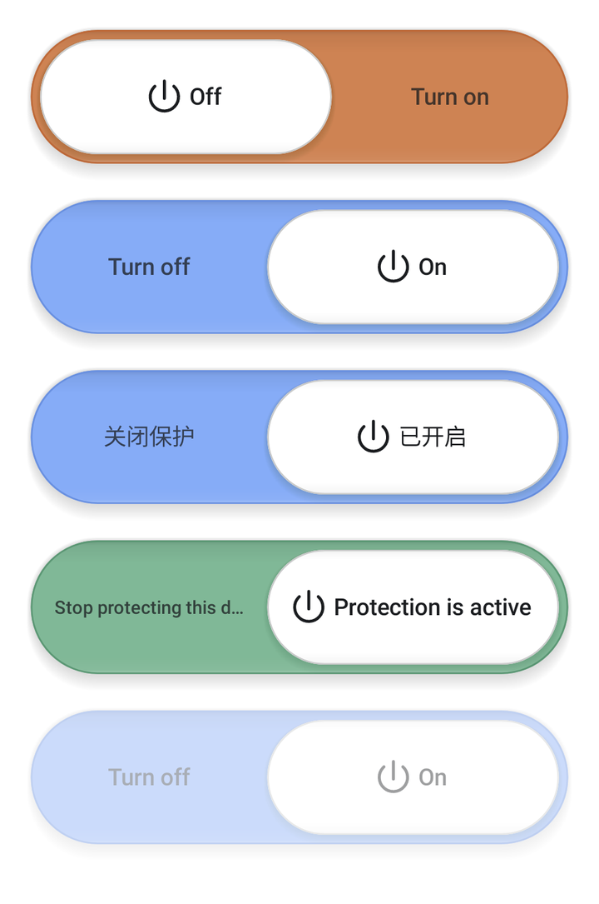 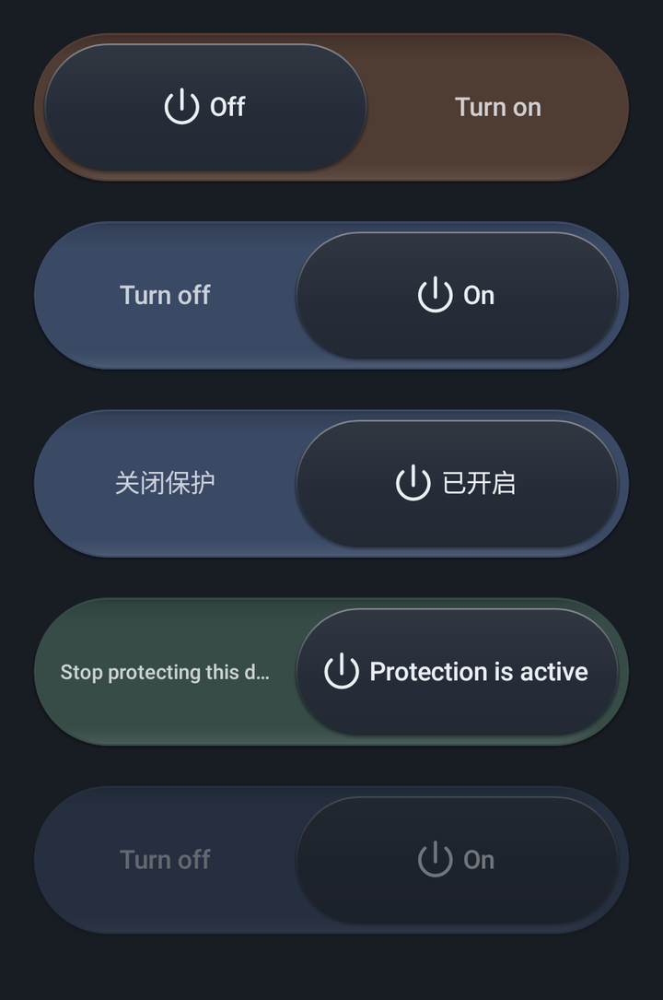

```xml
<io.github.avalonskyafar.mallet.widget.MalletPowerSwitch
    android:layout_width="match_parent"
    android:layout_height="wrap_content"
    app:malletChecked="true"
    app:malletPowerSwitchTurnOffLabel="@string/stop_protection" />
```

| XML attribute | Value | Meaning |
|---|---|---|
| `android:enabled` | boolean | Whether the component can be operated. Disabled, it pales as a whole. |
| `app:malletChecked` | boolean | Whether the switch starts on. |
| `app:malletPowerSwitchOnLabel` | string | State label on the thumb while the switch is on. Default "On". |
| `app:malletPowerSwitchOffLabel` | string | State label on the thumb while the switch is off. Default "Off". |
| `app:malletPowerSwitchTurnOnLabel` | string | Action label on the bed while the switch is off. Default "Turn on". |
| `app:malletPowerSwitchTurnOffLabel` | string | Action label on the bed while the switch is on. Default "Turn off". |
| `app:malletPowerSwitchOnHue` | `bronze` / `ochre` / `cobalt` / `jade` / `mist` | Hue of the bed while the switch is on. Default cobalt. |
| `app:malletPowerSwitchOffHue` | `bronze` / `ochre` / `cobalt` / `jade` / `mist` | Hue of the bed while the switch is off. Default bronze. |

| Member | What it does |
|---|---|
| `fun interface OnCheckedChangeListener` | Called when the user turns the switch on or off. |
| ↳ `fun onCheckedChanged(switch: MalletPowerSwitch, isChecked: Boolean)` | The user turned `switch` on or off; `isChecked` is the new state. |
| `fun setOnCheckedChangeListener(listener: OnCheckedChangeListener?)` | Listener for user-driven changes. |
| `var onLabel: CharSequence` | State label shown on the thumb while the switch is on. |
| `var offLabel: CharSequence` | State label shown on the thumb while the switch is off. |
| `var turnOnLabel: CharSequence` | Action label shown on the bed while the switch is off. |
| `var turnOffLabel: CharSequence` | Action label shown on the bed while the switch is on. |
| `var offHue: MalletHue` | Hue of the bed while the switch is off. |
| `var onHue: MalletHue` | Hue of the bed while the switch is on. |
| `fun setChecked(checked: Boolean, animate: Boolean)` | Turns the switch on or off from code. |

### MalletCheckbox

**New** · `io.github.avalonskyafar.mallet.widget.MalletCheckbox` · Showcase: Components › Checkboxes and radios

A small recessed bed that fills with its hue when it is checked.

Unchecked, the box is a neutral well. Checked, it becomes a coloured bed (cobalt unless
`hue` says otherwise) carrying a check mark. Between the two the hue fades in and the
check is drawn along its path; with reduced motion the box jumps.

An optional label (`text`) sits at the end of the box and wraps when it has to; the box
stays level with the first line. The whole view is the touch target, at least 44 dp tall.

`setOnCheckedChangeListener` is called for user input only (touch, keyboard, accessibility),
never for `setChecked` or `toggle`, so a listener may roll the box back safely.

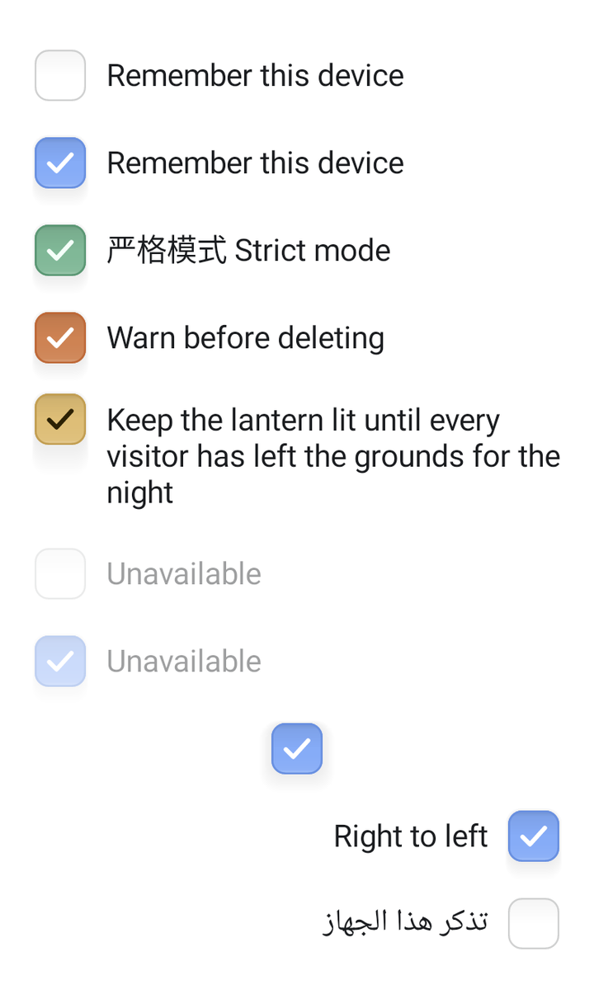 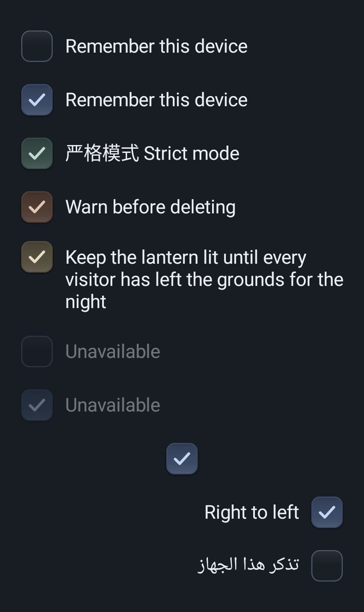

```xml
<io.github.avalonskyafar.mallet.widget.MalletCheckbox
    android:layout_width="wrap_content"
    android:layout_height="wrap_content"
    android:text="@string/remember_me"
    app:malletChecked="true"
    app:malletHue="jade" />
```

| XML attribute | Value | Meaning |
|---|---|---|
| `android:text` | string | Label at the end of the box. |
| `android:enabled` | boolean | Whether the component can be operated. Disabled, it pales as a whole. |
| `app:malletChecked` | boolean | Whether the box starts checked. |
| `app:malletHue` | `bronze` / `ochre` / `cobalt` / `jade` / `mist` | Hue that fills the checked box. Cobalt when absent. |

| Member | What it does |
|---|---|
| `fun interface OnCheckedChangeListener` | Called when the user checks or unchecks the box. |
| ↳ `fun onCheckedChanged(checkbox: MalletCheckbox, isChecked: Boolean)` | The user checked or unchecked `checkbox`; `isChecked` is its new state. |
| `fun setOnCheckedChangeListener(listener: OnCheckedChangeListener?)` | Listener for user-driven changes. |
| `var hue: MalletHue` | The hue that fills the box when it is checked. |
| `var text: CharSequence` | The label at the end of the box, or empty for a box without a label. |
| `fun setChecked(checked: Boolean, animate: Boolean)` | Checks or unchecks the box from code. |

### MalletRadioButton

**New** · `io.github.avalonskyafar.mallet.widget.MalletRadioButton` · Showcase: Components › Checkboxes and radios

One choice out of several: a small round recessed bed that fills with its hue and grows a
neutral bead in its centre when it is checked.

Unchecked the bed is a plain well; checked it is a coloured track (`hue`, cobalt by default)
and the bead scales up from nothing while the hue fades in. An optional label (`text`) sits
to the end of the bed, and the whole view is the touch target.

A checked radio cannot be unchecked by the user; only choosing a sibling does that. Put the
radios of one question into a `MalletRadioGroup`, which keeps a single one checked.

The view is at least 44 dp tall; the bed itself is 26 dp across.

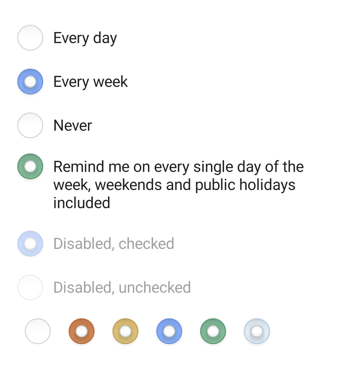 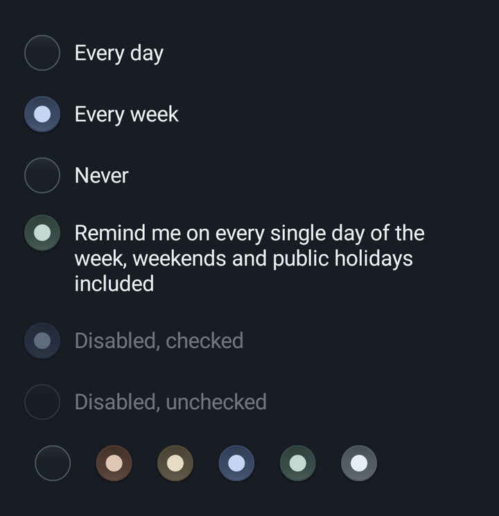

```xml
<io.github.avalonskyafar.mallet.widget.MalletRadioButton
    android:id="@+id/daily"
    android:layout_width="match_parent"
    android:layout_height="wrap_content"
    android:text="@string/every_day"
    app:malletChecked="true" />
```

| XML attribute | Value | Meaning |
|---|---|---|
| `app:malletChecked` | boolean | Whether the radio starts checked. Inside a MalletRadioGroup the last checked child wins. |
| `app:malletHue` | `bronze` / `ochre` / `cobalt` / `jade` / `mist` | Hue that fills the bed when the radio is checked. Cobalt by default. |
| `android:text` | string | Label drawn to the end of the bed. |
| `android:enabled` | boolean | Whether the component can be operated. Disabled, it pales as a whole. |

| Member | What it does |
|---|---|
| `fun interface OnCheckedChangeListener` | Called when the user changes the checked state of a radio. |
| ↳ `fun onCheckedChanged(radio: MalletRadioButton, isChecked: Boolean)` | The user changed `radio`; `isChecked` is its new state. |
| `fun setOnCheckedChangeListener(listener: OnCheckedChangeListener?)` | Listener for user-driven changes: a tap, a key or an accessibility action on this radio, or the user choosing a sibling in the same `MalletRadioGroup` (which reports `false` here). |
| `var hue: MalletHue` | Hue that fills the bed while the radio is checked. |
| `var text: CharSequence?` | Label drawn to the end of the bed, or `null` for a radio without a label. |
| `fun setChecked(checked: Boolean, animate: Boolean)` | Sets the state from code; with `animate` the hue and the bead glide in or out. |
| ↳ `const val BED_DP: Float` | Diameter of the round bed in dp. |
| ↳ `const val BEAD_DP: Float` | Diameter of the neutral bead of a checked radio in dp. |
| ↳ `const val MIN_TARGET_DP: Float` | Smallest height of the view, and width of a radio without a label, in dp. |

### MalletRadioGroup

**New** · `io.github.avalonskyafar.mallet.widget.MalletRadioGroup` · Showcase: Components › Checkboxes and radios

A vertical column of `MalletRadioButton`s that answers one question: checking one radio
unchecks the one that was checked before.

The group starts with whatever its children say (the last checked child wins) or with
`app:malletRadioCheckedButton`. It may start empty; once a radio is checked the user can only
move the choice, never remove it. `clearCheck` removes it from code.

Only direct children take part. Give every radio an `android:id`: `checkedId` reports it and
the saved state is keyed by it. A radio without an id receives a generated one, which does
not survive re-creation of the screen: the group then keeps the choice it was built with.

Pictures: see [MalletRadioButton](#malletradiobutton).

```xml
<io.github.avalonskyafar.mallet.widget.MalletRadioGroup
    android:layout_width="match_parent"
    android:layout_height="wrap_content"
    app:malletRadioCheckedButton="@+id/weekly">

    <io.github.avalonskyafar.mallet.widget.MalletRadioButton
        android:id="@+id/daily"
        android:layout_width="match_parent"
        android:layout_height="wrap_content"
        android:text="@string/every_day" />

    <io.github.avalonskyafar.mallet.widget.MalletRadioButton
        android:id="@+id/weekly"
        android:layout_width="match_parent"
        android:layout_height="wrap_content"
        android:text="@string/every_week" />
</io.github.avalonskyafar.mallet.widget.MalletRadioGroup>
```

| XML attribute | Value | Meaning |
|---|---|---|
| `app:malletRadioCheckedButton` | reference | Id of the child radio that is checked at start. |

| Member | What it does |
|---|---|
| `fun interface OnCheckedChangeListener` | Called when the user moves the choice to another radio of the group. |
| ↳ `fun onCheckedChanged(group: MalletRadioGroup, checkedId: Int)` |  |
| `fun setOnCheckedChangeListener(listener: OnCheckedChangeListener?)` | Listener for user-driven changes of the choice. |
| `val checkedId: Int get()` | Id of the checked radio, or `View.NO_ID` while nothing is chosen. |
| `fun check(id: Int, animate: Boolean = true)` | Moves the choice to the radio with `id` from code; `View.NO_ID` clears it. |
| `fun clearCheck(animate: Boolean = true)` | Leaves no radio checked. |

---

## Numbers and progress

An exact number, an approximate amount, and the two ways of saying that something is going on.

### MalletStepper

**Extended** · `io.github.avalonskyafar.mallet.widget.MalletStepper` · Showcase: Components › Numbers and progress

A precise number control: a recessed coloured track with a minus zone, a plus zone and a
neutral thumb in the centre that carries the value and never moves.

Tapping minus or plus changes the value by one `stepSize`; holding either repeats, slowly at
first and faster after ten steps, until the finger lifts or the range ends. Tapping the value
asks the app to open its own editor through `setOnEditRequestListener`. The value always sits on
the step grid that starts at `valueFrom` and never leaves the range; at a bound the mark that
can no longer do anything pales.

The view is 61 dp tall by default: a 53 dp track plus the gutter its shadow needs. Minus is
always on the left and plus on the right, also in right-to-left layouts, like a number line.

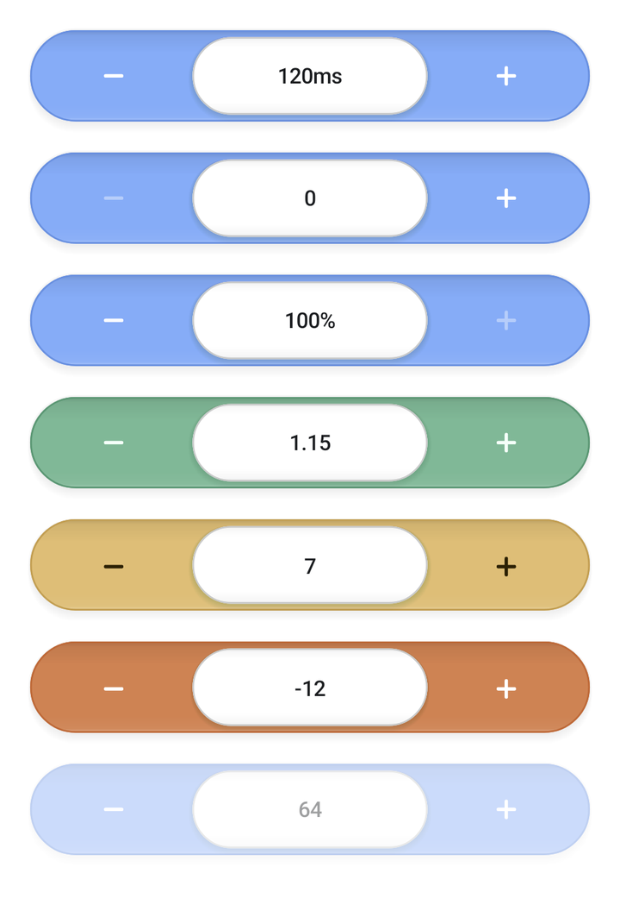 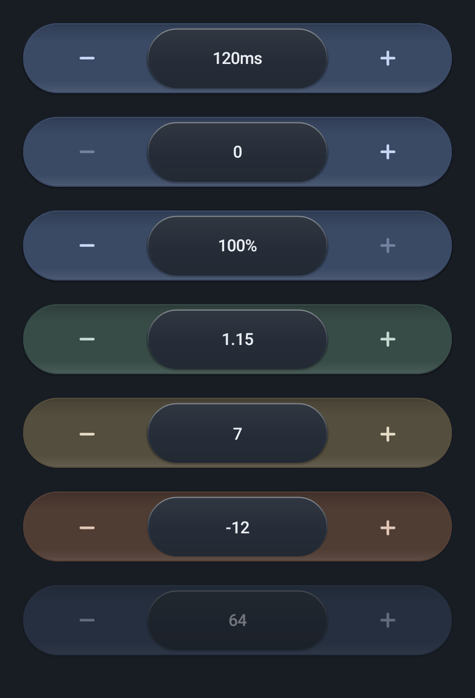

```xml
<io.github.avalonskyafar.mallet.widget.MalletStepper
    android:layout_width="match_parent"
    android:layout_height="wrap_content"
    app:malletValueFrom="0"
    app:malletValueTo="500"
    app:malletStepSize="10"
    app:malletValue="120"
    app:malletStepperUnit="ms" />
```

| XML attribute | Value | Meaning |
|---|---|---|
| `android:enabled` | boolean | Whether the component can be operated. Disabled, it pales as a whole. |
| `app:malletHue` | `bronze` / `ochre` / `cobalt` / `jade` / `mist` | One of the five hues of the theme. |
| `app:malletValueFrom` | float | Lower bound of a numeric control. |
| `app:malletValueTo` | float | Upper bound of a numeric control. |
| `app:malletStepSize` | float | The step a numeric control moves in. |
| `app:malletValue` | float | The value a numeric control starts with. |
| `app:malletStepperDecimals` | integer | Number of digits written after the decimal separator. |
| `app:malletStepperUnit` | string | Suffix written after the value, for example "ms" or "%". |

| Member | What it does |
|---|---|
| `fun interface OnValueChangeListener` | Called when the user changes the value by touch, keyboard or an accessibility action. |
| ↳ `fun onValueChanged(stepper: MalletStepper, value: Float)` |  |
| `fun interface OnEditRequestListener` | Called when the user taps the value (or presses Enter) to type a number directly. |
| ↳ `fun onEditRequest(stepper: MalletStepper)` |  |
| `fun setOnValueChangeListener(listener: OnValueChangeListener?)` | Listener for user-driven value changes. |
| `fun setOnEditRequestListener(listener: OnEditRequestListener?)` | Listener for a tap on the value. |
| `var value: Float` | The current value. |
| `var valueFrom: Float` | Lower bound of the range and origin of the step grid. |
| `var valueTo: Float` | Upper bound of the range. |
| `var stepSize: Float` | Distance between two neighbouring values; must be greater than zero. |
| `var decimals: Int` | Number of digits written after the decimal separator (0 to 6). |
| `var unit: CharSequence?` | Suffix written directly after the number, for example `" ms"` or `"%"`. |
| `var valueFormatter: ((Float) -> CharSequence)?` | Turns a value into the text written on the thumb and read by accessibility services. |
| `var hue: MalletHue` | The hue of the track. |
| `val formattedValue: CharSequence` | The value as it is written on the thumb and announced by accessibility services. |
| `fun setRange(valueFrom: Float, valueTo: Float)` | Sets both bounds at once; `valueTo` must not be below `valueFrom`. |

### MalletSlider

**New** · `io.github.avalonskyafar.mallet.widget.MalletSlider` · Showcase: Components › Numbers and progress

A slim recessed track with a coloured stretch that runs from the start to a neutral bead.

The bead follows the finger anywhere on the track; a tap makes it glide to the touched
place. The hue behind the bead is the value: either one hue (`hue`, cobalt by default)
or a scale set with `setHueScale`, for example bronze, ochre, cobalt, jade: the
stretch then wears the hue nearest to the bead; at the half-way point to the next hue it
switches to that one, over a short fade. The rest of the track stays a neutral groove.

With a `stepSize` above zero the bead snaps to the step grid and every crossed step gives a
detent haptic; with `0` the slider is continuous.

The view is 44 dp tall by default: a 14 dp track, centred, under a 28 dp bead. The track is
inset by half a bead on both sides, so the bead and its shadow never leave the view.

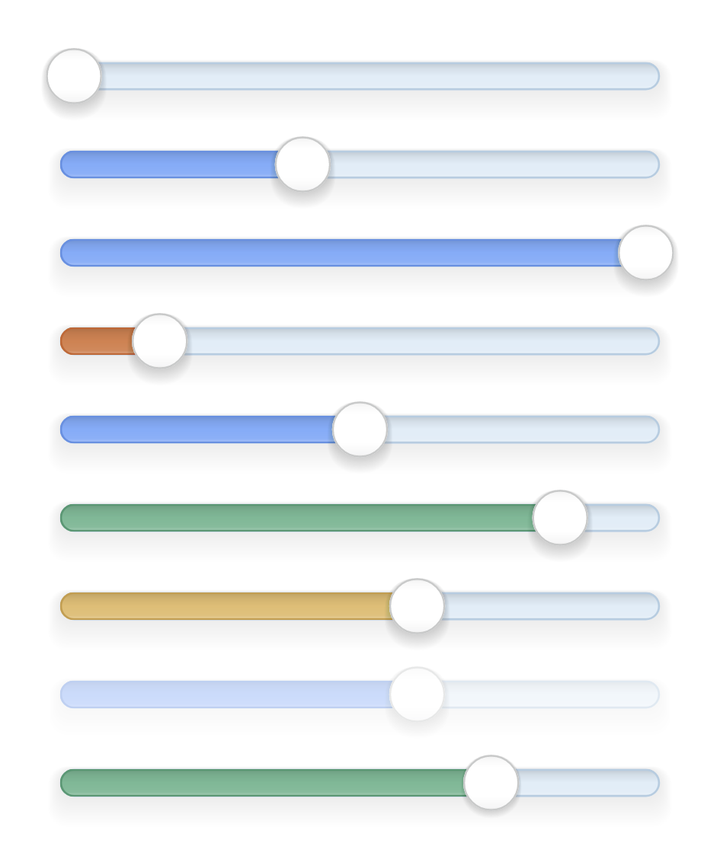 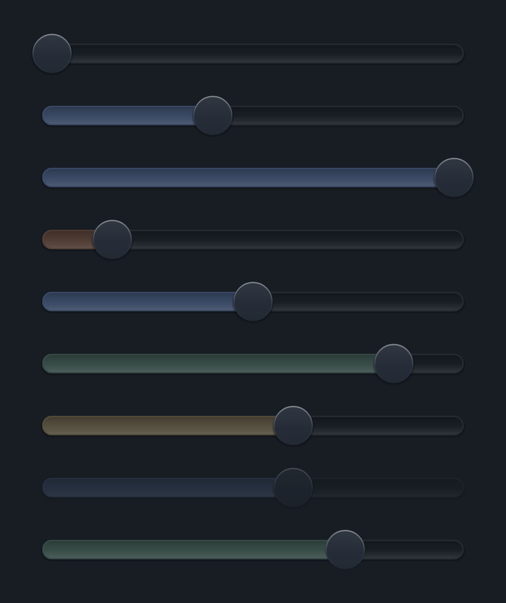

```xml
<io.github.avalonskyafar.mallet.widget.MalletSlider
    android:layout_width="match_parent"
    android:layout_height="wrap_content"
    app:malletValueFrom="0"
    app:malletValueTo="100"
    app:malletStepSize="5"
    app:malletValue="40"
    app:malletHue="cobalt" />
```

| XML attribute | Value | Meaning |
|---|---|---|
| `app:malletValueFrom` | float | Lower bound of a numeric control. |
| `app:malletValueTo` | float | Upper bound of a numeric control. |
| `app:malletStepSize` | float | The step a numeric control moves in. |
| `app:malletValue` | float | The value a numeric control starts with. |
| `app:malletHue` | `bronze` / `ochre` / `cobalt` / `jade` / `mist` | One of the five hues of the theme. |
| `app:malletSliderHueMode` | `single` / `scale` | How the stretch behind the bead is coloured. "single" fills it with the hue named by malletHue. "scale" takes the hue nearest to the bead from bronze, ochre, cobalt and jade, one hue per quarter of the track, and switches at the quarter's half-way point, for values that read as a strength. |
| `android:enabled` | boolean | Whether the component can be operated. Disabled, it pales as a whole. |

| Member | What it does |
|---|---|
| `fun interface OnValueChangeListener` | Called when the user changes the value by touch, keyboard or an accessibility action. |
| ↳ `fun onValueChanged(slider: MalletSlider, value: Float)` | The user moved the bead of `slider`; `value` is the new value, already clamped and snapped. |
| `fun interface OnStopTrackingTouchListener` | Called when a touch that moved the bead ends: after a drag or a tap, once per gesture. |
| ↳ `fun onStopTrackingTouch(slider: MalletSlider)` | The finger has lifted (or the drag was taken away); `MalletSlider.value` is final. |
| `fun setOnValueChangeListener(listener: OnValueChangeListener?)` | Listener for value changes made by the user. |
| `fun setOnStopTrackingTouchListener(listener: OnStopTrackingTouchListener?)` | Listener for the end of a touch gesture, the moment to commit an expensive change. |
| `var valueFormatter: ((Float) -> CharSequence)?` | Turns a value into the text accessibility services read, for example `"40 %"`. |
| `var value: Float` | The current value, always inside `valueFrom`..`valueTo` and on the step grid. |
| `var valueFrom: Float` | Lower bound, at the start of the track. |
| `var valueTo: Float` | Upper bound, at the end of the track. |
| `var stepSize: Float` | Distance between two stops, counted from `valueFrom`; `0` makes the slider continuous, and so does a negative, NaN or infinite step. |
| `var hue: MalletHue` | The hue of the stretch behind the bead. |
| `fun setValue(value: Float, animate: Boolean)` | Sets the value from code, optionally gliding the bead there. |
| `fun setHueScale(hues: List<MalletHue>?)` | Colours the stretch with a scale of hues instead of one hue. |

### MalletProgressBar

**New** · `io.github.avalonskyafar.mallet.widget.MalletProgressBar` · Showcase: Components › Numbers and progress

A slim recessed groove that fills with its hue as work completes.

The groove is the neutral, plain recess; the fill grows from the start edge (the
right edge in right-to-left layouts) and takes the colour of `hue`. `setProgress` glides
to the new amount. When the amount of work is unknown set `isIndeterminate`: a coloured
segment then travels through the groove and re-enters at the start. With reduced motion the
indeterminate bar shows a still, pale, full-width fill instead of moving.

The view is 22 dp tall by default: a 10 dp groove plus the gutter its shadow needs. It is
an indicator, so it takes neither focus nor touches. Animations run only while the view is
attached and visible.

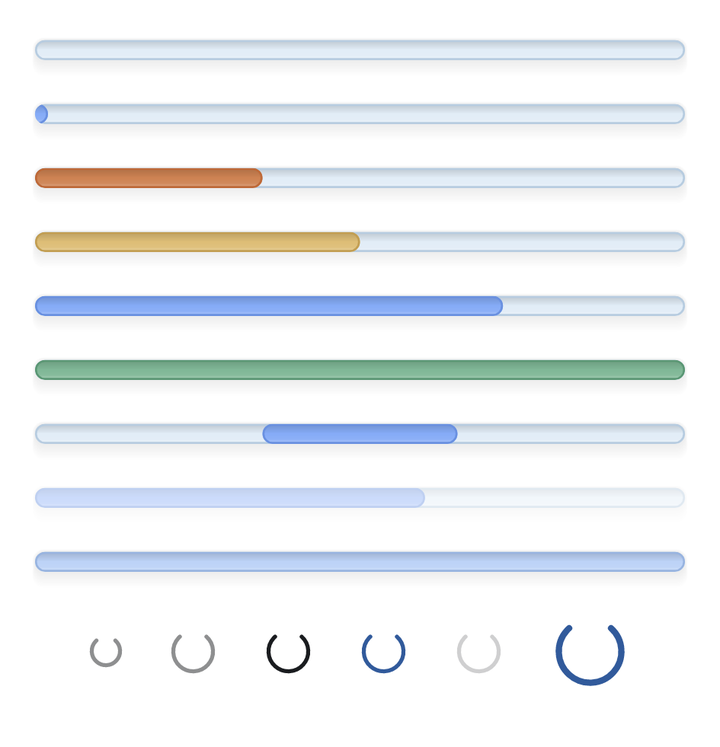 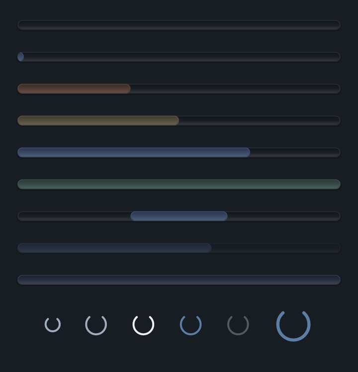

```xml
<io.github.avalonskyafar.mallet.widget.MalletProgressBar
    android:layout_width="match_parent"
    android:layout_height="wrap_content"
    app:malletHue="jade"
    app:malletProgressValue="0.4" />
```

| XML attribute | Value | Meaning |
|---|---|---|
| `app:malletHue` | `bronze` / `ochre` / `cobalt` / `jade` / `mist` | The hue of the fill. Default cobalt. |
| `app:malletProgressValue` | float | Initial progress, from 0 to 1. |
| `app:malletProgressIndeterminate` | boolean | True when the amount of work is unknown: a coloured segment travels through the groove. |
| `android:enabled` | boolean | Whether the component can be operated. Disabled, it pales as a whole. |

| Member | What it does |
|---|---|
| `var hue: MalletHue` | The hue of the fill. |
| `var progress: Float` | The completed share of the work, from 0 to 1. |
| `var isIndeterminate: Boolean` | True when the amount of work is unknown. |
| `fun setProgress(@FloatRange(from` | Sets the completed share to `value` (clamped to 0..1). |

### MalletSpinner

**New** · `io.github.avalonskyafar.mallet.widget.MalletSpinner` · Showcase: Components › Numbers and progress

An open ring that turns while something is going on and its amount is unknown.

The ring is the same 276 degree arc as the power icon and the loading state of
`MalletButton`, drawn with a 2 dp round-capped stroke and turning once every 900 ms at a
constant speed. With reduced motion it turns at half speed rather than standing still,
because a spinner that does not move reads as a stalled app.

The view is 28 dp square by default and the ring scales with it. It turns only while it is
attached and visible, takes neither focus nor touches, and announces itself as "Loading"
unless a content description is set.

Pictures: see [MalletProgressBar](#malletprogressbar).

```xml
<io.github.avalonskyafar.mallet.widget.MalletSpinner
    android:layout_width="wrap_content"
    android:layout_height="wrap_content"
    app:malletTone="accent" />
```

| XML attribute | Value | Meaning |
|---|---|---|
| `app:malletTone` | `ink` / `muted` / `accent` / `danger` / `warning` / `success` | The tone of the ring. Default muted. |
| `app:malletProgressSpinnerColor` | color | An explicit ring colour; wins over malletTone. |
| `android:enabled` | boolean | Whether the component can be operated. Disabled, it pales as a whole. |

| Member | What it does |
|---|---|
| `var tone: MalletTextTone` | The tone of the ring. |
| `var color: Int` | The colour of the ring. |
| `val isSpinning: Boolean get()` | True while the ring is actually turning: attached, visible and shown. |

---

## Text input

One component: a label, a recessed well and a support line.

### MalletTextField

**Extended** · `io.github.avalonskyafar.mallet.widget.MalletTextField` · Showcase: Components › Text fields

A text field: an optional label, a recessed well that holds the text, and an optional
support line with a helper or an error and a character counter.

The well is the only material. Its rim tells the state: a soft hairline at rest, solid ink
while the field has focus (in touch mode too, since it shows where typing goes) and the
danger colour while there is an `error`. The support line grows and shrinks instead of
popping. Everything that is not covered by a property is reachable through `editText`.

Several fields on one screen each restore their own text, error and password visibility,
and the one that was being typed in takes focus again, provided each field has an id.

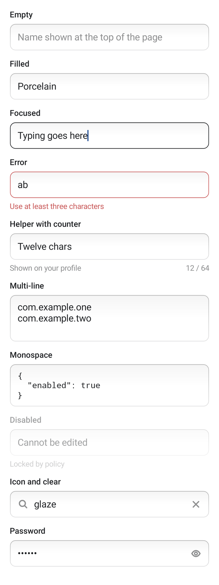 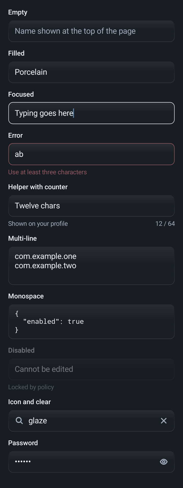

```xml
<io.github.avalonskyafar.mallet.widget.MalletTextField
    android:id="@+id/account"
    android:layout_width="match_parent"
    android:layout_height="wrap_content"
    android:hint="Name shown at the top of the page"
    android:maxLength="64"
    app:malletFieldLabel="Account name"
    app:malletFieldCounter="64"
    app:malletFieldEndAction="clear" />
```

| XML attribute | Value | Meaning |
|---|---|---|
| `android:enabled` | boolean | Whether the component can be operated. Disabled, it pales as a whole. |
| `android:text` | string | The text. |
| `android:hint` | string | The hint shown while the field is empty. |
| `android:inputType` | input type | The kind of text the keyboard is set up for. |
| `android:maxLength` | integer | Hard limit of characters. |
| `android:minLines` | integer | Lines the field is at least high for. |
| `android:maxLines` | integer | Lines after which the text scrolls. |
| `app:malletIcon` | one of 50 names, or `none` (see below) | An icon of the built-in set. Values follow the order of the MalletIcon enum. |
| `app:malletFieldLabel` | string | Label written above the well. |
| `app:malletFieldHelper` | string | Helper text written below the well. |
| `app:malletFieldError` | string | Error written below the well in place of the helper; also colours the rim. |
| `app:malletFieldCounter` | integer | Maximum length shown by the character counter; 0 hides the counter. |
| `app:malletFieldMultiline` | boolean | Several lines instead of one. |
| `app:malletFieldEndAction` | `none` / `clear` / `passwordToggle` | Action drawn inside the well at the end. |
| `app:malletFieldMonospace` | boolean | Monospace type, for code and configuration editors. |

| Member | What it does |
|---|---|
| `enum class EndAction` | What sits inside the well at its end. |
| `fun interface OnTextChangeListener` | Hears about text the user typed, pasted or cleared. |
| ↳ `fun onTextChanged(field: MalletTextField, text: CharSequence)` | Called after `text` of `field` changed through user input. |
| `val editText: EditText` | The `EditText` inside the well, for everything this class has no property for: IME options, filters, selection. |
| `fun setOnTextChangeListener(listener: OnTextChangeListener?)` | Called after the user changed the text. |
| `var text: CharSequence` | The text in the field. |
| `var hint: CharSequence?` | The hint shown in the muted colour while the field is empty. |
| `var label: CharSequence?` | The label above the well, or null for none. |
| `var helperText: CharSequence?` | Helper text below the well in the muted colour. |
| `var error: CharSequence?` | The error below the well, or null for none. |
| `var counterMaxLength: Int` | The length the counter (`12 / 64`) counts towards; 0 hides the counter. |
| `var leadingIcon: MalletIcon?` | The icon inside the well at the start, or null for none. |
| `var endAction: EndAction` | The action inside the well at the end. |
| `var isPasswordVisible: Boolean` | Whether a password is shown as typed. |
| `var isMultiline: Boolean` | Several lines instead of one: the text starts at the top and the well grows with it. |
| `var minLines: Int` | Lines the well is at least high for while `isMultiline`. |
| `var maxLines: Int` | Lines after which the text scrolls inside the well while `isMultiline`. |
| `var inputType: Int` | The `android.text.InputType` of the field. |
| `var isMonospace: Boolean` | Monospace type at a smaller size, for code and configuration editors. |
| `fun validate(rule: (CharSequence) -> CharSequence?): Boolean` | Checks the text with `rule`, which returns the error to show or null when the text is fine. |

---

## Rows and pages

A page is a scrolling column of headings and cards; a card is a column of rows.

### MalletPage

**Extracted** · `io.github.avalonskyafar.mallet.widget.MalletPage` · Showcase: Components › Built from XML

A vertically scrolling page: the canvas every Mallet screen stands on.

The page is a `ScrollView` that holds one vertical column, `content`. Views declared inside
the page in XML, or added with `addView`, go into that column, so a page is used like a
vertical `LinearLayout` that happens to scroll:

What the page takes care of:

- **Rhythm.** The padding is `MalletSpacing.PAGE_SIDE`, `MalletSpacing.PAGE_TOP` and
  `MalletSpacing.PAGE_BOTTOM`; `addTitle`, `addSection`, `addButton` and `addSpace` place
  the usual elements with the usual gaps. Padding given in XML replaces the default.
- **Edge to edge.** While `fitSystemBars` is on, the page reaches behind the system bars:
  the system-bar and display-cutout insets are added to its padding, and the keyboard
  inset to the bottom. A page asks for the insets whenever it is attached, so it is also
  right when it joins a screen late.
- **Clear bars.** Content that scrolls is not drawn under the status bar, nor under a
  navigation bar with buttons: text sliding beneath a clock cannot be read and makes the
  clock hard to read. It softens over a few dp and ends at the bar. Under the handle of
  gesture navigation, which covers almost nothing, content shows through.
- **Width.** The column grows no wider than `maxContentWidthDp` (560 dp) and stands in the
  middle of a wider page, so that on a tablet, or on a phone lying on its side, a title and
  its control do not drift to opposite ends of the screen.
- **Stillness.** There are no scroll bars, and the over-scroll effect only exists while the
  content is taller than the page: a short page does not move at all. A page opens at its
  top: it does not scroll to a text field, or raise the keyboard, unless the field is
  tapped or asked for.
- **State.** The scroll position is saved and restored. As for any view, this needs an id.

The column accepts the layout attributes a page needs: width, height, margins,
`layout_gravity` and `layout_weight`.

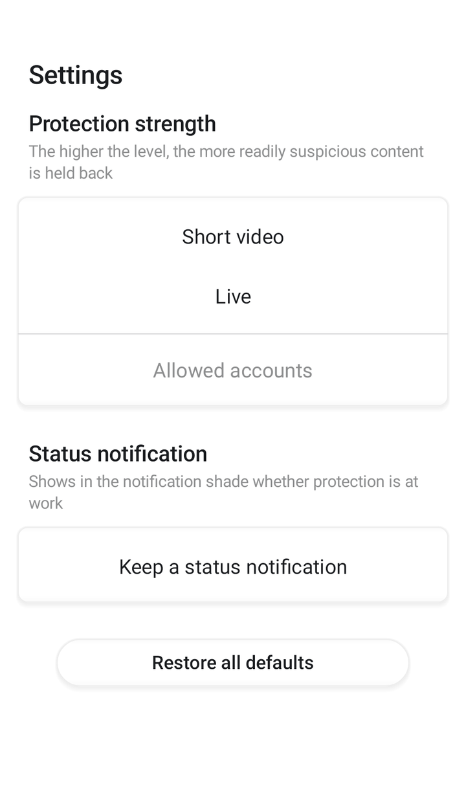 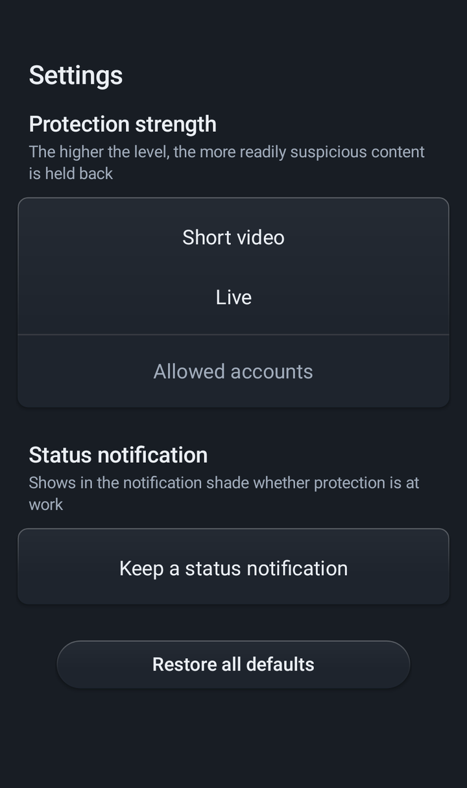

```xml
<io.github.avalonskyafar.mallet.widget.MalletPage
    android:id="@+id/page"
    android:layout_width="match_parent"
    android:layout_height="match_parent">
    <!-- headings, MalletSurface cards, buttons -->
</io.github.avalonskyafar.mallet.widget.MalletPage>
```

| XML attribute | Value | Meaning |
|---|---|---|
| `app:malletPageFitSystemBars` | boolean | Whether the page adds the system-bar, display-cutout and keyboard insets to its padding (default true). Switch it off inside a host that already handles insets. |
| `app:malletPageMaxContentWidth` | dimension | The widest the column of the page gets (default 560dp); on a wider page it is centred. 0dp lets the column fill the page. |

| Member | What it does |
|---|---|
| `val content: LinearLayout` | The vertical column that holds the children of the page. |
| `var fitSystemBars: Boolean` | Whether the page adds the system-bar and display-cutout insets to its padding, and the keyboard inset to the bottom. |
| `var maxContentWidthDp: Float` | The widest the column of the page gets, in dp. |
| `fun setPagePadding(startDp: Float, topDp: Float, endDp: Float, bottomDp: Float)` | Replaces the padding of the page, in dp. |
| `fun addTitle(text: CharSequence?): MalletText` | Adds the title of the page: 20 sp, start aligned, inset like a heading and followed by `MalletSpacing.TITLE_GAP`. |
| `fun <T : View> addSection(title: CharSequence?, detail: CharSequence?, card: T): T` | Adds a section: a `MalletHeading` (`title` over an optional muted `detail` line), then `MalletSpacing.HEADING_GAP`, then `card` across the full column, then `MalletSpacing.SECTION_GAP`. |
| `fun <T : View> addButton(button: T): T` | Adds a full-width button that stands on the page rather than in a card: side margins of `MalletSpacing.BUTTON_SIDE` and `MalletSpacing.SECTION_GAP` below. |
| `fun addSpace(dp: Float): View` | Adds `dp` of empty vertical space; accessibility services skip it. |
| ↳ `const val DEFAULT_MAX_CONTENT_WIDTH_DP: Float` | The widest the column of a page gets unless `maxContentWidthDp` says otherwise, in dp. |
| ↳ `const val BAR_FADE_DP: Float` | The distance over which scrolling content fades out before a system bar, in dp. |

### MalletHeading

**Extracted** · `io.github.avalonskyafar.mallet.widget.MalletHeading` · Showcase: Components › Rows and lists

The heading above a card or at the top of a page: a title in ink and, optionally, one quiet
line of detail below it.

Unlike the rows of a card, a heading is start aligned: it labels what follows instead of
being operated. It is inset by 10 dp on both sides so that its text lines up with the content
of the card below rather than with the card's rim. The detail line disappears, together with
its 4 dp gap, while `detail` is empty or blank; a detail without a title has no gap above it.

The title is announced as a heading by accessibility services, so a page can be navigated
heading by heading. The view itself is not focusable and has no state to save.

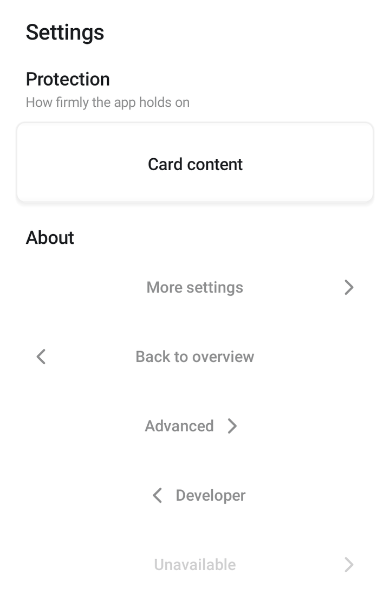 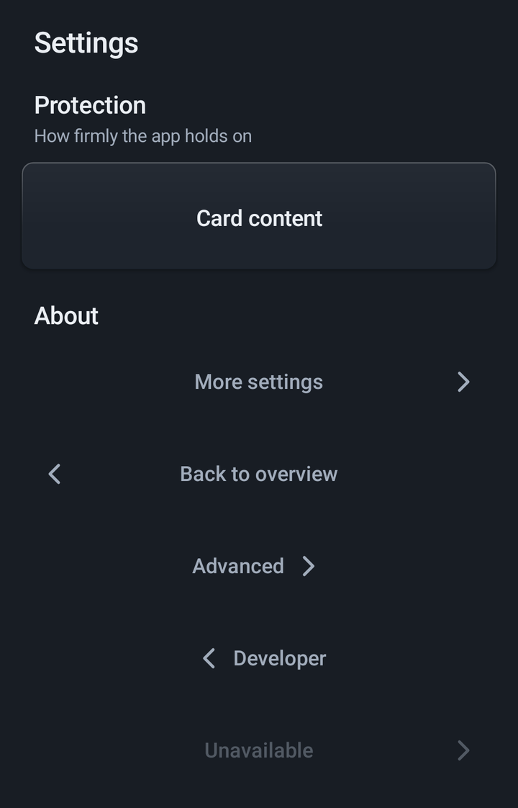

```xml
<io.github.avalonskyafar.mallet.widget.MalletHeading
    android:layout_width="match_parent"
    android:layout_height="wrap_content"
    app:malletTitle="Protection"
    app:malletDetail="How firmly the app holds on"
    app:malletHeadingLevel="section" />
```

| XML attribute | Value | Meaning |
|---|---|---|
| `app:malletTitle` | string | Main line of a row, heading or state view. |
| `app:malletDetail` | string | Supporting line under the title. |
| `app:malletHeadingLevel` | `section` / `page` | Weight of the title: heading of a section (17 sp, default) or title of a page (20 sp). |

| Member | What it does |
|---|---|
| `enum class Level` | How much weight the title carries. |
| `var title: CharSequence?` | The heading itself; `null` or empty hides the title line. |
| `var detail: CharSequence?` | Supporting line under the title; `null`, empty or blank hides the line. |
| `var level: Level` | `Level.SECTION` (default) for card headings, `Level.PAGE` for the title of a page. |

### MalletEntryRow

**Extended** · `io.github.avalonskyafar.mallet.widget.MalletEntryRow` · Showcase: Components › Rows and lists

A row of a card that leads somewhere: a sub-page, a picker, a dialog.

The title, and the optional detail line under it, are centred in the row. Everything else
is positioned on its own at an edge and never takes width from one side only, so the text
stays on the centre line of the row whatever surrounds it. (Only when the edges are so
crowded that a one-line text would no longer fit in less than half the row does the text
give up the centre line and use all the room between them.)

- `arrow`: a chevron at the end (muted, "this opens something") or at the start (ink, "the
  destination lies on that side").
- `leadingIcon`: an icon at the start.
- `value`: a short muted value at the end, before the end chevron, for example the current
  choice of the sub-page behind the row.

With `Alignment.START` the text is aligned to the start instead, for long, list-like
content.

Pressing sinks the text, icon and chevron by 1.5 dp; the row itself, and the card behind
it, stay still and nothing changes colour. Keyboard focus draws an ink rim inside the row.
A disabled row pales. The row is 62 dp high, 76 dp with a detail line, and grows with
large text. In right-to-left layouts start and end swap and the chevrons turn around.

The row is announced as one element, "title, value, detail", unless a content description
is set explicitly. It keeps no state of its own, so there is nothing to save or restore.

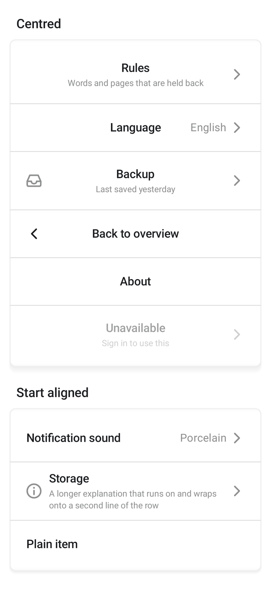 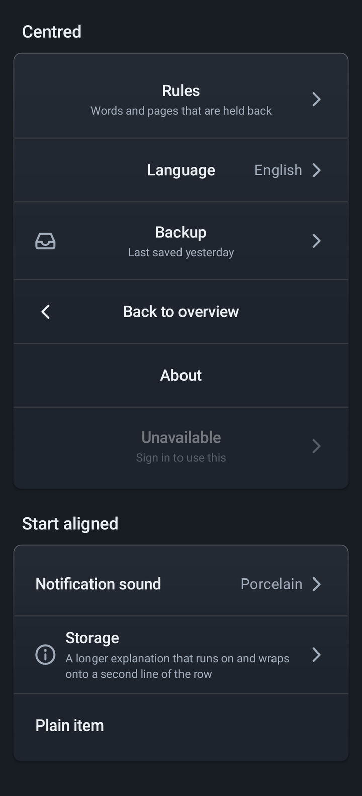

```xml
<io.github.avalonskyafar.mallet.widget.MalletEntryRow
    android:layout_width="match_parent"
    android:layout_height="wrap_content"
    app:malletTitle="Language"
    app:malletDetail="Used for menus and messages"
    app:malletEntryValue="English"
    app:malletEntryArrow="end" />
```

| XML attribute | Value | Meaning |
|---|---|---|
| `android:enabled` | boolean | Whether the component can be operated. Disabled, it pales as a whole. |
| `app:malletTitle` | string | Main line of a row, heading or state view. |
| `app:malletDetail` | string | Supporting line under the title. |
| `app:malletIcon` | one of 50 names, or `none` (see below) | Icon at the start of the row. |
| `app:malletEntryArrow` | `none` / `end` / `start` | Chevron at the edge of the row. |
| `app:malletEntryAlignment` | `center` / `start` | Whether the text is centred in the row or aligned to its start. |
| `app:malletEntryValue` | string | Short value shown at the end of the row, before the end chevron. |

| Member | What it does |
|---|---|
| `enum class Arrow { NONE, END, START }` | Where the chevron of the row sits. |
| `enum class Alignment { CENTER, START }` | How the title and the detail are aligned in the row. |
| `var title: CharSequence?` | Main line of the row. |
| `var detail: CharSequence?` | Supporting line under the title; `null` or blank removes it and lowers the row. |
| `var value: CharSequence?` | Short value at the end of the row, before the end chevron; `null` or blank removes it. |
| `var arrow: Arrow` | Chevron of the row. |
| `var alignment: Alignment` | Whether the text is centred in the row (the default) or aligned to its start. |
| `var leadingIcon: MalletIcon?` | Muted icon at the start of the row, or `null`. |
| ↳ `const val MIN_HEIGHT_DP: Float` | Height of a row without a detail line, in dp. |
| ↳ `const val MIN_HEIGHT_DETAIL_DP: Float` | Height of a row with a detail line, in dp. |

### MalletControlRow

**Extracted** · `io.github.avalonskyafar.mallet.widget.MalletControlRow` · Showcase: Components › Rows and lists

A settings row: a centred title (and optional detail) beside a control.

The row shares its width between the text column and the control by weight. For the common
case, a `MalletSegmentedTrack`, `setSegmented` picks the proportions from the option count:
two options 2 : 1, three options 1 : 3, four or more 1 : 4. `Layout.UTILITY` is 1 : 1.35
whatever the count. Any other view (a switch, a stepper, a slider) goes in through
`setControl`, or as the single child in XML.

The text is centred in its column, which suits a short label beside a wide track. For a
list of switches or steppers set `alignment` to `Alignment.START`: the text then stands at
the start edge, in line with the text of start-aligned entry rows.

The row is 64 dp high, or 72 dp with a detail line, and grows with large text. It is not
focusable itself: focus and keys go to the control. The control is announced with the title
and detail of the row, unless it brings a content description or text of its own (a button,
any text view, a labelled checkbox, radio button or chip): such a control names itself and
the text of the row is read as an element of its own. Disabling the row disables the control
and pales the text.

A track created by the row has no id; the row saves and restores its selection, provided the
row has an id.

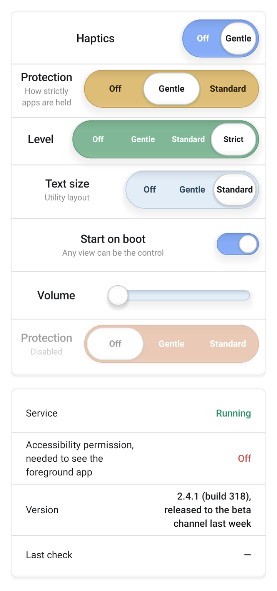 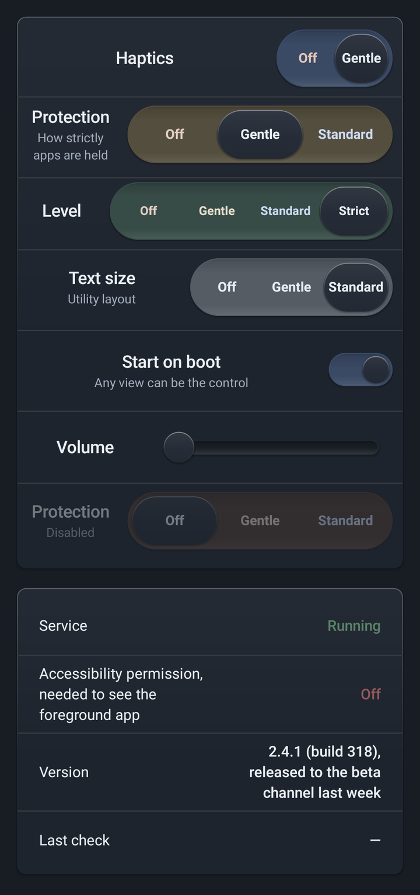

```xml
<io.github.avalonskyafar.mallet.widget.MalletControlRow
    android:id="@+id/strength"
    android:layout_width="match_parent"
    android:layout_height="wrap_content"
    app:malletTitle="Protection"
    app:malletDetail="How strictly apps are held"
    app:malletOptions="@array/strength_levels"
    app:malletSelectedIndex="1" />

<io.github.avalonskyafar.mallet.widget.MalletControlRow
    android:layout_width="match_parent"
    android:layout_height="wrap_content"
    app:malletTitle="Haptics">
    <io.github.avalonskyafar.mallet.widget.MalletSwitch
        android:layout_width="wrap_content"
        android:layout_height="wrap_content" />
</io.github.avalonskyafar.mallet.widget.MalletControlRow>
```

| XML attribute | Value | Meaning |
|---|---|---|
| `app:malletTitle` | string | Main line of a row, heading or state view. |
| `app:malletDetail` | string | Supporting line under the title. |
| `app:malletOptions` | reference | Options of the segmented track the row creates for itself. |
| `app:malletSelectedIndex` | integer | Index of the option selected at start. |
| `app:malletControlRowLayout` | `auto` / `utility` | How the width is shared between the text and a segmented track. "auto" follows the option count (two options 2 : 1, three 1 : 3, four or more 1 : 4); "utility" is always 1 : 1.35. |
| `app:malletControlRowAlignment` | `center` / `start` | Whether the title and the detail are centred in the text column or aligned to its start. |
| `app:malletControlRowTextWeight` | float | Weight of the text column next to a control declared as the XML child. |
| `app:malletControlRowControlWeight` | float | Weight of a control declared as the XML child. 0 (the default) keeps the control at its own width and gives the rest to the text. |
| `android:enabled` | boolean | Whether the component can be operated. Disabled, it pales as a whole. |

| Member | What it does |
|---|---|
| `enum class Layout` | How the width is shared between the text and a segmented track. |
| `enum class Alignment` | How the title and the detail stand in the text column. |
| `var title: CharSequence?` | The main line. |
| `var detail: CharSequence?` | The supporting line under the title. |
| `var layout: Layout` | The proportions used by `setSegmented`. |
| `var alignment: Alignment` | Whether the text is centred in its column (the default) or aligned to the start. |
| `var control: View?` | The control of the row, or `null` while there is none. |
| `val track: MalletSegmentedTrack? get()` | The control as a segmented track: the one made by `setSegmented`, or one that was put in. |
| `var textWeight: Float` | Weight of the text column. |
| `var controlWeight: Float` | Weight of the control; 0 when the control keeps its own width. |
| `fun setSegmented(options: List<CharSequence>, selected: Int, listener: MalletSegmentedTrack.OnSelectionChangeListener?): MalletSegmentedTrack` | Puts a segmented track into the row and returns it. |
| `fun setControl(view: View?, textWeight: Float = 1f, controlWeight: Float = 0f)` | Puts any view into the row as its control, replacing the previous one; `null` leaves the text alone. |
| ↳ `const val MIN_HEIGHT_DP: Float` | Height of a row without a detail line, in dp. |
| ↳ `const val MIN_HEIGHT_DETAIL_DP: Float` | Height of a row with a detail line, in dp. |
| ↳ `const val UTILITY_CONTROL_WEIGHT: Float` | Control weight of `Layout.UTILITY`, against a text weight of 1. |

### MalletLinkRow

**Extracted** · `io.github.avalonskyafar.mallet.widget.MalletLinkRow` · Showcase: Components › Rows and lists

A quiet link to another page, usually placed below the last card of a screen: a muted,
centred label and a chevron that says on which side the destination lies.

With `ArrowPlacement.EDGE` the label is centred in the row and the chevron sits at the edge
on its own: it never takes width from the label or shifts it. With
`ArrowPlacement.ADJACENT` the chevron follows the label closely and the pair is centred as
a group, which reads as a compact "go deeper" link.

The row has no body of its own. Pressing sinks the label and the chevron by 1.5 dp and
nothing changes colour; keyboard focus is shown as a rim inside the row. Set the action with
`setOnClickListener`; the row ticks first and then calls the listener. Start and end follow the
layout direction, so in a right-to-left layout an `ArrowDirection.END` chevron sits on, and
points to, the left. A label that does not fit on one line is ellipsized.

Pictures: see [MalletHeading](#malletheading).

```xml
<io.github.avalonskyafar.mallet.widget.MalletLinkRow
    android:layout_width="match_parent"
    android:layout_height="wrap_content"
    app:malletTitle="More settings"
    app:malletLinkRowArrowPlacement="edge"
    app:malletLinkRowArrowDirection="end"
    app:malletTone="muted" />
```

| XML attribute | Value | Meaning |
|---|---|---|
| `android:enabled` | boolean | Whether the component can be operated. Disabled, it pales as a whole. |
| `app:malletTitle` | string | The label of the link. |
| `app:malletTone` | `ink` / `muted` / `accent` / `danger` / `warning` / `success` | Colour role of the label and the chevron. Default: muted. |
| `app:malletLinkRowArrowPlacement` | `edge` / `adjacent` | Where the chevron sits: at the edge of the row, independent of the centred label (default), or right next to the label with the pair centred as a group. |
| `app:malletLinkRowArrowDirection` | `start` / `end` | The side the destination lies on, and so the side and direction of the chevron. Default: end. |

| Member | What it does |
|---|---|
| `enum class ArrowPlacement` | Where the chevron sits relative to the label. |
| `enum class ArrowDirection` | The side the destination lies on. |
| `var label: CharSequence?` | The text of the link. |
| `var arrowPlacement: ArrowPlacement` | `ArrowPlacement.EDGE` (default) or `ArrowPlacement.ADJACENT`. |
| `var arrowDirection: ArrowDirection` | The side of the destination; `ArrowDirection.END` by default. |
| `var tone: MalletTextTone` | Colour role of the label and the chevron; muted by default, because the link is quiet. |

### MalletKeyValueList

**Extracted** · `io.github.avalonskyafar.mallet.widget.MalletKeyValueList` · Showcase: Components › Rows and lists

A read-only card of facts: keys down the start side, their values down the end side, a
divider from rim to rim between the rows.

The key column and the value column keep the same widths in every row (1.22 : 1), so values
line up however long the texts are; long texts wrap inside their column. A value can carry a
tone: ink by default, `MalletTextTone.SUCCESS` and `MalletTextTone.DANGER` for good and bad
states. A `null` value is shown as an em dash.

Rows cannot be clicked or focused with the keyboard and show no press feedback. For a
screen reader each row is one element, "key, value".

Pictures: see [MalletControlRow](#malletcontrolrow).

```xml
<io.github.avalonskyafar.mallet.widget.MalletKeyValueList
    android:id="@+id/diagnostics"
    android:layout_width="match_parent"
    android:layout_height="wrap_content" />
```

```kotlin
diagnostics.addItem("Service", "Running", MalletTextTone.SUCCESS)
diagnostics.addItem("Last check", null)
```

| Member | What it does |
|---|---|
| `data class Item @JvmOverloads constructor(val key: CharSequence, val value: CharSequence?, val tone: MalletTextTone = MalletTextTone.INK)` | One fact: a `key`, its `value` (`null` shows an em dash) and the `tone` of the value. |
| `val items: List<Item> get()` | The facts shown, in order. |
| `fun setItems(items: List<Item>)` | Replaces all rows. |
| `fun addItem(key: CharSequence, value: CharSequence?, tone: MalletTextTone = MalletTextTone.INK)` | Appends one row, with a divider above it when it is not the first. |
| `fun clearItems()` | Removes all rows. |
| ↳ `const val KEY_WEIGHT: Float` | Weight of the key column. |
| ↳ `const val VALUE_WEIGHT: Float` | Weight of the value column. |

---

## Reading

Long-form content: explanations, notes, steps and pictures.

### MalletParagraph

**Extracted** · `io.github.avalonskyafar.mallet.widget.MalletParagraph` · Showcase: Components › Reading

Long-form copy: explanations, tutorials, anything that is read rather than scanned.

A paragraph is a `MalletText` in the body role that is aligned to the start and the top
and fills every line before it wraps: the simple break strategy and no hyphenation, so
earlier lines are never shortened to balance the last one.

With `protectClosingPunctuation` a word joiner (U+2060) is put in front of every CJK
closing punctuation mark when the text is set, which keeps the mark on the line of the
character it closes. `getText` therefore returns the processed text; the text as it was
given stays available as `rawText`.

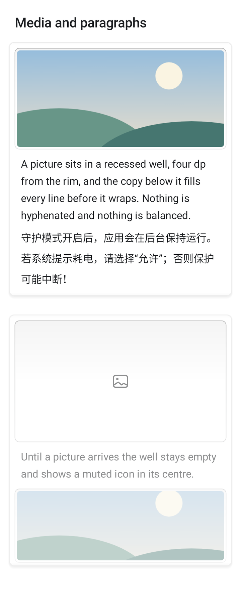 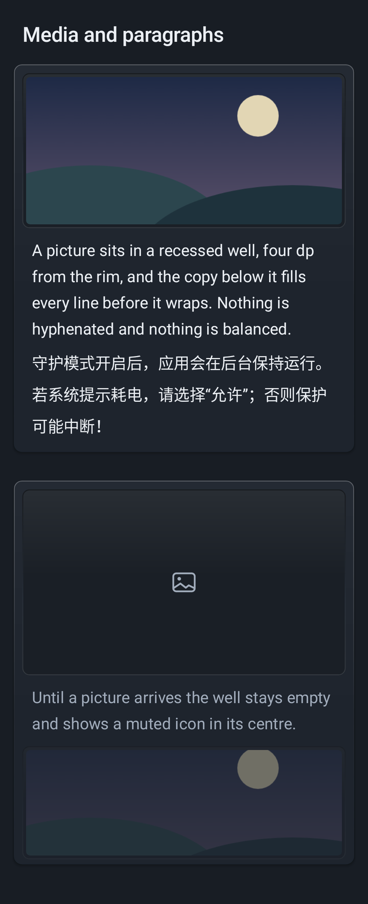

```xml
<io.github.avalonskyafar.mallet.widget.MalletParagraph
    android:layout_width="match_parent"
    android:layout_height="wrap_content"
    android:text="@string/tutorial_intro" />
```

| XML attribute | Value | Meaning |
|---|---|---|
| `app:malletParagraphProtectClosingPunctuation` | boolean | Whether CJK closing punctuation is tied to the character before it, so that it never starts a line. Defaults to true. |

| Member | What it does |
|---|---|
| `var rawText: CharSequence?` | The text as it was handed to `setText`, without the inserted word joiners. |
| `var protectClosingPunctuation: Boolean` | Whether CJK closing punctuation (`，。！？；：、）】》”’`) is tied to the character before it so that it never starts a line. |
| ↳ `const val CLOSING_PUNCTUATION: String` | The CJK closing punctuation marks that must not start a line. |
| ↳ `const val WORD_JOINER: Char` | The invisible character that forbids a line break on both of its sides. |
| ↳ `fun protect(text: CharSequence?): CharSequence?` | Returns `text` with a `WORD_JOINER` in front of every mark of `CLOSING_PUNCTUATION` that is not the first character and is not already protected. |

### MalletCallout

**Extracted** · `io.github.avalonskyafar.mallet.widget.MalletCallout` · Showcase: Components › Reading

A note beside running text: a thin bar in the tone colour at the start, then a title in the
same colour over a body in ink. It has no card and no background, so it reads as part of the
page rather than as a control.

The bar always spans the full height of the view, padding included, and sits at the start
edge (the right edge in right-to-left layouts). A missing title or body takes no room.
Extra views added in XML or with `addView` stack below the body, beside the bar.
A screen reader reads the callout as one element.

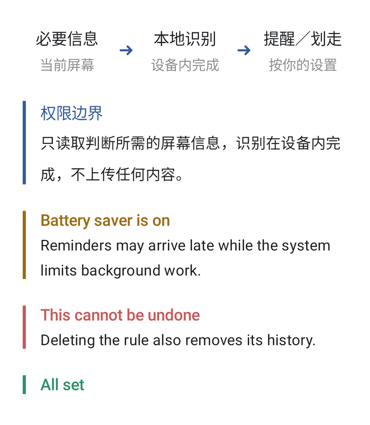 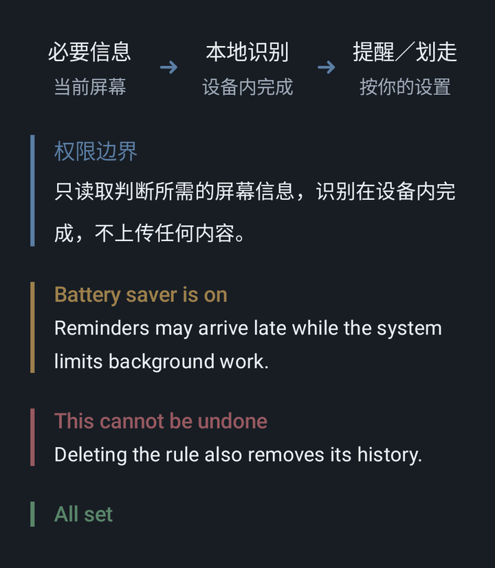

```xml
<io.github.avalonskyafar.mallet.widget.MalletCallout
    android:layout_width="match_parent"
    android:layout_height="wrap_content"
    app:malletTitle="What stays on the device"
    app:malletDetail="Recognition runs locally. Nothing on the screen is uploaded."
    app:malletTone="accent" />
```

| XML attribute | Value | Meaning |
|---|---|---|
| `app:malletTitle` | string | The title of the note, in the tone colour. |
| `app:malletDetail` | string | The body of the note, in ink. |
| `app:malletTone` | `ink` / `muted` / `accent` / `danger` / `warning` / `success` | Colour of the bar and the title: accent (default), danger, warning or success. |

| Member | What it does |
|---|---|
| `val titleView: MalletText =` | The view that shows `title`; exposed for fine tuning (max lines, text selection). |
| `val bodyView: MalletText =` | The view that shows `body`. |
| `var title: CharSequence?` | The title, in the tone colour. |
| `var body: CharSequence?` | The body, in ink, 7 dp below the title. |
| `var tone: MalletTextTone` | Colour of the bar and of the title: `MalletTextTone.ACCENT` (default) for a plain note, `DANGER`, `WARNING` or `SUCCESS` for a note with a verdict. |
| `val barColor: Int` | The colour the bar is painted with right now. |

### MalletFlowRow

**Extracted** · `io.github.avalonskyafar.mallet.widget.MalletFlowRow` · Showcase: Components › Reading

A flat sequence of steps: equal-width columns, each a centred title over a centred, muted
detail, with an accent arrow between neighbours. It shows an order without turning the
steps into cards or controls.

The columns share the width that the 28 dp arrow slots leave over, so every step is exactly
as wide as the others whatever its text; long text wraps inside its column. In right-to-left
layouts the first step is on the right and the arrows point left. A screen reader meets one
element per step, in order, and is told the position of each ("2 of 3"); the arrows are
decoration. The row is for reading: it takes no clicks and no keyboard focus.

Pictures: see [MalletCallout](#malletcallout).

```xml
<io.github.avalonskyafar.mallet.widget.MalletFlowRow
    android:layout_width="match_parent"
    android:layout_height="wrap_content"
    app:malletFlowRowTitles="@array/flow_titles"
    app:malletFlowRowDetails="@array/flow_details" />
```

| XML attribute | Value | Meaning |
|---|---|---|
| `app:malletFlowRowTitles` | reference | Titles of the steps, in order, as a string array. |
| `app:malletFlowRowDetails` | reference | Details of the steps, as a string array parallel to the titles. May be shorter or absent. |

| Member | What it does |
|---|---|
| `data class Step @JvmOverloads constructor(/** The name of the step, one or two words. */ val title: CharSequence, /** A supporting line under the titl` | One step of a `MalletFlowRow`: a short `title` and an optional `detail` below it. |
| `var steps: List<Step>` | The steps shown, in reading order. |
| `fun setSteps(vararg steps: Pair<CharSequence, CharSequence?>)` | Convenience for code: `setSteps("Read" to "this screen", "Decide" to "on the device")`. |

### MalletMediaFrame

**Extracted** · `io.github.avalonskyafar.mallet.widget.MalletMediaFrame` · Showcase: Components › Reading

A picture set into a recessed well: screenshots in a tutorial, an illustration in a card.

The well stays visible on all four sides: the picture is inset by 4 dp and its corners are
clipped to a 4 dp radius, inside the 7 dp radius of the well. The picture is
centre-cropped unless `scaleType` says otherwise.

Height: with an `aspectRatio` the picture keeps that shape at whatever width the frame is
given. Without one the layout height is used, and `wrap_content` falls back to
`DEFAULT_HEIGHT_DP` so that an empty frame and a frame with a large bitmap are equally tall.

While there is no image the well is empty apart from a muted picture icon in its centre,
which makes the frame usable as a placeholder while the image loads.

Accessibility: the frame is one element that reports itself as an image. It is announced
only when it has a content description; a picture without one is treated as decoration.

Pictures: see [MalletParagraph](#malletparagraph).

```xml
<io.github.avalonskyafar.mallet.widget.MalletMediaFrame
    android:layout_width="match_parent"
    android:layout_height="152dp"
    android:src="@drawable/tutorial_step_one"
    android:contentDescription="@string/tutorial_step_one_description" />
```

| XML attribute | Value | Meaning |
|---|---|---|
| `android:src` | drawable | The picture. |
| `android:scaleType` | scale type | How the picture is fitted. |
| `app:malletMediaAspectRatio` | float | Width divided by height of the picture inside the well, for example 1.7778 for 16:9. 0 (the default) uses the layout height instead. |

| Member | What it does |
|---|---|
| `val imageView: ImageView` | The view that shows the picture, for image loaders and anything this class does not forward. |
| `var scaleType: ImageView.ScaleType` | How the picture is fitted into the frame. |
| `var aspectRatio: Float` | Width divided by height of the picture inside the well, for example `16f / 9f`. |
| `val hasImage: Boolean get()` | Whether a picture is set. |
| `fun setImageDrawable(drawable: Drawable?)` | Shows `drawable`, or the empty well when it is `null`. |
| `fun setImageBitmap(bitmap: Bitmap?)` | Shows `bitmap`, or the empty well when it is `null`. |
| `fun setImageResource(@DrawableRes resId: Int)` | Shows the drawable resource `resId`; `0` clears the picture. |
| ↳ `const val IMAGE_INSET_DP: Float` | Distance between the edge of the well and the picture, in dp. |
| ↳ `const val IMAGE_RADIUS_DP: Float` | Corner radius of the picture, in dp. |
| ↳ `const val DEFAULT_HEIGHT_DP: Float` | Height of a frame that has neither a layout height nor an aspect ratio, in dp. |

---

## Navigation

Bars and tabs for apps with a few sections, and the spatial host for apps whose pages are places.

### MalletNavBar

**Extended** · `io.github.avalonskyafar.mallet.widget.MalletNavBar` · Showcase: Components › Navigation

The bottom navigation row: quiet outline icons with labels, standing on the bare canvas.

There is no bar, no background and no indicator. In `Mode.LAUNCHER` every item is a shortcut
and nothing is ever selected: this is the row at the bottom of a root page, with one entry for
each page that lies around it. In `Mode.TABS` one item is selected, and the only thing that
says so is ink: the selected icon and label turn from muted to ink and the icon stroke grows
a little heavier.

`malletNavBarIcons` is an integer array of `malletIcon` values, one per label; a label without
an icon gets the "more" circle. From code use `addItem` or `setItems`.

The items share the width equally and all labels are drawn in one size. When a label is too
wide for its item, all of them shrink together, to no less than 84 % of their size; where the
reader's settings have enlarged the text, they may shrink back to the plain size. What still
does not fit is cut with an ellipsis.

With a keyboard, the arrow keys move a cursor from item to item and Space or Enter activates
the item under it; the selection does not follow the cursor on its own.

The row is 72 dp tall at the plain label size; a label enlarged by the reader's settings,
once its descender no longer clears the baseline, grows it further. It also grows by the
navigation-bar inset, so it can sit at the very bottom
of an edge-to-edge window; switch that off with `fitNavigationBar` when the page around it is
already padded for the system bars. Set `elevated` when content scrolls underneath it.

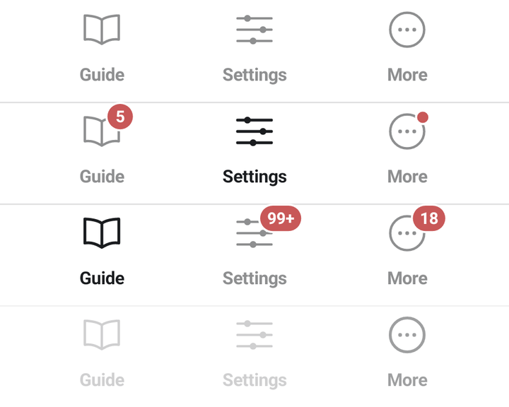 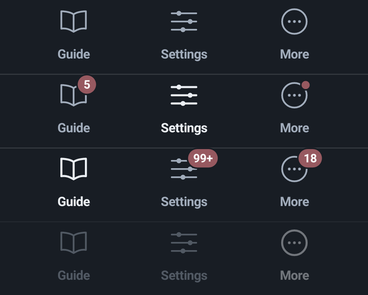

```xml
<io.github.avalonskyafar.mallet.widget.MalletNavBar
    android:layout_width="match_parent"
    android:layout_height="wrap_content"
    app:malletNavBarMode="tabs"
    app:malletOptions="@array/nav_labels"
    app:malletNavBarIcons="@array/nav_icons"
    app:malletSelectedIndex="0" />
```

| XML attribute | Value | Meaning |
|---|---|---|
| `app:malletNavBarMode` | `launcher` / `tabs` | "launcher": every item is a shortcut and nothing is selected (default). "tabs": one item is selected and drawn in ink. |
| `app:malletOptions` | reference | Item labels, in order. |
| `app:malletNavBarIcons` | reference | Integer array of malletIcon values, one per label. |
| `app:malletSelectedIndex` | integer | Selected item in tabs mode. |
| `app:malletElevated` | boolean | Draws a full-bleed hairline above the row, for content that scrolls underneath. |
| `app:malletNavBarFitNavigationBar` | boolean | Whether the row grows by the height of the system navigation bar (default true). Switch it off for a row that does not sit at the bottom of the window. |
| `android:enabled` | boolean | Whether the component can be operated. Disabled, it pales as a whole. |

| Member | What it does |
|---|---|
| `enum class Mode` | How the items behave. |
| `class Item(public val icon: MalletIcon, public val label: CharSequence)` | One entry of the row: an outline `icon` above a short `label`. |
| `fun interface OnItemSelectedListener` | Called when the user activates an item. |
| ↳ `fun onItemSelected(bar: MalletNavBar, index: Int)` | In `Mode.LAUNCHER` this is called for every tap. |
| `fun interface OnItemReselectedListener` | Called in `Mode.TABS` when the user taps the item that is already selected. |
| ↳ `fun onItemReselected(bar: MalletNavBar, index: Int)` |  |
| `fun setOnItemSelectedListener(listener: OnItemSelectedListener?)` | Listener for user-driven activation. |
| `fun setOnItemReselectedListener(listener: OnItemReselectedListener?)` | Listener for a tap on the selected item in `Mode.TABS`, typically "scroll to top". |
| `var mode: Mode` | Shortcut row or tab row. |
| `var selectedIndex: Int` | Index of the selected item in `Mode.TABS`; `-1` in `Mode.LAUNCHER` or without items. |
| `var elevated: Boolean` | Draws a full-bleed hairline along the top edge, for content that scrolls underneath the row. |
| `val items: List<Item> get()` | The items in logical order. |
| `var fitNavigationBar: Boolean` | Whether the row grows by the height of the system navigation bar, keeping the items above it in an edge-to-edge window. |
| `fun addItem(icon: MalletIcon, label: CharSequence): Int` | Appends an item and returns its index. |
| `fun setItems(items: List<Item>)` | Replaces all items. |
| `fun select(index: Int, animate: Boolean = true)` | Moves the selection to `index` from code; the listeners are not called. |
| `fun setBadge(index: Int, count: Int)` | Shows a count badge at the top end of the icon of item `index`; a `count` of zero or less removes it. |
| `fun setBadgeDot(index: Int, show: Boolean)` | Shows or removes a small dot without a number at the top end of the icon of item `index`. |
| `fun badgeCount(index: Int): Int` | The count shown on item `index`; zero when it has no badge or only a dot. |
| `fun hasBadgeDot(index: Int): Boolean` | Whether item `index` shows a dot without a number. |

### MalletTopBar

**New** · `io.github.avalonskyafar.mallet.widget.MalletTopBar` · Showcase: Components › Navigation

The bar at the top of a page: a centred title, a navigation button at the start and up to
two action icons at the end.

The bar is as quiet as the page under it: it has the canvas colour and no shadow. Only when
it is `lifted`, which `bindTo` switches on once the content has scrolled, a full-bleed
hairline separates it from what moves underneath. The canvas colour is only the default
background: a bar that stands on something else, a card for instance, keeps the background
you set on it (`android:background`, `setBackgroundColor`).

The title is centred in the bar and stays there whatever buttons are present: the room it
may use is the same on both sides, so a lone back button never pushes it off centre. A
title that does not fit is shortened with an ellipsis.

The bar is 56 dp high and grows only when large text needs more. It adds the status-bar
and display-cutout insets to its own height and sides (`fitStatusBar`), so it can sit at the
very top of an edge-to-edge window; the insets are passed on unconsumed.

Buttons are 24 dp icons in 48 dp targets. Pressing sinks the icon, a click ticks and then
calls the listener. Every button needs a content description; directional icons are
mirrored in right-to-left layouts.

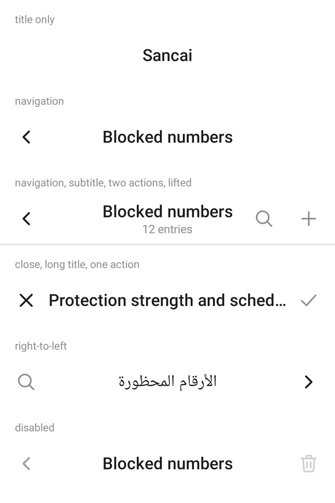 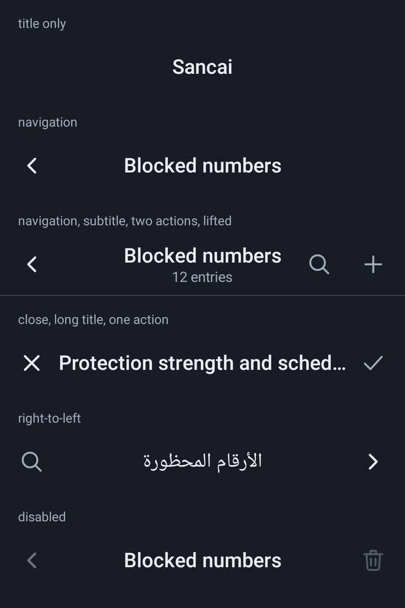

```xml
<io.github.avalonskyafar.mallet.widget.MalletTopBar
    android:id="@+id/top_bar"
    android:layout_width="match_parent"
    android:layout_height="wrap_content"
    app:malletTitle="Blocked numbers"
    app:malletTopBarSubtitle="12 entries"
    app:malletIcon="chevron_left" />
```

```kotlin
topBar.setNavigation(onClick = View.OnClickListener { finish() })
topBar.addAction(MalletIcon.SEARCH, getString(R.string.search)) { openSearch() }
topBar.bindTo(scrollView)
```

| XML attribute | Value | Meaning |
|---|---|---|
| `app:malletTitle` | string | The centred title. |
| `app:malletIcon` | one of 50 names, or `none` (see below) | Icon of the navigation button at the start; without it the bar has none. |
| `app:malletTopBarSubtitle` | string | A quiet second line under the title. |
| `app:malletTopBarNavigationDescription` | string | What the navigation button says to a screen reader (default: "Back"). |
| `app:malletTopBarLifted` | boolean | Whether the hairline along the bottom edge is shown from the start. |
| `app:malletTopBarFitStatusBar` | boolean | Whether the bar pads itself for the status bar and display cutout (default true). Switch it off inside a host that already handles those insets. |

| Member | What it does |
|---|---|
| `var title: CharSequence?` | The title, centred in the bar on one line. |
| `var subtitle: CharSequence?` | A quiet second line under the title. |
| `var lifted: Boolean` | Whether content lies under the bar. |
| `var fitStatusBar: Boolean` | Whether the bar pads itself for the status bar and display cutout (default true). |
| `val navigationButton: View? get()` | The navigation button, or `null` when the bar has none. |
| `val actionCount: Int get()` | Number of action icons at the end of the bar (0 to 2). |
| `fun setNavigation(icon: MalletIcon = MalletIcon.CHEVRON_LEFT, description: CharSequence? = null, onClick: OnClickListener?)` | Shows the navigation button at the start of the bar, drawn in ink. |
| `fun clearNavigation()` | Removes the navigation button. |
| `fun addAction(icon: MalletIcon, description: CharSequence, onClick: OnClickListener?): View` | Adds an action icon at the end of the bar, drawn muted, and returns its view (to disable it, or to anchor a menu to it). |
| `fun getActionAt(index: Int): View` | The view of the action at `index`, in the order the actions were added. |
| `fun clearActions()` | Removes every action icon. |
| `fun bindTo(scrollView: View?)` | Lets the bar follow a scrolling view: `lifted` is true while `scrollView` can scroll back up, that is, once content has moved under the bar. |
| ↳ `const val HEIGHT_DP: Float` | Height of the bar without insets, in dp. |
| ↳ `const val TARGET_DP: Float` | Side of a button's touch target, in dp. |
| ↳ `const val ICON_DP: Float` | Side of a button's icon, in dp. |
| ↳ `const val MAX_ACTIONS: Int` | Most action icons a bar holds. |

### MalletTabs

**New** · `io.github.avalonskyafar.mallet.widget.MalletTabs` · Showcase: Components › Navigation

Text tabs for switching between sibling views.

Tabs are a different idea from `MalletSegmentedTrack` on purpose. The track selects a *value*
and shows it with a hue; tabs select a *view* and stay quiet: muted labels directly on the
canvas, the selected one in ink, and under it a small accent capsule exactly as wide as the
label. The capsule glides to the new label when the selection changes and can follow a
continuous position (`setScrollPosition`), so it tracks the finger while a `MalletPager` is
dragged. A hairline runs along the bottom edge from one side of the view to the other.

With `Layout.FILL` every tab gets the same width. With `Layout.SCROLL` every tab is as wide as
its label plus 16 dp on either side; when the tabs do not fit, the row scrolls with the finger
and always brings the selected tab into view.

Left and right arrows move the selection (mirrored in right-to-left layouts), Home and End
jump to the first and last tab. Accessibility services see a tab list with one tab per label;
a tab that takes accessibility focus while scrolled out of view is scrolled into view.
The view is 44 dp tall.

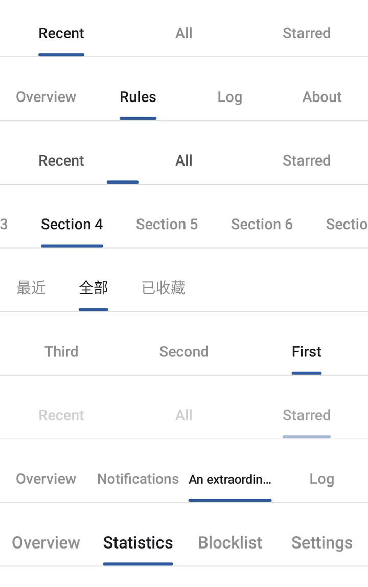 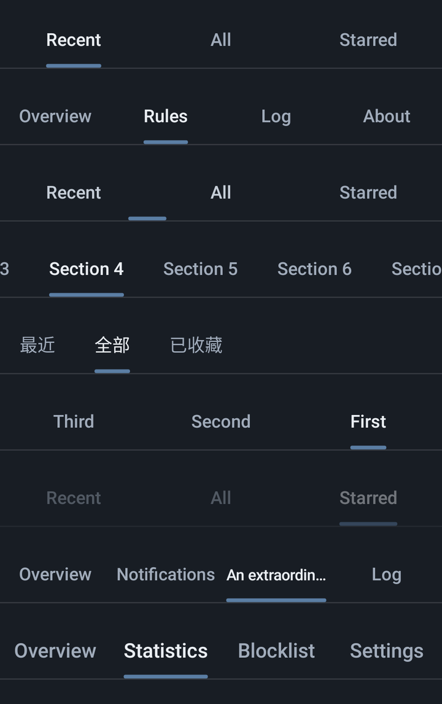

```xml
<io.github.avalonskyafar.mallet.widget.MalletTabs
    android:layout_width="match_parent"
    android:layout_height="wrap_content"
    app:malletOptions="@array/library_sections"
    app:malletSelectedIndex="0"
    app:malletTabsLayout="fill" />
```

| XML attribute | Value | Meaning |
|---|---|---|
| `app:malletOptions` | reference | The tab labels, a string array. |
| `app:malletSelectedIndex` | integer | Index of the option selected at start. |
| `app:malletTabsLayout` | `fill` / `scroll` | How tabs share the width. "fill" gives every tab the same width. "scroll" gives every tab its natural width and scrolls the row, keeping the selected tab in view. |
| `android:enabled` | boolean | Whether the component can be operated. Disabled, it pales as a whole. |

| Member | What it does |
|---|---|
| `enum class Layout` | How the tabs share the width of the view. |
| `fun interface OnTabSelectedListener` | Called when the user chooses another tab. |
| ↳ `fun onTabSelected(tabs: MalletTabs, index: Int)` |  |
| `fun setOnTabSelectedListener(listener: OnTabSelectedListener?)` | Listener for user-driven tab changes: a tap, a key, an accessibility action, or a swipe of the pager given to `attachTo`. |
| `val selectedIndex: Int get()` | Index of the selected tab. |
| `val tabs: List<CharSequence> get()` | The tab labels, in order. |
| `var layout: Layout` | How the tabs share the width: equal parts or natural widths in a scrolling row. |
| `fun setTabs(labels: List<CharSequence>)` | Replaces the tab labels. |
| `fun setTabs(vararg labels: CharSequence)` | Replaces the tab labels. |
| `fun select(index: Int, animate: Boolean = true)` | Selects tab `index` from code; the indicator glides there when `animate` is true. |
| `fun setScrollPosition(index: Int, offset: Float)` | Places the indicator `offset` (0 to 1) of the way from tab `index` to the tab after it, without changing the selection: the indicator's position and width and the ink of the two labels are blended between both tabs. |
| `fun attachTo(pager: MalletPager?)` | Couples the tabs with `pager`, or ends the coupling with `null`. |
| ↳ `const val HEIGHT_DP: Float` | Height of the view in dp. |

### MalletPager

**Extracted** · `io.github.avalonskyafar.mallet.interaction.MalletPager` · Showcase: Interactions › Pager

A horizontal pager for a handful of pages, such as the steps of a first-launch flow.

The finger moves two pages edge to edge: the current one leaves while its neighbour follows
it in. Letting go after `COMMIT_FRACTION` of the width, or with a speed of
`COMMIT_VELOCITY_WIDTHS` widths per second towards the neighbour, lands on the neighbour;
anything less glides back. The first and the last page do not over-scroll.

Non-obvious behaviour:

- Pages are created on demand and at most once. Only the current page and the one moving in
  are visible; visited neighbours inside `offscreenPageLimit` stay attached but invisible,
  pages further away are detached and kept for their return.
- While a move runs, further requests and gestures are ignored.
- The pager takes no keyboard focus of its own. Left / Right pressed inside a page turn the
  page when focus has nowhere else to go in that direction, Page Up / Page Down always do,
  and an attached `MalletPageIndicator` is the focusable handle of the pager.
- A programmatic move to a distant page brings that page in directly, one width of travel.
- `OnPageChangeListener.onPageSelected` fires for user input only (drag, keyboard,
  accessibility, a tap on an attached indicator); `OnPageChangeListener.onPageScrolled`
  reports every movement.
- Vertical movement is left to a scrolling parent, and a gesture that starts on a
  `MalletHorizontalDragOwner` (a switch or a track inside a page) is left to that view.
- A disabled pager keeps its page: no drag, key or accessibility action moves it. The pages
  themselves are not paled, since they are content rather than part of a control.
- In a right-to-left layout the next page comes in from the left.

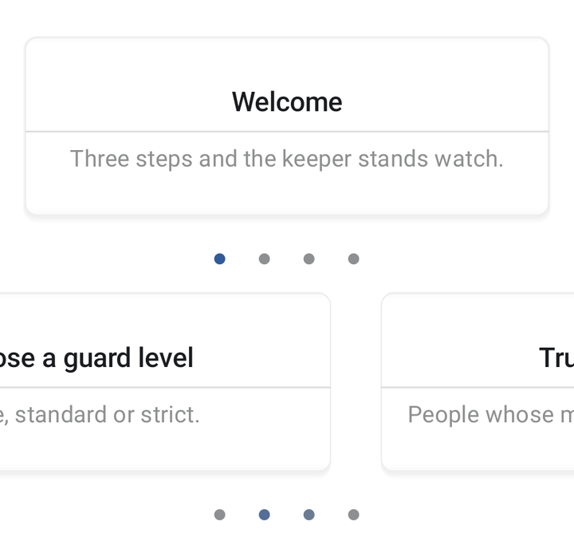 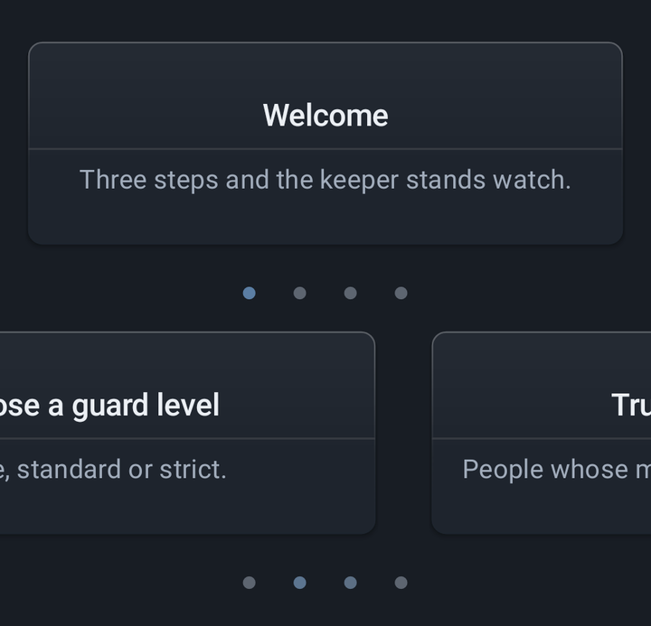

```xml
<io.github.avalonskyafar.mallet.interaction.MalletPager
    android:id="@+id/pager"
    android:layout_width="match_parent"
    android:layout_height="0dp"
    android:layout_weight="1"
    app:malletPagerOffscreenPageLimit="1" />
```

```kotlin
pager.setPages(4) { index, parent -> createStep(index, parent) }
indicator.attachTo(pager)
```

| XML attribute | Value | Meaning |
|---|---|---|
| `app:malletPagerOffscreenPageLimit` | integer | How many pages on each side of the current one stay attached. Default: 1. |

| Member | What it does |
|---|---|
| `fun interface PageProvider` | Creates the pages of a `MalletPager`. |
| ↳ `fun createPage(index: Int, parent: ViewGroup): View` | Returns the view of page `index`. |
| `interface OnPageChangeListener` | Receives the movement of a `MalletPager`. |
| ↳ `fun onPageSelected(index: Int) {}` | The user moved to page `index`. |
| ↳ `fun onPageScrolled(index: Int, offset: Float) {}` | The pager stands `offset` (0 until 1) of the way from page `index` to the page after it. |
| `var pageCount: Int` | Number of pages, as given to `setPages`. |
| `var currentPage: Int` | The page the pager shows or is landing on. |
| `var offscreenPageLimit: Int` | How many visited pages on each side of the current one stay attached (invisible) so that they need no layout pass when they move in. |
| `val isMoving: Boolean get()` | Whether a drag, a settle or an animated `setCurrentPage` is in progress. |
| `val scrollPosition: Float` | The continuous position: `2.25` is a quarter of the way from page 2 to page 3. |
| `fun setPages(count: Int, provider: PageProvider)` | Sets the pages: `count` of them, created by `provider` when they are first needed. |
| `fun setCurrentPage(index: Int, animate: Boolean)` | Moves to page `index`, gliding when `animate` is true and the pager is laid out, else at once. |
| `fun addOnPageChangeListener(listener: OnPageChangeListener)` | Adds a listener for page changes and movement. |
| `fun removeOnPageChangeListener(listener: OnPageChangeListener)` | Removes a listener added with `addOnPageChangeListener`. |
| `fun linkWith(other: MalletPager)` | Makes `other` follow this pager continuously: every drag, settle and programmatic move of this pager moves `other` by the same share of its own width, as a heading area that moves in step with a content area. |
| `fun unlink(other: MalletPager)` | Ends the link made with `linkWith`. |
| ↳ `const val COMMIT_FRACTION: Float` | Share of the width a drag must cover to land on the neighbour. |
| ↳ `const val COMMIT_VELOCITY_WIDTHS: Float` | Speed towards the neighbour, in pager widths per second, that lands on it at once. |

### MalletPageIndicator

**Extracted** · `io.github.avalonskyafar.mallet.widget.MalletPageIndicator` · Showcase: Interactions › Pager

A row of dots, one per page: muted, with the current one in the accent colour.

Attached to a `MalletPager` it follows the pager continuously: while a page moves, the two
dots involved cross-blend with the position. Tapping a dot goes to that page.

Non-obvious behaviour:

- Standalone use: set `count` and `selectedIndex` (or `app:malletPageIndicatorCount` and
  `app:malletSelectedIndex`) and listen with `setOnSelectionChangeListener`. While a
  pager is attached, both mirror the pager: setting `selectedIndex` moves it, setting
  `count` is ignored.
- The listener fires for user input only (tap, keyboard, accessibility action); the pager's
  own `onPageSelected` fires as well, because the tap is the user's.
- The indicator is the keyboard handle of its pager: it takes focus, and Left / Right move
  one page. A key that has no page to go to is not consumed.
- Each dot is a 7 dp circle in a 28 dp cell; a pressed dot sinks instead of changing colour.
- In dark themes the resting dots recede halfway towards the canvas, so that the accent dot
  remains the strongest mark of the row.
- Taps, keys and accessibility actions do nothing while the attached pager is disabled.
- To screen readers the row is a single element, "Page 2 of 8", with scroll actions.
- `selectedIndex` is saved and restored for standalone use; an attached indicator takes its
  position from the pager, which saves its own.

Pictures: see [MalletPager](#malletpager).

```xml
<io.github.avalonskyafar.mallet.widget.MalletPageIndicator
    android:id="@+id/dots"
    android:layout_width="wrap_content"
    android:layout_height="wrap_content"
    android:layout_gravity="center_horizontal" />
```

```kotlin
dots.attachTo(pager)
```

| XML attribute | Value | Meaning |
|---|---|---|
| `app:malletPageIndicatorCount` | integer | Number of dots of a standalone indicator. |
| `app:malletSelectedIndex` | integer | Index of the selected dot of a standalone indicator. |

| Member | What it does |
|---|---|
| `fun interface OnSelectionChangeListener` | Receives the dot the user chose on a `MalletPageIndicator`. |
| ↳ `fun onSelectionChanged(indicator: MalletPageIndicator, index: Int)` | The user moved `indicator` to dot `index`. |
| `fun setOnSelectionChangeListener(listener: OnSelectionChangeListener?)` | Called when the user chooses a dot. |
| `var count: Int` | Number of dots. |
| `var selectedIndex: Int` | Index of the accent dot. |
| `fun attachTo(pager: MalletPager?)` | Follows `pager` and moves it when a dot is tapped; `null` detaches and leaves the dots as they are, for standalone use. |

### MalletSpatialGraph

**Extended** · `io.github.avalonskyafar.mallet.interaction.MalletSpatialGraph` · Showcase: Interactions › Pages as places

Where the pages of an app lie in relation to one another.

In Mallet, pages are places rather than a stack. A page is reached by dragging the current
page towards the side where it lies; it slides in from that side, and a chevron on a row
points to where its page lies. The graph records those places; a `MalletSpatialHost` moves
between them.

Pages are identified by string keys. The graph is immutable.

```kotlin
val graph = MalletSpatialGraph.Builder(root = "main")
    .connect("main", Side.BELOW, "settings")      // settings is below main, main above settings
    .connect("main", Side.START, "guide")
    .connect("main", Side.END, "more")
    .connect("settings", Side.END, "advanced")
    .child("more", Side.END, "about")             // opened from a row; dragged back, not forth
    .build()
```

| Member | What it does |
|---|---|
| `enum class Side` | A side of a page. |
| ↳ `val opposite: Side` | The side facing this one. |
| ↳ `val isHorizontal: Boolean get()` | Whether moving to this side is a horizontal move. |
| `val keys: Set<String> get()` | Every page of the graph. |
| `fun contains(key: String): Boolean` |  |
| `fun neighbour(key: String, side: Side): String?` | The page that a drag from `key` towards `side` reveals, or `null`. |
| `fun sideOf(from: String, to: String): Side?` | The side of `from` on which `to` lies, or `null` when the two are not adjacent. |
| `fun parentOf(key: String): String?` | Where "back" leads from `key`; `null` for the root. |
| `class Builder(private val root: String)` | Collects connections and builds a validated graph. |
| ↳ `fun connect(from: String, side: Side, to: String, reciprocal: Boolean = true): Builder` | Puts `to` on the `side` side of `from`. |
| ↳ `fun child(parent: String, side: Side, child: String): Builder` | Places `child` on the `side` side of `parent` as a page that is opened from a row or button. |
| ↳ `fun parent(key: String, parentKey: String): Builder` | Overrides where "back" leads from `key`. |
| ↳ `fun build(): MalletSpatialGraph` | Validates and builds the graph. |

### MalletSpatialHost

**Extracted** · `io.github.avalonskyafar.mallet.interaction.MalletSpatialHost` · Showcase: Interactions › Pages as places

Shows one page of a `MalletSpatialGraph` and moves between pages with the finger.

The page under the finger and the page it uncovers travel together, edge to edge, at finger
speed. Nothing fades, scales or lags behind. Letting go past 28 % of the way, or with a
flick, lands on the new page; anything less glides back. A touch during the landing takes
over at once.

How the host shares the screen with what is inside the pages:

- A drag that starts on a `MalletHorizontalDragOwner` (a track, a switch, a slider) belongs
  to that control, unless it turns out to be vertical.
- Content that can still scroll up or down scrolls first; when it reaches its limit within
  the same gesture, the page starts to follow.
- Sideways, a gesture has one owner from start to finish. Content that can move in the
  direction of the drag when the drag begins (a pager with a page left that way, a row that
  slides aside, a horizontal list) keeps the whole gesture, also beyond the point where it
  stops; the page only follows a sideways drag that nothing under the finger can use.
- Horizontal drags that begin within 24 dp of a screen edge are left to the system.

A page is given the window insets (system bars, keyboard) when it is attached, however late
that is, so a page that pads itself for the bars is right from its first frame.

Page views come from the `PageFactory` and are kept while detached, so returning to a page
restores it exactly; see `setKeepAlive` and `invalidatePage`.

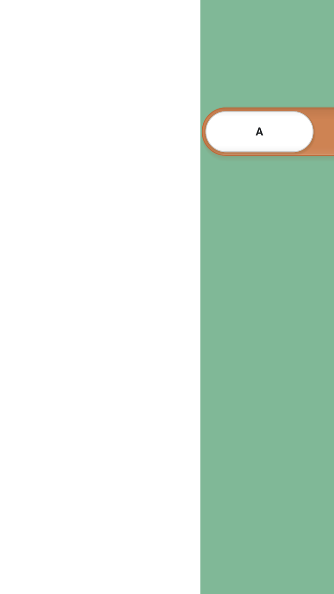

```kotlin
host.setGraph(graph) { key -> createPageView(key) }
host.show("main")
row.setOnClickListener { host.navigate("settings") }
```

| Member | What it does |
|---|---|
| `fun interface PageFactory` | Creates the view of a page. |
| ↳ `fun createPage(key: String): View` |  |
| `interface Listener` | Observes page changes. |
| ↳ `fun onPageSettled(key: String) {}` | The host has come to rest on `key`. |
| ↳ `fun onPageScrolled(from: String, to: String, fraction: Float) {}` | Pages are moving: `fraction` of the way from `from` to `to` (0..1). |
| `var prewarmNeighbours: Boolean` | Builds neighbouring pages ahead of time, while the host is idle. |
| `val currentKey: String? get()` | The page the host rests on, or is leaving. |
| `val isMoving: Boolean get()` | Whether pages are being dragged or are landing. |
| `fun setGraph(graph: MalletSpatialGraph, factory: PageFactory)` | Sets the places and how to build them. |
| `fun addListener(listener: Listener)` |  |
| `fun removeListener(listener: Listener)` |  |
| `fun setKeepAlive(keys: Set<String>?)` | Limits which pages stay alive while detached; `null` (the default) keeps every visited page. |
| `fun invalidatePage(key: String)` | Discards the kept view of `key`, so the next visit builds a fresh one. |
| `fun invalidatePages()` | Discards every kept view. |
| `fun show(key: String)` | Shows `key` at once, without movement. |
| `fun refreshCurrent()` | Rebuilds the page on screen in place, for example after its data changed. |
| `fun navigate(key: String, animate: Boolean = true)` | Moves to `key`, which slides in from the side where it lies. |
| `fun navigate(key: String, from: Side, animate: Boolean)` | Moves to `key`, sliding it in from `from`. |
| `fun back(): Boolean` | Moves to the parent of the current page. |
| `fun canGoBack(): Boolean` | Whether `back` would move. |
| ↳ `const val EDGE_DP: Float` | Width, in dp, of the screen-edge zones left to the system back gesture. |
| ↳ `const val BACK_PREVIEW_FRACTION: Float` | Share of the travel that a full system back swipe previews before it commits. |

### MalletBack

**Extended** · `io.github.avalonskyafar.mallet.interaction.MalletBack` · Showcase: Interactions › Pages as places

Connects the system back gesture to a `MalletSpatialHost`.

Back leads to the parent of the current page (see `MalletSpatialGraph.parentOf`). On
Android 14 and later the back swipe previews that move: the pages follow the swipe for up to
40 % of the way, land when the gesture is completed and glide back when it is cancelled. On
the root page the registration steps aside, so the system handles back itself.

```kotlin
private lateinit var back: MalletBack.Registration

override fun onCreate(savedInstanceState: Bundle?) {
    ...
    back = MalletBack.attach(this, host)
}

// Only needed below Android 13, or without android:enableOnBackInvokedCallback:
override fun onBackPressed() {
    if (!back.onBackPressed()) super.onBackPressed()
}
```

| Member | What it does |
|---|---|
| `interface Registration` | Handle returned by `attach`. |
| ↳ `fun onBackPressed(): Boolean` | Forwards a legacy back press. |
| ↳ `fun remove()` | Detaches from the host and from the system. |
| `fun attach(activity: Activity, host: MalletSpatialHost): Registration` | Routes back for `activity` to `host` until the registration is removed. |

### MalletSpatialTransition

**Extracted** · `io.github.avalonskyafar.mallet.interaction.MalletSpatialTransition` · Showcase: Interactions › Pages as places

Makes a second activity behave like a neighbouring page.

The new activity slides in from one side while the activity below slides out the other way,
edge to edge and at the same speed; nothing fades or scales. Afterwards the user can drag the
page back out by swiping anywhere inside it, towards the side it came from. Letting go past
28 % of the way, or with a flick, finishes the activity; anything less glides back.

How it works: `start` draws the launching activity into a bitmap, keeps it in memory under a
token and sends the token along in the intent. `wrap` puts that picture behind the real page
and moves both itself, so the window animation is switched off. When there is no picture
(the activity was launched some other way, the process was restarted, or the picture would
exceed `MAX_SNAPSHOT_BYTES`) the page is shown at once and the plain window slide animations
`R.anim.mallet_slide_*` are used instead; the swipe back still works.

The swipe leaves alone what needs horizontal drags itself: anything that is a
`MalletHorizontalDragOwner`, every `EditText`, whatever can itself scroll the way the finger
goes when the drag begins (a pager with a page left that way, a row that slides aside, a
sideways list; they answer through `canScrollHorizontally`), and the 24 dp zones at both
screen edges, which belong to the system. A page that is in the middle of something can
refuse the swipe with a `SwipeGate`.

Only `Side.START` and `Side.END` are supported; they follow the layout direction.

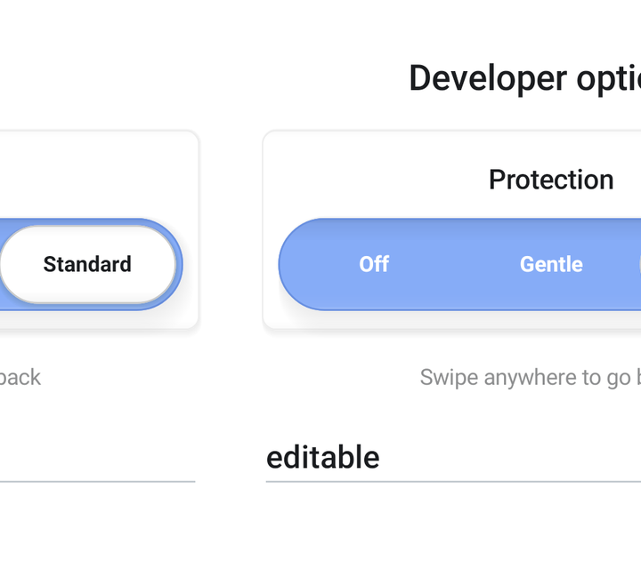 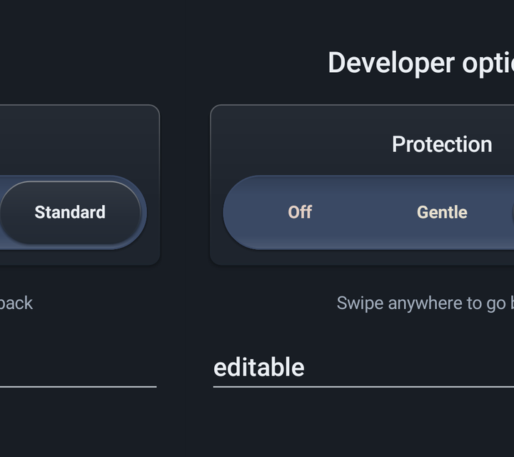

```kotlin
// in the launching activity
MalletSpatialTransition.start(this, Intent(this, DetailActivity::class.java), Side.END)

// in the new activity
override fun onCreate(savedInstanceState: Bundle?) {
    super.onCreate(savedInstanceState)
    setContentView(MalletSpatialTransition.wrap(this, pageView))
}

override fun onBackPressed() {
    MalletSpatialTransition.finish(this)
}
```

| Member | What it does |
|---|---|
| `fun interface SwipeGate` | Lets a page refuse the swipe back while it is in the middle of something, for example while it shows a detail pane of its own or while one of its controls is being dragged. |
| ↳ `fun canSwipeBack(): Boolean` | Returns false to keep the page where it is for the gesture that is starting. |
| `const val MAX_SNAPSHOT_BYTES: Long` | A picture of the launching activity larger than this (16 MB of pixels) is not taken. |
| `fun start(activity: Activity, intent: Intent, enterFrom: Side = Side.END)` | Starts `intent` from `activity` as a neighbouring page that comes in from `enterFrom`. |
| `fun wrap(activity: Activity, page: View): View` | Wraps `page` for an activity started with `start` and returns the view to pass to `setContentView`. |
| `fun finish(activity: Activity)` | Sends the page of `activity` back out the way it came in and finishes the activity when it has left the screen. |
| `fun setSwipeGate(wrapped: View, gate: SwipeGate?)` | Sets the `gate` asked before each swipe on `wrapped`, the view returned by `wrap`. |

---

## Overlays

What appears above a page: a question, a set of actions, a small menu, a passing message, a floating panel.

### MalletDialog

**Extracted** · `io.github.avalonskyafar.mallet.overlay.MalletDialog` · Showcase: Components › Dialogs and sheets

A modal question on a card: a centred title, a muted message, optional content
and one to three text actions under a rim-to-rim divider.

Behaviour worth knowing:

- An action callback returns `true` to close and `false` to stay open. Calling
  `showError` inside the positive callback also keeps the dialog open, whatever is returned.
- The card rises into place and sinks away again. **Once it has started to close, every
  further click and back press is ignored**, so an action can never be committed twice
  while the exit motion runs.
- Two actions sit side by side, the confirming one at the end. Three actions, or two whose
  labels do not fit on one line each, are stacked as full-width rows: positive, neutral,
  negative.
- Back closes a `Builder.cancelable` dialog; touching outside does not unless
  `Builder.canceledOnTouchOutside` is set.
- A dialog is a window, not a view, so it has no XML form and is not restored after a
  configuration change; show it again from your own state.

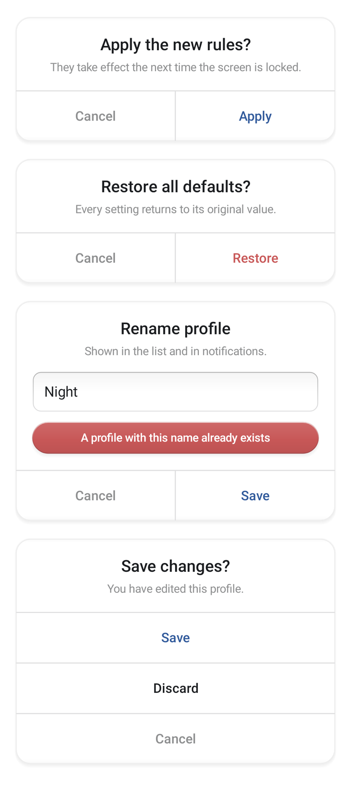 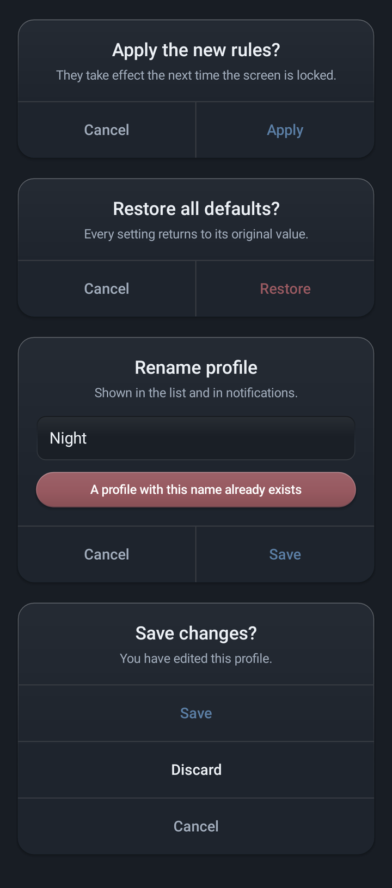

```kotlin
MalletDialog.Builder(context)
    .title("Restore all defaults?")
    .message("Every setting returns to its original value.")
    .positive("Restore", tone = MalletTextTone.DANGER) { dialog -> store.reset(); true }
    .negative("Cancel")
    .show()
```

| Member | What it does |
|---|---|
| `fun interface OnActionListener` | Called when the user chooses an action. |
| ↳ `fun onAction(dialog: MalletDialog): Boolean` | Returns `true` to close `dialog`, `false` to keep it open. |
| `fun interface OnInputListener` | Called with the text of an input dialog when its positive action is chosen. |
| ↳ `fun onInput(dialog: MalletDialog, text: String): Boolean` | Returns `true` to accept `text` and close, `false` to keep `dialog` open. |
| `fun interface OnDismissListener` | Called once when the dialog has left the screen. |
| ↳ `fun onDismiss(dialog: MalletDialog, positive: Boolean)` | every other way out (another action, back, outside touch, `dismiss`). |
| `var isClosing: Boolean` | `true` from the moment the dialog starts to close; actions and back are ignored then. |
| `val isShowing: Boolean` | Whether the dialog window is on screen (it still is while the exit motion runs). |
| `val contentView: View` | The card, for tests and for code that needs to look something up in the content. |
| `val dialog: Dialog` | The platform dialog that hosts the card, for window flags this class does not cover. |
| `val inputField: EditText?` | The editor of an input dialog, or `null` for any other dialog. |
| `val inputText: String` | The current text of an input dialog; empty for any other dialog. |
| `val error: CharSequence?` | The message in the validation slot, or `null` while no error is shown. |
| `val isStacked: Boolean` | Whether the actions are stacked as full-width rows (valid after the card was measured). |
| `fun show()` | Shows the dialog and plays the enter motion. |
| `fun dismiss()` | Closes the dialog with the exit motion. |
| `fun showError(message: CharSequence)` | Fills the validation slot above the actions with a danger capsule and gives a reject haptic. |
| `fun clearError()` | Empties and hides the validation slot. |
| `fun setActionEnabled(which: Int, enabled: Boolean)` | Enables or disables one action, for example the positive one until a form is complete. |
| `fun actionView(which: Int): View?` | The view of an action, or `null` when the dialog has no such action. |
| `class Builder(private val context: Context)` | Collects the parts of a dialog. |
| ↳ `fun title(title: CharSequence?): Builder` | Centred headline; it is also announced as the name of the dialog. |
| ↳ `fun message(message: CharSequence?): Builder` | Centred, muted explanation below the title. |
| ↳ `fun view(view: View?): Builder` | Custom content (a form, a few rows) between the message and the actions. |
| ↳ `fun positive(label: CharSequence?` | The confirming action, at the end of the row. |
| ↳ `fun positive(label: CharSequence?, listener: OnActionListener): Builder =` | The confirming action in the accent tone with its `listener`, for callers that cannot skip the tone (Java): `positive("Save", dialog -> save())`. |
| ↳ `fun negative(label: CharSequence?` | The dismissive action in the muted tone, at the start of the row. |
| ↳ `fun neutral(label: CharSequence, listener: OnActionListener?` | A third, alternative action in the ink tone. |
| ↳ `fun input(initial: CharSequence?` | Turns the dialog into an input dialog: a text field below the message. |
| ↳ `fun cancelable(cancelable: Boolean): Builder` | Whether back closes the dialog. |
| ↳ `fun canceledOnTouchOutside(cancel: Boolean): Builder` | Whether a touch outside the card closes a cancelable dialog. |
| ↳ `fun onDismiss(listener: OnDismissListener?): Builder` | Called once when the dialog has gone, with a flag for "the positive action closed it". |
| ↳ `fun build(): MalletDialog` | Builds the dialog without showing it. |
| ↳ `fun show(): MalletDialog` | Builds the dialog and shows it. |
| ↳ `const val ACTION_POSITIVE: Int` | The confirming action. |
| ↳ `const val ACTION_NEUTRAL: Int` | The optional third action. |
| ↳ `const val ACTION_NEGATIVE: Int` | The dismissive action. |
| ↳ `fun confirm(context: Context, title: CharSequence?, message: CharSequence?` | Asks for a confirmation with "Cancel" and one confirming action, and shows it. |
| ↳ `fun confirm(context: Context, title: CharSequence?, onConfirm: Runnable): MalletDialog =` | Asks for a confirmation of `title` alone, with "Cancel" and "OK", and shows it. |
| ↳ `fun message(context: Context, title: CharSequence?, message: CharSequence?` | Shows a notice with a single "OK" action. |

### MalletBottomSheet

**New** · `io.github.avalonskyafar.mallet.overlay.MalletBottomSheet` · Showcase: Components › Dialogs and sheets

A sheet that rises from the bottom edge of the window and follows the finger back down.

The sheet lives in a full-window dialog of its own, so it traps focus while it is open. It
shows a grabber, an optional centred title and message, and then either any view or a list
of centred actions with an optional cancel action below a divider.

Behaviour worth knowing:

- It glides up over `MalletMotion.DIALOG_MS` and glides down again; only the scrim fades,
  in proportion to the position of the sheet.
- Dragging down on the grabber, the header, or on content that is scrolled to its top
  moves a cancelable sheet (one built with `cancelable(false)` does not follow the
  finger). Letting go past `MalletMotion.COMMIT_FRACTION` of its height, or faster than
  `MalletMotion.COMMIT_VELOCITY_DP`, dismisses it; otherwise it returns.
- A tap on the scrim, the back key and the accessibility "dismiss" action dismiss it
  unless it was built with `cancelable(false)`.
- An action ticks, runs its callback, and then dismisses the sheet.
- The sheet pads itself for the navigation bar and rises above the keyboard.
- It is a transient surface: it is not restored after the activity is recreated. Dismiss
  it in `onDestroy` if it can outlive a configuration change.

The context must be an activity (or a themed wrapper around one), as for any dialog.

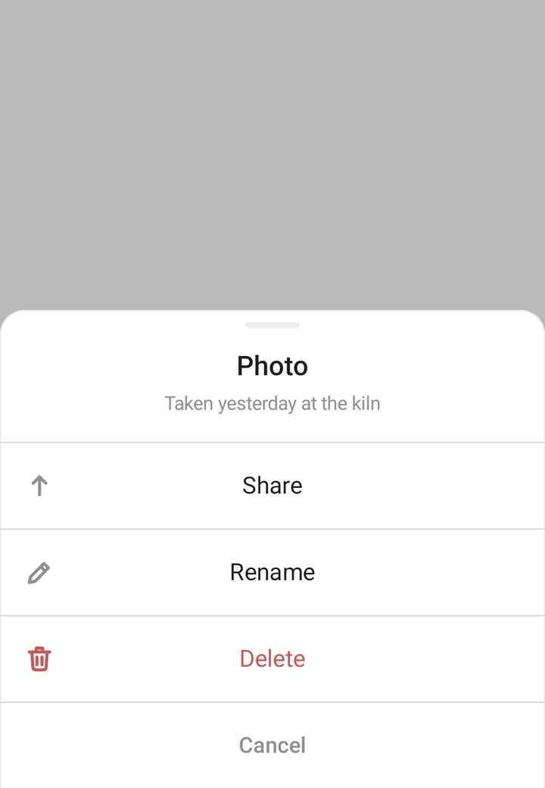 

```kotlin
MalletBottomSheet.Builder(activity)
    .title("Photo")
    .action("Share", icon = MalletIcon.ARROW_UP) { share() }
    .action("Delete", MalletTextTone.DANGER) { delete() }
    .cancel()
    .show()
```

| Member | What it does |
|---|---|
| `fun interface OnDismissListener` | Told when a sheet has left the screen, whatever made it leave. |
| ↳ `fun onDismiss(sheet: MalletBottomSheet)` |  |
| `val isShowing: Boolean` | Whether the sheet is on screen, including while it glides in or out. |
| `var isCancelable: Boolean` | Whether scrim taps, the back key and drags may dismiss the sheet. |
| `fun setOnDismissListener(listener: OnDismissListener?)` | Replaces the listener that is told when the sheet has left the screen. |
| `fun show(): MalletBottomSheet` | Shows the sheet and lets it glide up. |
| `fun dismiss()` | Lets the sheet glide down and then removes it. |
| `class Builder(private val context: Context)` | Collects the parts of a sheet. |
| ↳ `fun title(title: CharSequence?): Builder` | Centred title above the content; it is also announced as the name of the sheet. |
| ↳ `fun message(message: CharSequence?): Builder` | Centred, muted explanation below the title. |
| ↳ `fun view(view: View?): Builder` | Any content. |
| ↳ `fun action(label: CharSequence, tone: MalletTextTone` | Adds an action row. |
| ↳ `fun action(label: CharSequence, onClick: Runnable): Builder =` | Adds a plain action row: `label` in the ink tone, without an icon. |
| ↳ `fun cancel(label: CharSequence?` | Adds the cancel action below a full-bleed divider. |
| ↳ `fun cancelable(cancelable: Boolean): Builder` | Whether scrim taps, the back key and drags may dismiss the sheet (default true). |
| ↳ `fun onDismiss(listener: OnDismissListener?): Builder` | Listener told when the sheet has left the screen. |
| ↳ `fun build(): MalletBottomSheet` | Builds the sheet without showing it. |
| ↳ `fun show(): MalletBottomSheet` | Builds the sheet and shows it. |

### MalletMenu

**New** · `io.github.avalonskyafar.mallet.overlay.MalletMenu` · Showcase: Components › Dialogs and sheets

A small panel of actions that grows out of the control that opened it.

The menu is built in code and shown in its own popup window:

- The panel sits below the anchor, aligned with its end edge. It flips above the anchor when
  there is no room below and always stays 8 dp inside the window. A menu taller than the
  window scrolls.
- Items are indexed in the order they were added; dividers do not count.
- Pressing an item sinks its content; nothing is tinted. A click ticks, runs the
  item's callback, then dismisses the menu. Touching outside and Back (or Escape) dismiss it as well.
- With a keyboard, focus moves into the menu (to the first checked item, else the first
  enabled one), Up and Down walk the enabled items, Enter or Space activates, and focus
  returns to the anchor when the menu closes.
- It grows from the anchor corner; with reduced motion it only fades.

A menu can be shown again after it was dismissed, and changed between showings.

 

```kotlin
MalletMenu(context)
    .add(getString(R.string.sort_by_name), MalletIcon.EDIT) { sortByName() }
    .add(getString(R.string.sort_by_date)) { sortByDate() }
    .addDivider()
    .addDanger(getString(R.string.delete_all), MalletIcon.TRASH) { deleteAll() }
    .setChecked(0)
    .show(anchor)
```

| Member | What it does |
|---|---|
| `val itemCount: Int get()` | Number of items; dividers do not count. |
| `val isShowing: Boolean get()` | Whether the menu is on screen (it still is while it glides away). |
| `fun add(label: CharSequence, icon: MalletIcon? = null, onClick: Runnable? = null): MalletMenu` | Adds an action with an optional leading `icon`. |
| `fun add(label: CharSequence, onClick: Runnable): MalletMenu` | Adds an action without an icon. |
| `fun addDanger(label: CharSequence, icon: MalletIcon? = null, onClick: Runnable? = null): MalletMenu` | Adds a destructive action: label and icon are drawn in the danger colour. |
| `fun addDanger(label: CharSequence, onClick: Runnable): MalletMenu` | Adds a destructive action without an icon. |
| `fun addDivider(): MalletMenu` | Starts a new group: a hairline from rim to rim after the items added so far. |
| `fun setChecked(index: Int, checked: Boolean = true): MalletMenu` | Marks the item at `index` as the selected one (a trailing check mark) or, with `checked` false, clears its mark. |
| `fun isChecked(index: Int): Boolean` | Whether the item at `index` carries the check mark. |
| `fun setEnabled(index: Int, enabled: Boolean): MalletMenu` | Enables or disables the item at `index`. |
| `fun isEnabled(index: Int): Boolean` | Whether the item at `index` can be picked. |
| `fun clear(): MalletMenu` | Removes every item and divider. |
| `fun setOnDismissListener(listener: Runnable?): MalletMenu` | Called whenever the menu has closed, whatever closed it. |
| `fun show(anchor: View)` | Opens the menu next to `anchor`, which must be attached to a window. |
| `fun dismiss()` | Closes the menu; it shrinks back into the anchor corner first. |
| ↳ `const val MIN_WIDTH_DP: Float` | Narrowest panel body, in dp. |
| ↳ `const val MAX_WIDTH_DP: Float` | Widest panel body, in dp; longer labels are ellipsised. |
| ↳ `const val ITEM_HEIGHT_DP: Float` | Height of an item at the default text size, in dp. |
| ↳ `const val WINDOW_MARGIN_DP: Float` | Distance the panel keeps from the window edges, in dp. |

### MalletToast

**Extended** · `io.github.avalonskyafar.mallet.overlay.MalletToast` · Showcase: Components › Dialogs and sheets

Passing feedback: a pill that rises at the bottom of the activity, says one thing and
sinks away again.

The toast is a view inside the activity's content (`android.R.id.content`), not a system
toast and not a window, so it follows the Mallet theme of the activity and never outlives
it. A new toast removes the one on screen at once and takes its place.

A plain toast stays `DURATION_MS`, one with an action `ACTION_DURATION_MS`. While a screen
reader explores the screen it stays at least `SCREEN_READER_DURATION_MS`, is announced as
a polite live region and offers a "dismiss" accessibility action.

Use it from the UI thread only.

 

```kotlin
MalletToast.show(activity, "Saved")
MalletToast.error(activity, "Could not reach the server")
MalletToast.Builder(activity)
    .message("Entry deleted")
    .action("Undo") { restore() }
    .show()
```

| Member | What it does |
|---|---|
| `fun interface OnDismissListener` | Told when a toast has left the screen. |
| ↳ `fun onDismiss(toast: MalletToast, actionTaken: Boolean)` | `toast` has left the screen for any reason: its time ran out, `MalletToast.dismiss`, a newer toast, or its action, in which case `actionTaken` is `true`. |
| `enum class Tone` | What the colour of the pill says. |
| `val isShowing: Boolean` | `true` from `show` until the pill has been removed; still `true` while it sinks away. |
| `val duration: Long` | The time this toast stays before it leaves by itself; 0 means until `dismiss`. |
| `fun show(): MalletToast` | Puts the pill into the activity and lets it rise. |
| `fun dismiss()` | Lets the pill sink away and removes it. |
| `class Builder(private val activity: Activity)` | Assembles a toast with more than a message and a tone. |
| ↳ `fun message(message: CharSequence): Builder` | The one thing the toast says. |
| ↳ `fun message(@StringRes message: Int): Builder` | The message as a string resource. |
| ↳ `fun tone(tone: Tone): Builder` | The colour of the pill; `Tone.NEUTRAL` when not set. |
| ↳ `fun action(label: CharSequence, onClick: Runnable): Builder` | One text action at the end of the pill, for example "Undo". |
| ↳ `fun action(@StringRes label: Int, onClick: Runnable): Builder =` | The action label as a string resource. |
| ↳ `fun duration(durationMs: Long): Builder` | How long the toast stays, in milliseconds; 0 keeps it until `MalletToast.dismiss`. |
| ↳ `fun onDismiss(listener: OnDismissListener?): Builder` | Listener told once when the pill has left the screen, whatever made it leave. |
| ↳ `fun build(): MalletToast` | Creates the toast without showing it. |
| ↳ `fun show(): MalletToast` | Creates the toast and shows it. |
| ↳ `const val DURATION_MS: Long` | Time a plain toast stays, in milliseconds. |
| ↳ `const val ACTION_DURATION_MS: Long` | Time a toast with an action stays, in milliseconds. |
| ↳ `const val SCREEN_READER_DURATION_MS: Long` | Shortest stay while a screen reader explores the screen, in milliseconds. |
| ↳ `const val RISE_DP: Float` | Distance the pill travels when it rises and sinks, in dp. |
| ↳ `const val SIDE_MARGIN_DP: Float` | Free space kept on each side of the pill, in dp. |
| ↳ `const val BOTTOM_MARGIN_DP: Float` | Distance between the pill and the bottom of the content (above bars and keyboard), in dp. |
| ↳ `fun show(activity: Activity, message: CharSequence, tone: Tone` | Shows `message` in a pill of the given `tone` and returns the toast. |
| ↳ `fun error(activity: Activity, message: CharSequence): MalletToast =` | Shows `message` as an error: a pill in the danger colour. |
| ↳ `fun cancel(activity: Activity)` | Removes the toast on screen in `activity`, if there is one, without its exit glide. |

### MalletFloatingPanel

**Extracted** · `io.github.avalonskyafar.mallet.overlay.MalletFloatingPanel` · Showcase: Components › Dialogs and sheets

A small panel that floats above a screen and is moved with the finger: a status
read-out, a mini player, a debug badge.

It is a `FrameLayout` that holds any content, 12 dp from the sides of the body and
8 dp from its top and bottom. The view is slightly larger than the body the eye sees, because
the shadow is drawn inside the view (1.4 dp on each side, 1 dp above, 4.8 dp below).

From code, `attach` adds one to an activity and `remove` takes it away again.

**Moving.** A drag that starts anywhere on the panel, including on its content, moves it. The
panel cannot leave the padded bounds of its parent. On release it stays where it is, or glides
to the nearer side when `snapToEdge` is set. While it is dragged it draws the tightened shadow
of a pressed body. A touch that stays inside the touch slop is a click. A drag that is
cancelled (by the system, by disabling or removing the panel under the finger) is undone: the
panel returns to where the drag found it and the listener is not called.

**Position.** `positionX` and `positionY` are fractions of the free travel: 0 is the start
(or top) edge of the parent, 1 the end (or bottom) edge, whatever the sizes of panel and
parent. The position therefore survives rotation and resizing, mirrors in right-to-left
layouts, and is saved with the view state (the view needs an id; `attach` gives it one). The
panel is placed with translation, so give it `wrap_content` layout params without gravity
inside a `FrameLayout`-like parent.

**Keyboard and accessibility.** With keyboard focus the arrow keys move the panel in steps of
16 dp (an arrow that cannot move it further is not consumed, so focus travels on) and Space or
Enter click it. Accessibility services get the actions "move to the start / end / top / bottom
edge". `setOnPositionChangeListener` fires for all of these and for drags, never for setters.

**As a system overlay.** The same view can float over other apps in a `WindowManager` window
of type `TYPE_ACCESSIBILITY_OVERLAY` (from an accessibility service) or
`TYPE_APPLICATION_OVERLAY` (with the "draw over other apps" permission). `overlayLayoutParams`
returns non-focusable, wrap-content params and `bindToWindow` makes dragging move the window
instead of translating the view; the fractions then refer to the screen:

 

```xml
<io.github.avalonskyafar.mallet.overlay.MalletFloatingPanel
    android:id="@+id/status"
    android:layout_width="wrap_content"
    android:layout_height="wrap_content"
    app:malletFloatingPanelPositionX="1"
    app:malletFloatingPanelPositionY="0.2"
    app:malletFloatingPanelSnapToEdge="true">
    <io.github.avalonskyafar.mallet.widget.MalletText ... />
</io.github.avalonskyafar.mallet.overlay.MalletFloatingPanel>
```

```kotlin
val panel = MalletFloatingPanel(service)          // a context with a Mallet theme
panel.addView(MalletText.create(service, "Capturing", MalletTextRole.CAPTION))
val params = MalletFloatingPanel.overlayLayoutParams(
    WindowManager.LayoutParams.TYPE_ACCESSIBILITY_OVERLAY)
val windowManager = service.getSystemService(WindowManager::class.java)
panel.bindToWindow(windowManager, params)         // before addView
windowManager.addView(panel, params)
// later
panel.remove()
```

| XML attribute | Value | Meaning |
|---|---|---|
| `app:malletFloatingPanelPositionX` | float | Start position as a fraction of the free travel: 0 start edge, 1 end edge. |
| `app:malletFloatingPanelPositionY` | float | Start position as a fraction of the free travel: 0 top, 1 bottom. |
| `app:malletFloatingPanelSnapToEdge` | boolean | Glide to the nearer side of the parent when a drag ends. Default false. |

| Member | What it does |
|---|---|
| `var isDragging: Boolean` | True while the finger is moving the panel. |
| `var snapToEdge: Boolean` | Whether the panel glides to the nearer side of its parent when a drag ends. |
| `fun interface OnPositionChangeListener` | Called when the user has moved the panel. |
| ↳ `fun onPositionChanged(panel: MalletFloatingPanel, x: Float, y: Float)` | The user moved `panel`; `x` and `y` are its new `positionX` and `positionY`. |
| `fun setOnPositionChangeListener(listener: OnPositionChangeListener?)` | Listener for moves made by the user: the end of a drag, an arrow key, an accessibility action. |
| `var positionX: Float` | Horizontal position as a fraction of the free travel: 0 rests on the start edge of the parent's padded bounds, 1 on the end edge. |
| `var positionY: Float` | Vertical position as a fraction of the free travel: 0 is the top, 1 the bottom. |
| `val isBoundToWindow: Boolean get()` | True once `bindToWindow` has made this panel a window of its own. |
| `fun setPosition(x: Float, y: Float, animate: Boolean = false)` | Moves the panel to the given fractions (clamped to 0..1). |
| `fun bindToWindow(windowManager: WindowManager, params: WindowManager.LayoutParams)` | Makes the panel a window of its own: from now on a drag updates the position of `params` through `windowManager` instead of translating the view, and the fractions refer to the screen. |
| `fun remove()` | Takes the panel off the screen: out of its parent, or out of the window manager when it was bound with `bindToWindow`. |
| ↳ `const val CONTENT_PADDING_HORIZONTAL_DP: Float` | Space between the sides of the body and the content, in dp. |
| ↳ `const val CONTENT_PADDING_VERTICAL_DP: Float` | Space between the top and bottom of the body and the content, in dp. |
| ↳ `fun attach(activity: Activity, content: View): MalletFloatingPanel` | Adds a floating panel holding `content` to the content view of `activity` and returns it. |
| ↳ `fun overlayLayoutParams(type: Int` | Layout params for hosting a panel in a `WindowManager` overlay: wrap-content, anchored top-left (the panel itself puts the start edge on the right in a right-to-left layout), translucent, not focusable (the app below keeps the keyboard) but touchable so the panel can be dragged. |

---

## States

What an area shows when it has nothing, is waiting, or has failed.

### MalletStateView

**New** · `io.github.avalonskyafar.mallet.widget.MalletStateView` · Showcase: Components › Empty, loading, error

A centred message for an area that is empty, has failed, is offline or has finished.

From top to bottom: an outline icon, a title, a supporting detail and one optional action
as a neutral capsule button. Every part is optional; a part that is absent takes its gap
with it. There is no card around the message: it sits on the canvas, or inside whatever
card contains it. `compact` shrinks the icon and the gaps for use inside a card row.

`kind` chooses the icon and its colour; `icon`, `iconTone` and `iconColor` override the
preset afterwards. The view holds no state the user can change, so it saves none.

To a screen reader the icon, title and detail are one element; the action is a second one.
Disabling the view pales the message and disables the action.

 

```xml
<io.github.avalonskyafar.mallet.widget.MalletStateView
    android:layout_width="match_parent"
    android:layout_height="wrap_content"
    app:malletStateViewKind="offline"
    app:malletTitle="No connection"
    app:malletDetail="Nothing was changed. Check the network and try again."
    app:malletStateViewAction="Retry" />
```

| XML attribute | Value | Meaning |
|---|---|---|
| `app:malletTitle` | string | The title, one short phrase. |
| `app:malletDetail` | string | The supporting sentence under the title. |
| `app:malletIcon` | one of 50 names, or `none` (see below) | Overrides the icon of the kind; "none" removes the icon. |
| `app:malletStateViewKind` | `empty` / `error` / `offline` / `success` / `info` | The preset of icon and icon colour. Default empty. |
| `app:malletStateViewAction` | string | Label of the action button; without it there is no button. |
| `app:malletStateViewCompact` | boolean | The small form for a card row: 28dp icon and tighter gaps. |
| `android:enabled` | boolean | Whether the component can be operated. Disabled, it pales as a whole. |

| Member | What it does |
|---|---|
| `enum class Kind(internal val icon: MalletIcon, internal val tone: MalletTextTone)` | What the area is telling the user. |
| `val actionButton: MalletButton` | The action button. |
| `var kind: Kind` | The preset. |
| `var icon: MalletIcon?` | The icon above the title, or `null` for none. |
| `var iconTone: MalletTextTone` | Colour role of the icon, used while `iconColor` is `null`. |
| `var iconColor: Int?` | An explicit icon colour; wins over `iconTone` until set back to `null`. |
| `var title: CharSequence?` | The title, one short phrase in ink; `null` or empty hides it. |
| `var detail: CharSequence?` | The supporting sentence in the muted colour; `null` or empty hides it. |
| `var actionLabel: CharSequence?` | The label of the action, or `null` while there is no action. |
| `fun setOnActionClickListener(listener: OnClickListener?)` | Called when the user presses the action (touch, keyboard or accessibility click), with `actionButton` as the view. |
| `var compact: Boolean` | The small form for a card row: a 28 dp icon and tighter gaps. |
| `fun setAction(label: CharSequence?, listener: OnClickListener?)` | Sets the action in one call: `label` as `actionLabel` and `listener` as the click listener, replacing the previous one. |

### MalletStateLayout

**New** · `io.github.avalonskyafar.mallet.widget.MalletStateLayout` · Showcase: Components › Empty, loading, error

A frame that shows exactly one of four states of an area: its content, a loading
placeholder, an empty message or an error message.

The first child is the content; the layout takes one child only, like a scroll view. The
other three views are created the first time their state is shown: loading is a centred
spinner over a muted caption, empty and error are `MalletStateView` presets. Configure the
presets with `setEmpty` and `setError`, or replace any of the three with `setLoadingView`,
`setEmptyView` and `setErrorView`. A state view lives in the hierarchy only while it is on
screen; the content stays attached and is hidden, so it keeps its own saved state.

Changing `state` lets the outgoing view sink 8 dp while the incoming view rises 8 dp into
place; the two overlap and only the last part of the way out is faded. With reduced
motion, or before the layout is on screen, the views are swapped at once. While the
outgoing view is on its way out the layout takes no touches, so an action in it cannot be
pressed a second time.

Loading never flashes: once the loading state is on screen it stays for at least
`minimumLoadingMs`. A state asked for earlier is remembered (`state` returns it at once)
and shown when the time is up (`displayedState` follows then). A layout taken off screen
meanwhile stops waiting and shows that state as soon as the detach is over.

`state` is saved and restored. Each change on screen is announced to accessibility
services as a pane change, and keyboard focus that was inside the outgoing view moves
into the incoming one. Disabling the layout disables the three state views (the message
pales, its action cannot be pressed); the content is left to its owner.

 

```xml
<io.github.avalonskyafar.mallet.widget.MalletStateLayout
    android:layout_width="match_parent"
    android:layout_height="match_parent"
    app:malletStateLayoutState="loading"
    app:malletStateLayoutEmptyTitle="No accounts yet">

    <ScrollView android:layout_width="match_parent" android:layout_height="match_parent" />
</io.github.avalonskyafar.mallet.widget.MalletStateLayout>
```

| XML attribute | Value | Meaning |
|---|---|---|
| `app:malletStateLayoutState` | `content` / `loading` / `empty` / `error` | The state shown first. Default content. |
| `app:malletStateLayoutMinimumLoadingMs` | integer | Shortest time the loading state stays on screen, in milliseconds. Default 400. |
| `app:malletStateLayoutLoadingLabel` | string | The caption under the spinner. Default "Loading". |
| `app:malletStateLayoutEmptyTitle` | string | Title of the default empty message. |
| `app:malletStateLayoutEmptyDetail` | string | Supporting sentence of the default empty message. |
| `app:malletStateLayoutErrorTitle` | string | Title of the default error message. |
| `app:malletStateLayoutErrorDetail` | string | Supporting sentence of the default error message. |
| `android:enabled` | boolean | Whether the component can be operated. Disabled, it pales as a whole. |

| Member | What it does |
|---|---|
| `enum class State { CONTENT, LOADING, EMPTY, ERROR }` | What the area shows. |
| `var contentView: View?` | The content: the first (and only) child added by the owner, or `null` while there is none. |
| `var state: State` | The state the area is asked to show. |
| `val displayedState: State get()` | The state that is on screen right now. |
| `var minimumLoadingMs: Long` | The shortest time the loading state stays on screen once shown, in milliseconds. |
| `var loadingLabel: CharSequence` | The caption under the default spinner, also read by screen readers. |
| `fun setState(state: State, animate: Boolean)` | Shows `state`. |
| `fun stateView(state: State): View? =` | The view used for `state`: the content, or the loading, empty or error view. |
| `fun setLoadingView(view: View?): Unit` | Replaces the loading view. |
| `fun setEmptyView(view: View?): Unit` | Replaces the empty view. |
| `fun setErrorView(view: View?): Unit` | Replaces the error view. |
| `fun setEmpty(title: CharSequence?, detail: CharSequence? = null, actionLabel: CharSequence? = null, listener: OnClickListener? = null)` | Configures the default empty message: an inbox icon, `title`, `detail` and, when `actionLabel` is given, the one action that fills the area. |
| `fun setError(title: CharSequence?, detail: CharSequence? = null, retryLabel: CharSequence? = null, listener: OnClickListener? = null)` | Configures the default error message: an error icon in the danger colour, `title`, `detail` and a retry action. |

### MalletSkeleton

**New** · `io.github.avalonskyafar.mallet.widget.MalletSkeleton` · Showcase: Components › Empty, loading, error

A placeholder shape that stands where content will appear once it has loaded.

The block is a quiet neutral fill, a little darker than the page in a light theme and a
little lighter than a card in a dark one, with 6 dp corners; `shape` turns it into a capsule
or a circle. While it is attached and visible a soft band of light crosses it from start to
end in 1400 ms at a constant speed and then rests for 300 ms.

All skeletons in a window share one clock and one sweep: the band is 40 % of the window
wide and its place is derived from the frame time and from where each block sits in the
window, so a screen full of placeholders shows a single band passing over all of them
rather than one band per block. In a right-to-left layout the sweep runs the other way.

With reduced motion there is no band; the block breathes between 70 % and 100 % opacity
over 1600 ms instead, again in step with every other skeleton.

Without a size it is as wide as its parent allows (times `widthFraction`) and 12 dp high,
the height of a line of text (times the text scale of the theme); a circle is 40 dp. `text` builds a paragraph of such lines.
A skeleton takes no focus and no touches and is hidden from accessibility services: mark
the container that is loading as busy instead. A disabled skeleton pales and stands still.

 

```xml
<io.github.avalonskyafar.mallet.widget.MalletSkeleton
    android:layout_width="match_parent"
    android:layout_height="12dp"
    app:malletSkeletonShape="capsule" />
```

| XML attribute | Value | Meaning |
|---|---|---|
| `app:malletSkeletonShape` | `block` / `capsule` / `circle` | Outline of the placeholder: a block with rounded corners, a capsule or a circle. |
| `app:malletSkeletonAnimated` | boolean | False keeps the block still: no travelling band and no breathing. |
| `app:malletSkeletonWidthFraction` | float | Share of the offered width a wrap_content skeleton takes, 0.05 to 1. Default 1. |
| `app:malletCornerRadius` | dimension | Corner radius of the block shape. Default 6 dp. |
| `android:enabled` | boolean | Whether the component can be operated. Disabled, it pales as a whole. |

| Member | What it does |
|---|---|
| `enum class Shape` | The outline of a skeleton. |
| `var shape: Shape` | The outline of the block. |
| `var cornerRadiusDp: Float` | Corner radius of a `Shape.BLOCK` in dp, limited to half the smaller side. |
| `var widthFraction: Float` | The share of the offered width the skeleton takes when its layout width is `wrap_content`, 0.05 to 1. |
| `var isAnimated: Boolean` | Whether the block moves at all. |
| `val isRunning: Boolean get()` | True while the band travels or the block breathes: animated, enabled, attached and visible. |
| `val fillColor: Int` | The resting colour of the block in this theme. |
| `val bandColor: Int` | The colour at the middle of the travelling band in this theme. |
| ↳ `fun text(context: Context, @IntRange(from` | Builds the placeholder of a paragraph: `lines` capsule lines, 12 dp high and 8 dp apart (both times the text scale of the theme), in a vertical column. |

### MalletBanner

**New** · `io.github.avalonskyafar.mallet.widget.MalletBanner` · Showcase: Components › Empty, loading, error

A persistent inline message at the top of a page or a card. It reports a *condition* that
lasts (offline, a permission is missing, a backup is overdue); a passing *event* belongs in
a toast.

The body is a flat surface (a rim, no shadow) with a thin bar in the tone colour at the
start, an icon in the same colour, a title over a muted detail, up to two text actions at
the end of the text column and an optional close icon. Text stays neutral: the tone lives in
the bar and the icon only.

The banner appears by growing its height from zero and leaves the same way, so it pushes
the content below it instead of covering it. Give it `wrap_content` height. When it has
fully collapsed its visibility becomes `GONE`; `show` makes it `VISIBLE` again. Its top
and bottom margins close and open with it, so give the banner its gap as a margin. Whether it
is showing survives a configuration change. The platform's `isShown()` keeps its usual
meaning; ask `isShowing` for the banner's own state.

A screen reader hears the tone ("Warning") with the title, and the banner is a live region,
so a banner that appears is announced without stealing focus. The actions and the close icon
are ordinary focus stops for the keyboard.

 

```xml
<io.github.avalonskyafar.mallet.widget.MalletBanner
    android:layout_width="match_parent"
    android:layout_height="wrap_content"
    app:malletBannerTone="warning"
    app:malletTitle="Accessibility service is off"
    app:malletDetail="Nothing is being filtered until it is switched back on."
    app:malletBannerAction="Open settings"
    app:malletBannerDismissible="true" />
```

| XML attribute | Value | Meaning |
|---|---|---|
| `app:malletTitle` | string | Main line of a row, heading or state view. |
| `app:malletDetail` | string | Supporting line under the title. |
| `app:malletIcon` | one of 50 names, or `none` (see below) | Replaces the icon the tone brings. |
| `app:malletBannerTone` | `info` / `warning` / `danger` / `success` | What kind of condition the banner reports. |
| `app:malletBannerAction` | string | Label of the main text action, at the very end. |
| `app:malletBannerSecondaryAction` | string | Label of the second text action, before the main one. |
| `app:malletBannerDismissible` | boolean | Shows the close icon. |
| `app:malletBannerShowIcon` | boolean | Hides the tone icon when false. |
| `app:malletBannerShown` | boolean | Whether the banner starts out shown (default) or collapsed. |

| Member | What it does |
|---|---|
| `enum class Tone` | What kind of condition a banner reports; picks the colour of the bar and the icon. |
| `fun interface OnDismissListener` | Called when the user closes the banner with its close icon. |
| ↳ `fun onDismiss(banner: MalletBanner)` | `banner` has started to collapse because the user closed it. |
| `val titleView: MalletText =` | The view that shows `title`; exposed for fine tuning (max lines, ellipsis). |
| `val detailView: MalletText =` | The view that shows `detail`. |
| `val actionButton: MalletButton` | The main text action, at the very end of the text column. |
| `val secondaryActionButton: MalletButton` | The second text action, before the main one. |
| `fun setOnDismissListener(listener: OnDismissListener?)` | Called when the user closes the banner. |
| `var title: CharSequence?` | The title, in ink. |
| `var detail: CharSequence?` | The muted line under the title. |
| `var tone: Tone` | Colour of the bar and the icon, and the icon itself unless `icon` replaces it. |
| `var icon: MalletIcon?` | Replaces the icon the `tone` brings; `null` (default) goes back to the tone's own. |
| `var showIcon: Boolean` | Whether the tone icon is drawn. |
| `var isDismissible: Boolean` | Whether the close icon is offered. |
| `var toneDescription: CharSequence?` | What a screen reader says before the title: by default the name of the `tone` ("Warning"). |
| `var closeDescription: CharSequence` | Description of the close icon for screen readers; "Close" by default. |
| `val toneColor: Int` | The colour the bar and the icon are painted with right now. |
| `val isShowing: Boolean` | Whether the banner is showing or on its way in. |
| `fun setAction(text: CharSequence?, listener: OnClickListener?)` | Sets the main text action. |
| `fun setSecondaryAction(text: CharSequence?, listener: OnClickListener?)` | Sets the second text action, placed before the main one. |
| `fun show(animate: Boolean = true)` | Shows the banner by growing its height from where it is to its full height, pushing the content below it; a banner that started hidden, or was dismissed, grows from zero. |
| `fun dismiss(animate: Boolean = true)` | Collapses the banner to zero height and then sets its visibility to `GONE`. |

---

## Interaction

The behaviour behind the components, usable on views of your own.

### MalletPress

**Extracted** · `io.github.avalonskyafar.mallet.interaction.MalletPress` · Showcase: Interactions › Press and haptics

The Mallet press: what is touched sinks by 1.5 dp and springs straight back.

Only the content that is actually operated moves. The card or page around it stays still,
and nothing changes colour. The sink starts on touch-down without the usual tap delay, and
the content is back in place before the click is delivered, so a page that starts moving in
response never carries a half-pressed row with it.

| Member | What it does |
|---|---|
| `fun attach(host: View, content: View = host, onClick: View.OnClickListener? = null)` | Makes `host` pressable. |
| `fun attachSink(host: View, content: View = host)` | The sink alone: touching `host` sinks `content`, releasing puts it back. |
| `fun sink(content: View, distancePx: Float)` | Starts sinking `content` by `distancePx`. |
| `fun release(content: View)` | Puts `content` back at once. |

### MalletHaptics

**Extended** · `io.github.avalonskyafar.mallet.interaction.MalletHaptics` · Showcase: Interactions › Press and haptics

The haptic vocabulary of Mallet. Every call is a no-op when `MalletTheme.haptics` is off.
Each effect falls back to the nearest one the running Android version offers; `detent` is
silent below Android 8.1.

| Effect | Meaning |
|---|---|
| `tick` | a state change was committed |
| `detent` | the finger crossed into another option while dragging |
| `confirm` | a consequential action succeeded |
| `reject` | an action was refused or failed validation |
| `longPress` | a long press was recognised |

| Member | What it does |
|---|---|
| `fun tick(view: View): Unit` |  |
| `fun detent(view: View)` |  |
| `fun confirm(view: View)` |  |
| `fun reject(view: View)` |  |
| `fun longPress(view: View): Unit` |  |

### MalletRevealLayout

**Extended** · `io.github.avalonskyafar.mallet.interaction.MalletRevealLayout` · Showcase: Interactions › Reveal and expand

A row that slides aside to uncover one action, typically "Delete".

The layout takes exactly one child, the row. Under it lies a recessed coloured bed that
starts at the `revealEdge` of the layout. Dragging the row away from that edge follows the
finger for at most `STRIP_WIDTH_DP`; the bed shows as far as the row has moved, and the
action (an icon above a label) comes out from the edge with the row. On release the row
opens when at least `OPEN_FRACTION` of the strip is uncovered and closes otherwise. A tap on
the open row closes it, and opening one row closes the other open rows of the same parent
(see `closeSiblings`).

**The bed is flush with the edge of the layout.** Padding of the layout and margins of the
row inset the row, never the bed. As a direct child of a vertical
`io.github.avalonskyafar.mallet.widget.MalletSurface` the layout is stretched to the cell of
its row: from rim to rim of the card, up to the divider above and down to the divider below,
or to the rim of the card for the first and the last row, whose corners it then follows. The
row itself stays where the card's padding puts it. So the action comes out from the edge of
the card, not from a box inside it. A closed row shows nothing of the bed, and the layout
gives the row no background of its own.

Gestures that start on a `MalletHorizontalDragOwner` inside the row (a switch, a track) are
left to that view, and mostly-vertical movement is handed back to the scrolling parent.
The action is also offered as a custom accessibility action, and from the keyboard: with
the row focused, the arrow pointing away from the reveal edge opens it, Enter or Space runs
the uncovered action, and the opposite arrow or Escape closes it. Rows come back closed
after a configuration change: `isOpen` is deliberately not saved.

In code: `row.setAction(getString(R.string.mallet_action_delete)) { delete(item) }`.

 

```xml
<io.github.avalonskyafar.mallet.widget.MalletSurface ...>
    <io.github.avalonskyafar.mallet.interaction.MalletRevealLayout
        android:layout_width="match_parent"
        android:layout_height="wrap_content"
        app:malletRevealActionLabel="@string/mallet_action_delete"
        app:malletRevealActionTone="danger"
        app:malletRevealEdge="start">
        <io.github.avalonskyafar.mallet.widget.MalletControlRow ... />
    </io.github.avalonskyafar.mallet.interaction.MalletRevealLayout>
    <io.github.avalonskyafar.mallet.widget.MalletDivider ... />
    <!-- the next row -->
</io.github.avalonskyafar.mallet.widget.MalletSurface>
```

| XML attribute | Value | Meaning |
|---|---|---|
| `app:malletRevealEdge` | `start` / `end` | The side from which the action is uncovered: the start or the end edge of the row's cell. As a direct child of a vertical MalletSurface the layout is stretched over that cell, from rim to rim of the card, so the action comes out from the rim of the card; anywhere else the layout is its own cell. Mirrored in RTL. |
| `app:malletRevealActionLabel` | string | The label of the action under the row. With the icon, when one is set, it comes out from the edge together with the row. Without a label the row does not move. |
| `app:malletRevealActionTone` | `ink` / `muted` / `accent` / `danger` / `warning` / `success` | The tone that colours the bed under the row. The bed shows exactly as far as the row has moved; a closed row shows no colour. Default: danger. |
| `app:malletRevealActionIcon` | integer | Ordinal of the MalletIcon drawn above the label; -1 (default) for none. |
| `app:malletRevealCloseSiblings` | boolean | Whether opening this row closes the other open rows of the same parent. Default: true. |

| Member | What it does |
|---|---|
| `enum class Edge { START, END }` | The edge of the row at which the action strip is uncovered. |
| `fun interface OnOpenChangeListener` | Told when the user opens or closes the row, and when the user's opening of a sibling closes this one (see `closeSiblings`). |
| ↳ `fun onOpenChanged(layout: MalletRevealLayout, open: Boolean)` | `open` is the state the row is settling to. |
| `var actionLabel: CharSequence?` | The label of the action, or null while the row has no action. |
| `var actionTone: MalletTextTone` | The tone that colours the bed behind the row. |
| `var actionIcon: MalletIcon?` | The icon drawn above the label, or null for a label alone. |
| `var revealEdge: Edge` | The edge at which the action appears. |
| `var closeSiblings: Boolean` | Whether opening this row closes the other open reveal rows of the same parent. |
| `fun setOnOpenChangeListener(listener: OnOpenChangeListener?)` | Called when the user opens or closes the row by drag, tap, key or accessibility action. |
| `val isOpen: Boolean get()` | True while the row is open or settling open. |
| `val row: View? get()` | The single child that slides, or null before it is added. |
| `fun setAction(label: CharSequence, tone: MalletTextTone = MalletTextTone.DANGER, icon: MalletIcon? = null, onClick: OnClickListener?)` | Sets the one action behind the row. |
| `fun setOnActionClickListener(onClick: OnClickListener?)` | Replaces the callback of the action; for rows whose action is declared in XML. |
| `fun clearAction()` | Removes the action and closes the row at once. |
| `fun open(animate: Boolean = true)` | Opens the row, uncovering the action. |
| `fun close(animate: Boolean = true)` | Closes the row. |
| ↳ `const val STRIP_WIDTH_DP: Float` | Width of the action strip, and the farthest the row travels. |
| ↳ `const val OPEN_FRACTION: Float` | Share of the strip that must be uncovered on release for the row to open. |

### MalletExpandableLayout

**New** · `io.github.avalonskyafar.mallet.interaction.MalletExpandableLayout` · Showcase: Interactions › Reveal and expand

A section that expands and collapses. The first child is the header and is always
visible; all further children form the body, which opens below it.

Expanding grows the height of the body from zero while the body stays anchored at its
top edge and is clipped at the bottom, as if a cover slid away. Nothing fades or scales.
Collapsing is the reverse, and a change of mind in mid-flight turns around from the
current height. While collapsed, the body children are `GONE`, so they take no part in
layout, focus or accessibility; their own visibility comes back when the section opens.
Change the visibility of a body child only while the section is expanded.

With `toggleOnHeaderClick` the header is pressable (it sinks under the finger) and
toggles the section; Enter and Space do the same when it has focus. The header also
carries the expanded / collapsed state description and the expand / collapse
accessibility actions. A view passed to `setIndicator`, typically a chevron at the end
of the header, turns half a circle with the progress.

A disabled section keeps its current state: the header pales and no longer toggles,
the body stays as it is.

The layout is always vertical and top-aligned. Give it an id to have its state saved.

 

```xml
<io.github.avalonskyafar.mallet.interaction.MalletExpandableLayout
    android:id="@+id/details"
    android:layout_width="match_parent"
    android:layout_height="wrap_content"
    app:malletExpandableExpanded="false"
    app:malletExpandableIndicator="@+id/chevron">

    <FrameLayout android:layout_width="match_parent" android:layout_height="56dp">
        <!-- centred title, and @id/chevron at the end -->
    </FrameLayout>

    <TextView android:layout_width="match_parent" android:layout_height="wrap_content" />
</io.github.avalonskyafar.mallet.interaction.MalletExpandableLayout>
```

| XML attribute | Value | Meaning |
|---|---|---|
| `app:malletExpandableExpanded` | boolean | Whether the section starts expanded. Default: true. |
| `app:malletExpandableToggleOnHeaderClick` | boolean | Whether a click on the header (the first child) toggles the section. Default: true. |
| `app:malletExpandableIndicator` | reference | Id of a view inside the header that turns half a circle while the section opens. |

| Member | What it does |
|---|---|
| `fun interface OnExpansionChangeListener` | Told when the user expands or collapses the section. |
| ↳ `fun onExpansionChanged(layout: MalletExpandableLayout, expanded: Boolean)` | `expanded` is the state the user just chose; the body may still be moving. |
| `fun interface OnExpansionProgressListener` | Told about every step of the opening, so that other views can move with it. |
| ↳ `fun onExpansionProgress(layout: MalletExpandableLayout, fraction: Float)` | `fraction` runs from 0 (collapsed) to 1 (fully expanded). |
| `fun setOnExpansionChangeListener(listener: OnExpansionChangeListener?)` | Called after the user toggled the section through the header, the keyboard or an accessibility action. |
| `fun setOnExpansionProgressListener(listener: OnExpansionProgressListener?)` | Called whenever the open fraction changes, whoever caused it, including each frame of the animation. |
| `var isExpanded: Boolean` | Whether the section is expanded, or on its way there. |
| `val expansionFraction: Float get()` | How far the body is open right now: 0 collapsed, 1 fully expanded. |
| `val isSettling: Boolean get()` | Whether the body is on its way to the state given by `isExpanded`. |
| `val header: View? get()` | The first child, or null while the layout is empty. |
| `var toggleOnHeaderClick: Boolean` | Whether a click on the header toggles the section. |
| `var expandedStateDescription: CharSequence?` | State description of the header while expanded. |
| `var collapsedStateDescription: CharSequence?` | State description of the header while collapsed. |
| `var headerFocusRadiusDp: Float` | Corner radius, in dp, of the rim drawn inside the header while it has keyboard focus. |
| `fun setExpanded(expanded: Boolean, animate: Boolean)` | Expands or collapses the section without calling `setOnExpansionChangeListener`. |
| `fun toggle()` | Switches between expanded and collapsed with the animation, like `setExpanded`. |
| `fun setIndicator(view: View?)` | Names the view that shows the direction of the section, usually a chevron inside the header. |
| `fun getIndicator(): View?` | The view set with `setIndicator` or found through the XML attribute, if any. |

### MalletThemeTransition

**Extracted** · `io.github.avalonskyafar.mallet.interaction.MalletThemeTransition` · Showcase: Appearance

Changes the theme without a flash.

Switching the palette recreates the activity, which would cut hard from the old colours to
the new ones. This helper captures the old appearance just before the recreation, lays it
over the freshly built content and fades it away. Nothing moves, only the light changes,
which is why this is the one place in the toolkit where a fade is the right motion.

The captured picture is kept in memory under a token that travels in the activity's
intent extras: it survives the recreation but not process death, after which `play` simply
does nothing. Pictures larger than `MAX_SNAPSHOT_BYTES` are not taken; the theme then
changes with the plain cut. With reduced motion nothing is captured or faded.

All functions must be called on the main thread.

 

```kotlin
// where the user picks a theme, e.g. in a MalletSegmentedTrack listener
track.setOnSelectionChangeListener { _, index ->
    savePalette(index)
    MalletThemeTransition.recreateAfter(track)   // lets the thumb finish its glide first
}

// in the activity
override fun onCreate(savedInstanceState: Bundle?) {
    super.onCreate(savedInstanceState)
    setContentView(page)
    MalletThemeTransition.play(this)
}
```

| Member | What it does |
|---|---|
| `const val EXTRA_SNAPSHOT: String` | Intent extra that carries the token of the captured appearance across recreation. |
| `const val MAX_SNAPSHOT_BYTES: Long` | Largest picture, in bytes of ARGB pixels, that is captured (16 MB). |
| `const val DEFAULT_DELAY_MS: Long` | Default delay of `recreateAfter`: one control glide plus two frames. |
| `fun prepare(activity: Activity): Boolean` | Captures the current appearance of `activity` for the next `play`, without recreating. |
| `fun isPrepared(activity: Activity): Boolean` | Whether `activity` carries a captured appearance that `play` would fade out. |
| `fun discard(activity: Activity)` | Forgets the appearance captured for `activity`, if any, and frees its picture. |
| `fun recreate(activity: Activity)` | Captures the current appearance of `activity` and recreates it. |
| `fun recreateAfter(view: View, delayMs: Long = DEFAULT_DELAY_MS): Boolean` | Recreates the activity that hosts `view` after `delayMs`, so that the control which triggered the change finishes settling in the old theme first. |
| `fun cancelRecreate(view: View): Boolean` | Withdraws a recreation requested with `recreateAfter` for the activity that hosts `view`. |
| `fun play(activity: Activity): Boolean` | Lays the appearance captured before the recreation over the content of `activity` and fades it out over `MalletMotion.THEME_FADE_MS`. |

### MalletHorizontalDragOwner

**Extended** · `io.github.avalonskyafar.mallet.interaction.MalletHorizontalDragOwner` · Showcase: Interactions › Who owns the gesture

Marks a view that claims horizontal drags which start on it: tracks, switches, steppers and
sliders.

Gesture hosts such as page hosts, pagers, swipe-back layouts and swipe-to-reveal rows leave
a gesture that starts on such a view to the view, unless the gesture turns out to be
vertical. Implement it on your own horizontally draggable views to get the same treatment.

### MalletControl

`io.github.avalonskyafar.mallet.widget.MalletControl` · Showcase: Interactions › Who owns the gesture

Base class of the custom-drawn Mallet controls, and a starting point for your own.

It resolves the `theme` once, owns a `material` painter, fades the whole control when it is
disabled, repaints on focus changes and offers `settle` for the one kind of animation a
control ever runs.

Conventions every control built on this class follows:

- Change listeners fire for user input only (touch, keyboard, accessibility). Setting a value
  from code never calls back, so rolling a control back from inside its own listener is safe.
- The listener is called first and the haptic tick second, so a control that switches haptics
  off stays silent when it does so.
- A drag that turns vertical is handed back to the scrolling parent and leaves the value
  untouched.

| XML attribute | Value | Meaning |
|---|---|---|
| `android:focusable` | boolean | Whether the component takes keyboard focus. True unless the layout says otherwise. |
| `android:clickable` | boolean | Whether the component answers taps and keys. True unless the layout says otherwise. |

| Member | What it does |
|---|---|
| `const val DISABLED_ALPHA: Int` | Alpha (0..255) of a disabled control: the colour pales, the shape stays. |

---

## Icon names

Values of `app:malletIcon`, which are the constants of `MalletIcon` in lower case:

`none`, `chevron_left`, `chevron_right`, `chevron_up`, `chevron_down`, `arrow_left`, `arrow_right`, `arrow_up`, `arrow_down`, `check`, `close`, `plus`, `minus`, `search`, `more_horizontal`, `more_vertical`, `menu`, `power`, `book`, `sliders`, `more_circle`, `info`, `warning`, `error`, `success`, `trash`, `edit`, `copy`, `share`, `download`, `refresh`, `eye`, `eye_off`, `lock`, `bell`, `star`, `heart`, `home`, `user`, `sun`, `moon`, `layers`, `grid`, `list`, `image`, `inbox`, `cloud_off`, `clock`, `shield`, `hand`, `palette`.
